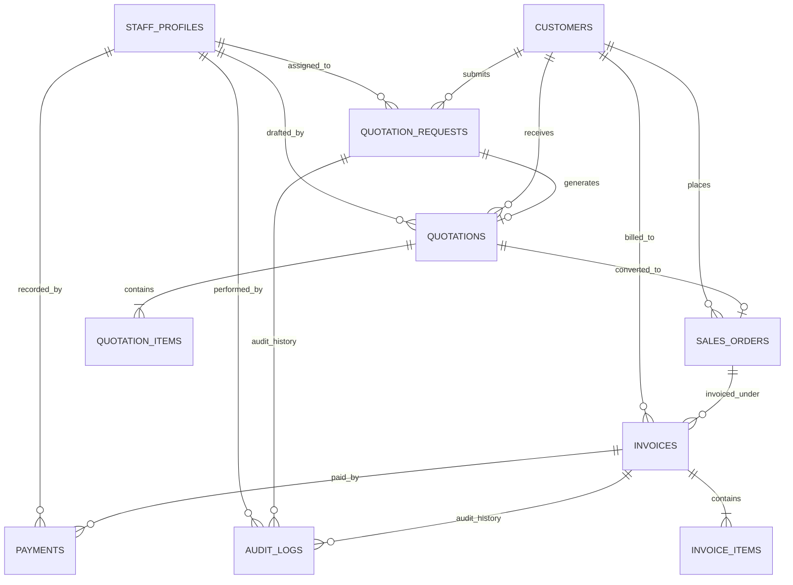

# Phase 2A: Supabase Architecture & Secure Quotation Submission Plan

**Project:** Santhaya Associates Pvt. Ltd. — Web Platform  
**Document:** `docs/PHASE-2-ARCHITECTURE.md`  
**Version:** 1.0  
**Date:** 2026-10-26  
**Status:** Architecture Proposal — Planning Only (Awaiting Human Approval)  
**Security & Architecture Reviewers:** Senior Full-Stack Engineer, Database Architect, Security Reviewer  

---

## Scope Lock Reminder (2026-10-26)
Santhaya Associates is exclusively a construction tender and machinery supply enterprise. The application and database are strictly scoped to:
1. **Government and private construction tender services**
2. **Construction machinery supply**
3. **Manufacturing machinery supply**
4. **Approved quotation and GST billing workflows**

No unrelated agency services, inventory e-commerce, or public client accounts are permitted.

---

## 1. Database Design & Entity Relationships

The database architecture employs PostgreSQL via Supabase. To ensure clean separation of concerns and phased rollout, tables are categorized into:
- **Phase 2 Immediate**: `staff_profiles`, `customers`, `quotation_requests`, `audit_logs`
- **Future Phases (Phases 3, 4, 5)**: `quotations`, `quotation_items`, `sales_orders`, `invoices`, `invoice_items`, `payments`

### Money and Financial Total Design Rule
Per **RULES §15**, binary floating-point types (`FLOAT`, `DOUBLE PRECISION`, `REAL`) are strictly prohibited for monetary amounts. All currency, discounts, tax rates, and line totals use `NUMERIC(15,2)` or `NUMERIC(12,4)` for decimal safety.

---

### Phase 2 Immediate Tables

#### 1. `staff_profiles` (Phase 2 Immediate / Phase 3 Foundation)
Establishes authorized internal personnel. Merely possessing an account in Supabase `auth.users` does not grant access; an active record with an authorized role is mandatory.

- **Primary Key:** `id UUID` (References `auth.users(id) ON DELETE CASCADE`)
- **Columns & Data Types:**
  - `id UUID PRIMARY KEY REFERENCES auth.users(id)`
  - `email TEXT NOT NULL UNIQUE`
  - `full_name TEXT NOT NULL`
  - `role staff_role_enum NOT NULL DEFAULT 'viewer'` (Enum: `'admin'`, `'estimator'`, `'billing_manager'`, `'viewer'`)
  - `is_active BOOLEAN NOT NULL DEFAULT true`
  - `created_at TIMESTAMPTZ NOT NULL DEFAULT timezone('utc'::text, now())`
  - `updated_at TIMESTAMPTZ NOT NULL DEFAULT timezone('utc'::text, now())`
- **Constraints:**
  - `email_format_check CHECK (email ~* '^[A-Za-z0-9._%+-]+@[A-Za-z0-9.-]+\.[A-Za-z]{2,}$')`
- **Indexes:**
  - `CREATE UNIQUE INDEX idx_staff_profiles_email ON public.staff_profiles(email);`
  - `CREATE INDEX idx_staff_profiles_role_active ON public.staff_profiles(role, is_active);`
- **Access Permissions:**
  - `anon`: No access (REVOKE ALL).
  - `authenticated`: SELECT only own profile; admin can SELECT all active staff.
  - `service_role`: Full administrative access.

#### 2. `customers` (Phase 2 Immediate)
Maintains commercial client entities created upon quotation intake. Public visitors do not have login credentials; customer records are managed by staff and updated automatically during submission.

- **Primary Key:** `id UUID DEFAULT gen_random_uuid()`
- **Columns & Data Types:**
  - `id UUID PRIMARY KEY DEFAULT gen_random_uuid()`
  - `company_name TEXT NOT NULL`
  - `primary_contact_person TEXT NOT NULL`
  - `email TEXT NOT NULL`
  - `phone VARCHAR(15) NOT NULL`
  - `gstin VARCHAR(15)` (Optional, validated format)
  - `billing_address TEXT` (Optional in Phase 2; required for invoicing)
  - `billing_state TEXT NOT NULL` (Place of supply determinant)
  - `client_type customer_type_enum NOT NULL DEFAULT 'private'` (Enum: `'government'`, `'private_corporate'`, `'contractor'`, `'individual'`)
  - `notes TEXT`
  - `created_at TIMESTAMPTZ NOT NULL DEFAULT timezone('utc'::text, now())`
  - `updated_at TIMESTAMPTZ NOT NULL DEFAULT timezone('utc'::text, now())`
- **Constraints:**
  - `phone_format_check CHECK (phone ~ '^[6-9]\d{9}$')`
  - `gstin_format_check CHECK (gstin IS NULL OR gstin ~ '^[0-9]{2}[A-Z]{5}[0-9]{4}[A-Z]{1}[1-9A-Z]{1}Z[0-9A-Z]{1}$')`
- **Indexes:**
  - `CREATE INDEX idx_customers_email ON public.customers(email);`
  - `CREATE INDEX idx_customers_phone ON public.customers(phone);`
  - `CREATE INDEX idx_customers_gstin ON public.customers(gstin) WHERE gstin IS NOT NULL;`
  - `CREATE INDEX idx_customers_company ON public.customers(lower(company_name));`
- **Access Permissions:**
  - `anon`: No direct access (REVOKE ALL).
  - `authenticated`: Active staff can SELECT and UPDATE.
  - `service_role`: Full access for server-side intake.

#### 3. `quotation_requests` (Phase 2 Immediate)
Core repository for inbound public commercial inquiries submitted through the website.

- **Primary Key:** `id UUID DEFAULT gen_random_uuid()`
- **Columns & Data Types:**
  - `id UUID PRIMARY KEY DEFAULT gen_random_uuid()`
  - `reference_number TEXT NOT NULL UNIQUE` (e.g. `INQ-2026-0001` via sequence)
  - `customer_id UUID REFERENCES public.customers(id) ON DELETE SET NULL`
  - `business_name TEXT NOT NULL`
  - `contact_person TEXT NOT NULL`
  - `email TEXT NOT NULL`
  - `phone VARCHAR(15) NOT NULL`
  - `gstin VARCHAR(15)`
  - `service_category service_category_enum NOT NULL` (Enum: `'construction_tenders'`, `'construction_machinery'`, `'manufacturing_machinery'`)
  - `requirement_details TEXT NOT NULL`
  - `quantity TEXT`
  - `technical_specs TEXT`
  - `delivery_location TEXT NOT NULL`
  - `notes TEXT`
  - `privacy_consent BOOLEAN NOT NULL DEFAULT false`
  - `status quotation_request_status_enum NOT NULL DEFAULT 'new'` (Enum: `'new'`, `'under_review'`, `'quotation_drafted'`, `'rejected'`, `'archived'`)
  - `assigned_staff_id UUID REFERENCES public.staff_profiles(id) ON DELETE SET NULL`
  - `submission_ip_hash VARCHAR(64) NOT NULL` (SHA-256 for rate limit & abuse protection without raw PII)
  - `user_agent TEXT`
  - `idempotency_key VARCHAR(64) UNIQUE` (Prevents double submission)
  - `created_at TIMESTAMPTZ NOT NULL DEFAULT timezone('utc'::text, now())`
  - `updated_at TIMESTAMPTZ NOT NULL DEFAULT timezone('utc'::text, now())`
- **Constraints:**
  - `privacy_consent_check CHECK (privacy_consent = true)`
  - `phone_check CHECK (phone ~ '^[6-9]\d{9}$')`
  - `gstin_check CHECK (gstin IS NULL OR gstin ~ '^[0-9]{2}[A-Z]{5}[0-9]{4}[A-Z]{1}[1-9A-Z]{1}Z[0-9A-Z]{1}$')`
- **Indexes:**
  - `CREATE UNIQUE INDEX idx_quotation_requests_ref ON public.quotation_requests(reference_number);`
  - `CREATE INDEX idx_quotation_requests_status ON public.quotation_requests(status);`
  - `CREATE INDEX idx_quotation_requests_category ON public.quotation_requests(service_category);`
  - `CREATE INDEX idx_quotation_requests_created ON public.quotation_requests(created_at DESC);`
  - `CREATE INDEX idx_quotation_requests_ip_hash ON public.quotation_requests(submission_ip_hash, created_at DESC);`
- **Access Permissions:**
  - `anon`: No direct table access (REVOKE ALL).
  - `authenticated`: Active staff can SELECT; estimators/admins can UPDATE status/assignment.
  - `service_role`: Full server-side intake and persistence.

#### 4. `audit_logs` (Phase 2 Immediate)
Immutable audit trail recording state transitions, security events, and administrative edits.

- **Primary Key:** `id UUID DEFAULT gen_random_uuid()`
- **Columns & Data Types:**
  - `id UUID PRIMARY KEY DEFAULT gen_random_uuid()`
  - `entity_type VARCHAR(50) NOT NULL` (e.g. `'quotation_request'`, `'quotation'`, `'invoice'`)
  - `entity_id UUID NOT NULL`
  - `action VARCHAR(50) NOT NULL` (e.g. `'submitted'`, `'status_change'`, `'assigned'`, `'printed'`)
  - `actor_type VARCHAR(20) NOT NULL` (e.g. `'public_api'`, `'staff'`, `'system'`)
  - `actor_id UUID REFERENCES public.staff_profiles(id) ON DELETE SET NULL` (NULL for public submissions)
  - `actor_ip_hash VARCHAR(64)`
  - `previous_state JSONB`
  - `new_state JSONB`
  - `created_at TIMESTAMPTZ NOT NULL DEFAULT timezone('utc'::text, now())`
- **Constraints:**
  - Immutability enforced by RLS and database triggers (NO UPDATE, NO DELETE).
- **Indexes:**
  - `CREATE INDEX idx_audit_logs_entity ON public.audit_logs(entity_type, entity_id);`
  - `CREATE INDEX idx_audit_logs_created_at ON public.audit_logs(created_at DESC);`
- **Access Permissions:**
  - `anon`: No access.
  - `authenticated`: Active staff can SELECT logs for review; NO UPDATE; NO DELETE.
  - `service_role`: INSERT only.

---

### Future Phase Tables (Phases 3, 4, 5)

#### 5. `quotations` (Phase 4: Quotation Lifecycle & PDF)
- **Primary Key:** `id UUID DEFAULT gen_random_uuid()`
- **Columns:**
  - `id UUID PRIMARY KEY DEFAULT gen_random_uuid()`
  - `quotation_number TEXT NOT NULL UNIQUE` (e.g. `QUO-2026-0001`)
  - `quotation_request_id UUID REFERENCES public.quotation_requests(id)`
  - `customer_id UUID NOT NULL REFERENCES public.customers(id)`
  - `revision_number INT NOT NULL DEFAULT 1`
  - `is_latest_revision BOOLEAN NOT NULL DEFAULT true`
  - `status quotation_status_enum NOT NULL DEFAULT 'draft'` (Enum: `'draft'`, `'pending_approval'`, `'sent'`, `'accepted'`, `'rejected'`, `'expired'`)
  - `valid_until DATE NOT NULL`
  - `subtotal_amount NUMERIC(15,2) NOT NULL DEFAULT 0.00`
  - `discount_amount NUMERIC(15,2) NOT NULL DEFAULT 0.00`
  - `tax_amount NUMERIC(15,2) NOT NULL DEFAULT 0.00`
  - `total_amount NUMERIC(15,2) NOT NULL DEFAULT 0.00`
  - `terms_and_conditions TEXT NOT NULL`
  - `pdf_storage_path TEXT`
  - `created_by_staff_id UUID NOT NULL REFERENCES public.staff_profiles(id)`
  - `approved_by_staff_id UUID REFERENCES public.staff_profiles(id)`
  - `accepted_at TIMESTAMPTZ`
  - `created_at TIMESTAMPTZ NOT NULL DEFAULT timezone('utc'::text, now())`
  - `updated_at TIMESTAMPTZ NOT NULL DEFAULT timezone('utc'::text, now())`

#### 6. `quotation_items` (Phase 4)
- **Primary Key:** `id UUID DEFAULT gen_random_uuid()`
- **Columns:**
  - `id UUID PRIMARY KEY DEFAULT gen_random_uuid()`
  - `quotation_id UUID NOT NULL REFERENCES public.quotations(id) ON DELETE CASCADE`
  - `line_number INT NOT NULL`
  - `item_description TEXT NOT NULL`
  - `hsn_sac_code VARCHAR(10) NOT NULL`
  - `quantity NUMERIC(10,2) NOT NULL`
  - `unit_of_measure VARCHAR(20) NOT NULL` (e.g. `'units'`, `'days'`, `'months'`, `'metric_ton'`, `'sq_meters'`)
  - `unit_rate NUMERIC(15,2) NOT NULL`
  - `line_discount NUMERIC(15,2) NOT NULL DEFAULT 0.00`
  - `taxable_amount NUMERIC(15,2) NOT NULL`
  - `gst_rate_percent NUMERIC(5,2) NOT NULL` (e.g. `18.00`)
  - `cgst_amount NUMERIC(15,2) NOT NULL DEFAULT 0.00`
  - `sgst_amount NUMERIC(15,2) NOT NULL DEFAULT 0.00`
  - `igst_amount NUMERIC(15,2) NOT NULL DEFAULT 0.00`
  - `total_line_amount NUMERIC(15,2) NOT NULL`
  - `created_at TIMESTAMPTZ NOT NULL DEFAULT timezone('utc'::text, now())`

#### 7. `sales_orders` (Phase 5: Orders & Operations)
- **Primary Key:** `id UUID DEFAULT gen_random_uuid()`
- **Columns:**
  - `id UUID PRIMARY KEY DEFAULT gen_random_uuid()`
  - `order_number TEXT NOT NULL UNIQUE` (e.g. `SO-2026-0001`)
  - `quotation_id UUID NOT NULL REFERENCES public.quotations(id)`
  - `customer_id UUID NOT NULL REFERENCES public.customers(id)`
  - `status sales_order_status_enum NOT NULL DEFAULT 'confirmed'` (Enum: `'confirmed'`, `'in_progress'`, `'fulfilled'`, `'cancelled'`)
  - `customer_po_number TEXT`
  - `customer_po_date DATE`
  - `delivery_deadline DATE`
  - `created_at TIMESTAMPTZ NOT NULL DEFAULT timezone('utc'::text, now())`
  - `updated_at TIMESTAMPTZ NOT NULL DEFAULT timezone('utc'::text, now())`

#### 8. `invoices` (Phase 5: GST Billing & Invoicing)
- **Primary Key:** `id UUID DEFAULT gen_random_uuid()`
- **Columns:**
  - `id UUID PRIMARY KEY DEFAULT gen_random_uuid()`
  - `invoice_number TEXT NOT NULL UNIQUE` (Sequential tax invoice per FY, e.g. `SA/2026-27/0001`)
  - `sales_order_id UUID REFERENCES public.sales_orders(id)`
  - `customer_id UUID NOT NULL REFERENCES public.customers(id)`
  - `invoice_date DATE NOT NULL`
  - `due_date DATE NOT NULL`
  - `place_of_supply_state_code VARCHAR(2) NOT NULL` (e.g. `'27'` for Maharashtra)
  - `supply_type supply_type_enum NOT NULL` (Enum: `'intra_state'` [CGST+SGST] or `'inter_state'` [IGST])
  - `customer_gstin VARCHAR(15)`
  - `subtotal_amount NUMERIC(15,2) NOT NULL`
  - `discount_total NUMERIC(15,2) NOT NULL DEFAULT 0.00`
  - `cgst_total NUMERIC(15,2) NOT NULL DEFAULT 0.00`
  - `sgst_total NUMERIC(15,2) NOT NULL DEFAULT 0.00`
  - `igst_total NUMERIC(15,2) NOT NULL DEFAULT 0.00`
  - `cess_total NUMERIC(15,2) NOT NULL DEFAULT 0.00`
  - `round_off_amount NUMERIC(5,2) NOT NULL DEFAULT 0.00`
  - `final_total_amount NUMERIC(15,2) NOT NULL`
  - `paid_amount NUMERIC(15,2) NOT NULL DEFAULT 0.00`
  - `balance_due NUMERIC(15,2) NOT NULL`
  - `payment_status invoice_payment_status_enum NOT NULL DEFAULT 'unpaid'` (Enum: `'unpaid'`, `'partially_paid'`, `'paid'`, `'overdue'`)
  - `status invoice_status_enum NOT NULL DEFAULT 'issued'` (Enum: `'draft'`, `'issued'`, `'cancelled'`, `'rectified'`)
  - `irn_hash VARCHAR(64)` (For future e-invoicing if applicable)
  - `created_at TIMESTAMPTZ NOT NULL DEFAULT timezone('utc'::text, now())`
  - `updated_at TIMESTAMPTZ NOT NULL DEFAULT timezone('utc'::text, now())`

#### 9. `invoice_items` (Phase 5)
- **Primary Key:** `id UUID DEFAULT gen_random_uuid()`
- **Columns:**
  - `id UUID PRIMARY KEY DEFAULT gen_random_uuid()`
  - `invoice_id UUID NOT NULL REFERENCES public.invoices(id) ON DELETE RESTRICT`
  - `line_number INT NOT NULL`
  - `item_description TEXT NOT NULL`
  - `hsn_sac_code VARCHAR(10) NOT NULL`
  - `quantity NUMERIC(10,2) NOT NULL`
  - `unit_rate NUMERIC(15,2) NOT NULL`
  - `taxable_value NUMERIC(15,2) NOT NULL`
  - `gst_rate_percent NUMERIC(5,2) NOT NULL`
  - `cgst_amount NUMERIC(15,2) NOT NULL DEFAULT 0.00`
  - `sgst_amount NUMERIC(15,2) NOT NULL DEFAULT 0.00`
  - `igst_amount NUMERIC(15,2) NOT NULL DEFAULT 0.00`
  - `total_amount NUMERIC(15,2) NOT NULL`
  - `created_at TIMESTAMPTZ NOT NULL DEFAULT timezone('utc'::text, now())`

#### 10. `payments` (Phase 5: Financial Tracking)
- **Primary Key:** `id UUID DEFAULT gen_random_uuid()`
- **Columns:**
  - `id UUID PRIMARY KEY DEFAULT gen_random_uuid()`
  - `payment_reference TEXT NOT NULL UNIQUE` (e.g. `PAY-2026-0001`)
  - `invoice_id UUID NOT NULL REFERENCES public.invoices(id) ON DELETE RESTRICT`
  - `payment_date DATE NOT NULL`
  - `payment_mode payment_mode_enum NOT NULL` (Enum: `'neft_rtgs'`, `'cheque'`, `'bank_transfer'`, `'upi'`, `'other'`)
  - `transaction_reference TEXT` (Bank UTR / Cheque number)
  - `amount_received NUMERIC(15,2) NOT NULL`
  - `reconciliation_status VARCHAR(20) NOT NULL DEFAULT 'pending'`
  - `recorded_by_staff_id UUID NOT NULL REFERENCES public.staff_profiles(id)`
  - `notes TEXT`
  - `created_at TIMESTAMPTZ NOT NULL DEFAULT timezone('utc'::text, now())`

---

## 2. Complete Entity Relationship Diagram



---

## 3. Security Architecture & Row Level Security (RLS)

### Principles of Defense-in-Depth
1. **Zero Browser Privilege:** The browser client only holds `NEXT_PUBLIC_SUPABASE_ANON_KEY`. The database grants **ZERO SELECT / UPDATE / DELETE** permissions to `anon`.
2. **Server-Mediated Ingestion:** Public form submissions POST to a Next.js Server Route Handler (`/api/quotation-request`), which performs validation, anti-spam heuristics, and inserts via the server-only `SUPABASE_SERVICE_ROLE_KEY`.
3. **Explicit Role Authorization:** Authenticated users in Supabase Auth are rejected unless their `auth.uid()` corresponds to an active profile in `staff_profiles` with a required operational role.

### Database Role Grants
```sql
-- Revoke all default public permissions
REVOKE ALL ON ALL TABLES IN SCHEMA public FROM anon, authenticated;
REVOKE ALL ON ALL SEQUENCES IN SCHEMA public FROM anon, authenticated;

-- Grant minimal permissions
GRANT USAGE ON SCHEMA public TO anon, authenticated, service_role;

-- Anonymous: NO table access (all access via Next.js server route)
-- Authenticated: SELECT/UPDATE based on strict RLS policies below
GRANT SELECT, UPDATE ON public.quotation_requests TO authenticated;
GRANT SELECT ON public.staff_profiles TO authenticated;
GRANT SELECT ON public.audit_logs TO authenticated;

-- Service role (server-side only): full execution
GRANT ALL ON ALL TABLES IN SCHEMA public TO service_role;
GRANT ALL ON ALL SEQUENCES IN SCHEMA public TO service_role;
```

### Proposed Row Level Security (RLS) Policies

```sql
-- Enable RLS on all tables
ALTER TABLE public.quotation_requests ENABLE ROW LEVEL SECURITY;
ALTER TABLE public.staff_profiles ENABLE ROW LEVEL SECURITY;
ALTER TABLE public.customers ENABLE ROW LEVEL SECURITY;
ALTER TABLE public.audit_logs ENABLE ROW LEVEL SECURITY;

-- Helper security definer function for staff status
CREATE OR REPLACE FUNCTION public.is_active_staff(user_id UUID)
RETURNS BOOLEAN
LANGUAGE sql
STABLE
SECURITY DEFINER
SET search_path = public
AS $$
  SELECT EXISTS (
    SELECT 1 FROM public.staff_profiles
    WHERE id = user_id AND is_active = true
  );
$$;

-- Helper security definer function for role hierarchy
CREATE OR REPLACE FUNCTION public.has_staff_role(user_id UUID, required_roles staff_role_enum[])
RETURNS BOOLEAN
LANGUAGE sql
STABLE
SECURITY DEFINER
SET search_path = public
AS $$
  SELECT EXISTS (
    SELECT 1 FROM public.staff_profiles
    WHERE id = user_id AND is_active = true AND role = ANY(required_roles)
  );
$$;

-- RLS: quotation_requests
-- 1. Anonymous read denial
CREATE POLICY "Deny anonymous select on quotation_requests"
  ON public.quotation_requests FOR SELECT TO anon USING (false);

-- 2. Staff read allowance
CREATE POLICY "Active staff can select quotation_requests"
  ON public.quotation_requests FOR SELECT TO authenticated
  USING (public.is_active_staff(auth.uid()));

-- 3. Staff update allowance (Estimators and Admins only)
CREATE POLICY "Estimators and Admins can update quotation_requests"
  ON public.quotation_requests FOR UPDATE TO authenticated
  USING (public.has_staff_role(auth.uid(), ARRAY['admin'::staff_role_enum, 'estimator'::staff_role_enum]))
  WITH CHECK (public.has_staff_role(auth.uid(), ARRAY['admin'::staff_role_enum, 'estimator'::staff_role_enum]));

-- 4. Delete denial (Immutable records)
CREATE POLICY "Deny all delete on quotation_requests"
  ON public.quotation_requests FOR DELETE USING (false);

-- RLS: audit_logs (Strictly Append-Only)
CREATE POLICY "Deny anonymous select on audit_logs"
  ON public.audit_logs FOR SELECT TO anon USING (false);

CREATE POLICY "Active staff can read audit_logs"
  ON public.audit_logs FOR SELECT TO authenticated
  USING (public.is_active_staff(auth.uid()));

CREATE POLICY "Deny all update on audit_logs"
  ON public.audit_logs FOR UPDATE USING (false);

CREATE POLICY "Deny all delete on audit_logs"
  ON public.audit_logs FOR DELETE USING (false);
```

---

## 4. Public Form Submission Pipeline & Anti-Spam Architecture

```
[ Public Client Browser ]
         │
         │ 1. Client-side Zod validation
         │ 2. Check honeypot field is empty
         │ 3. Record page render timestamp
         │ 4. HTTP POST /api/quotation-request
         ▼
[ Next.js API Route Handler: /api/quotation-request ]
         │
         │ 5. Rate-Limit Check: Sliding window (max 5 requests / 15 min per IP hash)
         │    └─ Exceeded? ──> Return 429 Too Many Requests (Retry-After header)
         │
         │ 6. Bot Detection (Honeypot & Time Heuristic):
         │    ├─ Honeypot filled? ──> Silent 200 OK discard (Bot trapped)
         │    └─ Submitted < 2.5s? ──> Reject 400 Bad Request
         │
         │ 7. Server-Side Zod Validation & Sanitization:
         │    ├─ Strip control characters & escape HTML
         │    ├─ Strict Indian Phone regex: ^[6-9]\d{9}$
         │    ├─ Optional GSTIN regex: ^[0-9]{2}[A-Z]{5}[0-9]{4}[A-Z]{1}[1-9A-Z]{1}Z[0-9A-Z]{1}$
         │    └─ Privacy consent === true
         │
         │ 8. Duplicate Submission Check:
         │    └─ Compute idempotency hash: SHA-256(email + serviceCategory + requirementDetails)
         │    └─ Check for identical submission in last 10 minutes -> Return existing reference
         │
         │ 9. Database Transaction (Supabase Service Client):
         │    ├─ UPSERT customer by email/phone
         │    ├─ INSERT quotation_requests (status = 'new')
         │    └─ INSERT audit_logs (action = 'submitted')
         │
         │ 10. Privacy-Conscious Logging:
         │     └─ Log: Reference number, service category, timestamp, hashed IP (NO phone/email PII)
         ▼
[ Client Response: HTTP 201 Created ]
         │
         │ 11. Returns { success: true, referenceNumber: "INQ-2026-0001", message: "..." }
         ▼
[ Public Client Browser ]
Displays verified confirmation badge with official inquiry reference number
```

---

## 5. Indian GST & Invoicing Schema Architecture

### Regulatory & Professional Review Requirement
> [!IMPORTANT]
> **Accountant Review Mandatory:** In strict compliance with **PRD §6** and **RULES §10**, all Indian GST tax classifications, HSN/SAC codes, place-of-supply determination logic, e-invoicing thresholds, and invoice numbering sequences are designed structurally but will **NOT** execute production calculations until validated by a certified Indian Chartered Accountant.

### Architectural Capabilities Embedded in the Schema
1. **HSN/SAC Code Support:**
   - Construction contracts / civil tenders: SAC `9954` (Construction services).
   - Machinery supply / leasing: HSN `8429` (Earthmoving machinery), HSN `8426` (Cranes/lifting equipment), HSN `8462` (Machine tools for manufacturing).
2. **Deterministic Dual / Single Tax Allocation:**
   - **Intra-State:** Place of Supply == Supplier State (e.g. Maharashtra to Maharashtra) -> Equal split of CGST (`9%`) and SGST (`9%`).
   - **Inter-State:** Place of Supply != Supplier State (e.g. Maharashtra to Karnataka) -> Full IGST (`18%`).
3. **Financial Year Invoice Numbering Sequence:**
   - Format: `SA/YYYY-YY/XXXX` (e.g. `SA/2026-27/0001`), unbroken sequence enforced by database trigger and advisory locks to prevent gaps.
4. **Decoupled Line-Item Rounding:**
   - Line items rounded to 2 decimal places independently; invoice round-off adjustment stored in `round_off_amount` to prevent floating-point discrepancies.

---

## 6. Supabase Configuration & Environment Management

### Credentials Separation

| Environment Variable | Exposed To | Security Level | Purpose |
| :--- | :--- | :--- | :--- |
| `NEXT_PUBLIC_SUPABASE_URL` | Browser + Server | Public | API gateway URL for Supabase project |
| `NEXT_PUBLIC_SUPABASE_ANON_KEY` | Browser + Server | Public (Restricted) | Anonymous client key; strictly zero table permissions via RLS |
| `SUPABASE_SERVICE_ROLE_KEY` | **Server Only** | **Confidential Secret** | Privileged key used exclusively in Next.js Route Handlers |
| `INTERNAL_NOTIFICATION_EMAIL` | **Server Only** | Confidential | Recipient email for internal alerts |
| `NEXT_PUBLIC_SITE_URL` | Browser + Server | Public | Canonical URL base |

### Setup Checklist & Operational Workflow
1. **Project Provisioning:**
   - Create Supabase project in the nearest region (e.g. `ap-south-1` Mumbai for Indian low-latency).
2. **Environment File Handling:**
   - Maintain `.env.example` with variable names only.
   - Configure secrets locally in `.env.local` (verified in `.gitignore`). Never commit secret keys or paste them into chat transcripts.
3. **Migration Management:**
   - Use Supabase CLI: `supabase/migrations/<timestamp>_phase2_schema.sql`.
   - Every migration includes idempotent DDL statements (`CREATE TABLE IF NOT EXISTS`, `CREATE OR REPLACE FUNCTION`).
4. **Environment Separation:**
   - **Local / Preview:** Local Supabase CLI emulator or separate Supabase preview project.
   - **Production:** Dedicated production project with Point-in-Time Recovery (PITR) enabled.
5. **Backup & Disaster Recovery:**
   - Daily automated backups with 7-day retention minimum.
   - Reversible down-migrations (`001_phase2_down.sql`) maintained for disaster rollback.

---

## 7. Comprehensive Testing Matrix

| Test ID | Test Scenario | Input / Action | Expected Result | Verification Check |
| :--- | :--- | :--- | :--- | :--- |
| **TC-01** | Successful submission | Valid form data with optional GSTIN | HTTP 201, returns `INQ-2026-XXXX`, DB record created with status `'new'` | Verify row in DB & reference displayed on UI |
| **TC-02** | Valid submission without GSTIN | Valid form data with empty GSTIN | HTTP 201, `gstin` is `NULL` in DB, reference returned | Verify row created without GSTIN error |
| **TC-03** | Invalid phone number | Phone `"12345"` or `"5876543210"` | HTTP 400 Bad Request, field error on `phone` | DB untouched; form displays Indian phone error |
| **TC-04** | Invalid GSTIN format | GSTIN `"INVALIDGST123"` | HTTP 400 Bad Request, field error on `gstin` | DB untouched; form displays GSTIN error |
| **TC-05** | Missing privacy consent | `privacyConsent: false` | HTTP 400 Bad Request, consent error message | DB untouched; submission blocked |
| **TC-06** | Duplicate submission | Identical payload submitted twice within 2 mins | HTTP 200/201 returning existing reference without duplicate DB row | Prevents database row inflation |
| **TC-07** | Rate-limit enforcement | > 5 requests from same IP in 15 mins | HTTP 429 Too Many Requests, `Retry-After: 900` | 6th request blocked at API gateway level |
| **TC-08** | Bot honeypot trap | Decoy `company_fax_or_website` filled | HTTP 200 returned to fool bot, NO database row created | Verified in audit logs |
| **TC-09** | Anonymous read denial | `supabase.from('quotation_requests').select()` with anon key | Empty array or `401/403 Permission Denied` via RLS | Confirms public cannot query inquiries |
| **TC-10** | Direct anon write denial | `supabase.from('quotation_requests').insert()` with anon key | `401/403 Permission Denied` via RLS | Enforces that all writes must flow through server API |
| **TC-11** | Staff authorization gate | Authenticated user not in `staff_profiles` | Access to staff views denied | Confirms `auth.users` alone is insufficient |
| **TC-12** | Audit log immutability | Attempting `UPDATE` or `DELETE` on `audit_logs` | `403 Permission Denied` via RLS | Proves audit log cannot be modified |

---

## 8. Phase 2 Implementation Sequence & Approval Checkpoints

```
[ Gate 2A: Architecture Approval ]  <─── (Current Step: Awaiting Approval)
     │
     ▼
[ Step 2.1: Supabase Setup & SDK ]
  - Install @supabase/supabase-js, @supabase/ssr
  - Provide .env.example
     │
     ▼
[ Step 2.2: Schema Migration ]
  - Execute DDL migration (staff_profiles, customers, quotation_requests, audit_logs)
  - Execute RLS policies and role grants
     │
     ▼
[ Step 2.3: Server-Side Pipeline ]
  - Implement server Supabase client singleton
  - Implement server-side Zod validation and XSS sanitization
  - Implement IP-hash sliding window rate limiter and honeypot filter
  - Implement /api/quotation-request Route Handler
     │
     ▼
[ Step 2.4: Client Form Integration ]
  - Connect /request-quotation to live API endpoint
  - Replace Phase 1 demo simulation with verified live submission receipt
  - Maintain graceful error states for network disruptions
     │
     ▼
[ Step 2.5: Automated Security & Functional Verification ]
  - Run integration test suite matching Section 7 test matrix
  - Run typecheck, lint, and build
     │
     ▼
[ Gate 2B: Phase 2 Completion Review ]
  - Present test evidence, logs, and updated MEMORY.md for human approval before Phase 3
```

---

## 9. Risks and Unresolved Decisions

1. **Transactional Email Provider:**
   - Inbound staff email notifications require an approved transactional email service (e.g. Resend, Amazon SES, or SendGrid). Awaiting confirmation of corporate email provider.
2. **Turnstile / Bot Defense:**
   - Honeypot and timing heuristics provide primary bot protection. If public spam volume increases, Cloudflare Turnstile will be integrated without UX degradation.
3. **GST & Invoicing Legal Sign-Off:**
   - Retained as a strict gate for Phase 5. No accounting calculations will be implemented until formal tax counsel review is conducted.

---

*End of Architecture Specification.*
