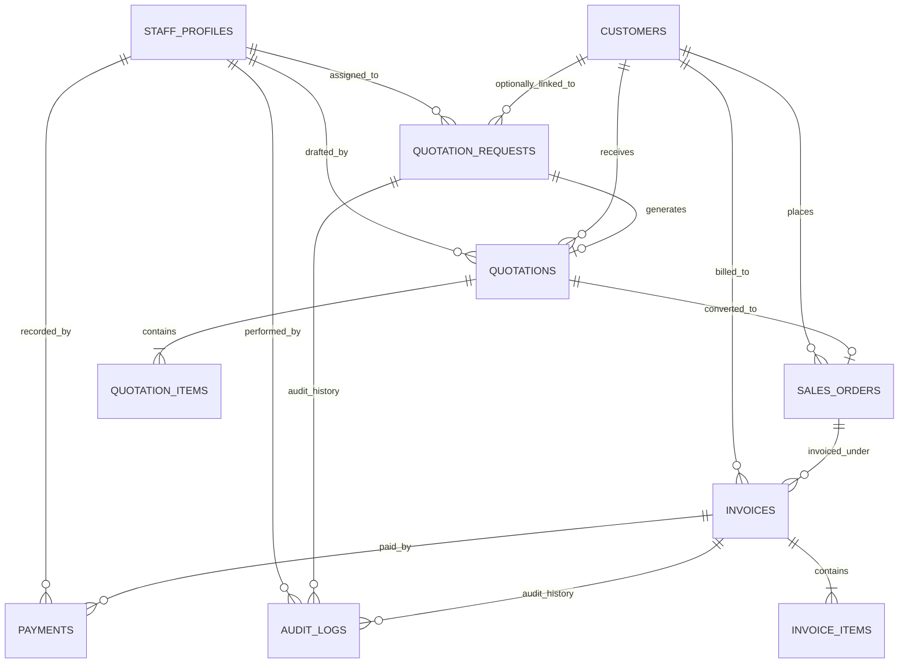

# Phase 2A: Supabase Architecture & Secure Quotation Submission Plan
## Security-Hardened Database Architecture & Ingestion Pipeline

**Project:** Santhaya Associates Pvt. Ltd. — Web Platform  
**Document:** `docs/PHASE-2-ARCHITECTURE.md`  
**Version:** 2.0 (Security & Architecture Corrections Incorporated)  
**Date:** 2026-10-26  
**Status:** Architecture Proposal — Planning Only (Awaiting Final Human Approval)  
**Security & Architecture Reviewers:** Senior Full-Stack Engineer, Database Architect, Security Reviewer  

---

## Scope Lock Reminder (2026-10-26)
Santhaya Associates is exclusively a construction tender and machinery supply enterprise. The application and database are strictly scoped to:
1. **Government and private construction tender services**
2. **Construction machinery supply**
3. **Manufacturing machinery supply**
4. **Approved quotation and GST billing workflows**

No unrelated agency services, inventory e-commerce, or public client accounts are permitted.

---

## 1. Database Design & Phased Table Segregation

The database architecture employs PostgreSQL via Supabase. To ensure clean separation of concerns and phased rollout, tables are categorized into:
- **Phase 2 Immediate**: `staff_profiles`, `customers`, `quotation_requests`, `rate_limits`, `audit_logs`
- **Future Phases (Phases 3, 4, 5)**: `quotations`, `quotation_items`, `sales_orders`, `invoices`, `invoice_items`, `payments`

### Money and Financial Total Design Rule
Per **RULES §15**, binary floating-point types (`FLOAT`, `DOUBLE PRECISION`, `REAL`) are strictly prohibited for monetary amounts. All currency, discounts, tax rates, and line totals use `NUMERIC(15,2)` or `NUMERIC(12,4)` for decimal safety.

---

### Phase 2 Immediate Tables

#### 1. `staff_profiles` (Phase 2 Immediate / Phase 3 Foundation)
Establishes authorized internal personnel. Merely possessing an account in Supabase `auth.users` does not grant access; an active record with an authorized role is mandatory.

- **Primary Key:** `id UUID` (References `auth.users(id) ON DELETE CASCADE`)
- **Columns & Data Types:**
  - `id UUID PRIMARY KEY REFERENCES auth.users(id)`
  - `email TEXT NOT NULL UNIQUE`
  - `full_name TEXT NOT NULL`
  - `role staff_role_enum NOT NULL DEFAULT 'viewer'` (Enum: `'admin'`, `'estimator'`, `'billing_manager'`, `'viewer'`)
  - `is_active BOOLEAN NOT NULL DEFAULT true`
  - `created_at TIMESTAMPTZ NOT NULL DEFAULT timezone('utc'::text, now())`
  - `updated_at TIMESTAMPTZ NOT NULL DEFAULT timezone('utc'::text, now())`
- **Constraints:**
  - `email_format_check CHECK (email ~* '^[A-Za-z0-9._%+-]+@[A-Za-z0-9.-]+\.[A-Za-z]{2,}$')`
- **Privilege Escalation Safeguards:**
  - Staff users can NEVER update their own `role` or `is_active` fields.
  - Updates to `staff_profiles` are restricted strictly to active staff with the `admin` role.
- **Indexes:**
  - `CREATE UNIQUE INDEX idx_staff_profiles_email ON public.staff_profiles(email);`
  - `CREATE INDEX idx_staff_profiles_role_active ON public.staff_profiles(role, is_active);`
- **Access Permissions:**
  - `anon`: No access (REVOKE ALL).
  - `authenticated`: SELECT only own profile; admins can SELECT and UPDATE staff profiles.
  - `service_role`: Administrative setup only.

#### 2. `customers` (Phase 2 Immediate / Transition)
Maintains commercial client entities. Public visitors never create client login accounts.

- **Safe Customer Matching Rule:**
  - Quotation inquiries are **NEVER automatically merged** into existing customer profiles using email alone.
  - In commercial/industrial procurement, shared generic emails (e.g. `procurement@company.com`) or branch offices with differing delivery locations would risk data corruption or account hijacking.
  - Each inquiry is preserved independently. Linking an inquiry to a verified master customer record is a staff-controlled operation (Phase 3/4) based on verified legal identity (e.g. GSTIN / PAN / Corporate CIN).
- **Primary Key:** `id UUID DEFAULT gen_random_uuid()`
- **Columns & Data Types:**
  - `id UUID PRIMARY KEY DEFAULT gen_random_uuid()`
  - `company_name TEXT NOT NULL`
  - `primary_contact_person TEXT NOT NULL`
  - `email TEXT NOT NULL`
  - `phone VARCHAR(15) NOT NULL`
  - `gstin VARCHAR(15)` (Optional, validated format)
  - `billing_address TEXT` (Required for invoicing in Phase 5)
  - `billing_state TEXT NOT NULL` (Place of supply determinant)
  - `client_type customer_type_enum NOT NULL DEFAULT 'private'` (Enum: `'government'`, `'private_corporate'`, `'contractor'`, `'individual'`)
  - `is_verified BOOLEAN NOT NULL DEFAULT false` (Verified by staff against statutory records)
  - `notes TEXT`
  - `created_at TIMESTAMPTZ NOT NULL DEFAULT timezone('utc'::text, now())`
  - `updated_at TIMESTAMPTZ NOT NULL DEFAULT timezone('utc'::text, now())`
- **Constraints:**
  - `phone_format_check CHECK (phone ~ '^[6-9]\d{9}$')`
  - `gstin_format_check CHECK (gstin IS NULL OR gstin ~ '^[0-9]{2}[A-Z]{5}[0-9]{4}[A-Z]{1}[1-9A-Z]{1}Z[0-9A-Z]{1}$')`
- **Indexes:**
  - `CREATE INDEX idx_customers_email ON public.customers(email);`
  - `CREATE INDEX idx_customers_phone ON public.customers(phone);`
  - `CREATE INDEX idx_customers_gstin ON public.customers(gstin) WHERE gstin IS NOT NULL;`
  - `CREATE INDEX idx_customers_company ON public.customers(lower(company_name));`
- **Access Permissions:**
  - `anon`: No direct access (REVOKE ALL).
  - `authenticated`: Active staff can SELECT and UPDATE verified customer records.
  - `service_role`: Controlled administrative writes.

#### 3. `quotation_requests` (Phase 2 Immediate)
Core repository for inbound public commercial inquiries. Each record represents an **immutable historical snapshot** of the customer's submitted details at that moment.

- **Primary Key:** `id UUID DEFAULT gen_random_uuid()`
- **Columns & Data Types:**
  - `id UUID PRIMARY KEY DEFAULT gen_random_uuid()`
  - `reference_number TEXT NOT NULL UNIQUE` (e.g. `INQ-2026-0001` via sequence)
  - `customer_id UUID REFERENCES public.customers(id) ON DELETE SET NULL` (Nullable; qualified during staff review)
  - `business_name TEXT NOT NULL`
  - `contact_person TEXT NOT NULL`
  - `email TEXT NOT NULL`
  - `phone VARCHAR(15) NOT NULL`
  - `gstin VARCHAR(15)`
  - `service_category service_category_enum NOT NULL` (Enum: `'construction_tenders'`, `'construction_machinery'`, `'manufacturing_machinery'`)
  - `requirement_details TEXT NOT NULL`
  - `quantity TEXT`
  - `technical_specs TEXT`
  - `delivery_location TEXT NOT NULL`
  - `notes TEXT`
  - `privacy_consent BOOLEAN NOT NULL DEFAULT false`
  - `status quotation_request_status_enum NOT NULL DEFAULT 'new'` (Enum: `'new'`, `'under_review'`, `'quotation_drafted'`, `'rejected'`, `'archived'`)
  - `assigned_staff_id UUID REFERENCES public.staff_profiles(id) ON DELETE SET NULL`
  - `submission_ip_hash VARCHAR(64) NOT NULL` (Salted SHA-256 for abuse tracking without raw PII)
  - `user_agent TEXT`
  - `idempotency_key UUID UNIQUE NOT NULL` (Client-generated submission-scoped UUID)
  - `risk_flag VARCHAR(50)` (e.g. `'rapid_submission'`, `'none'`)
  - `created_at TIMESTAMPTZ NOT NULL DEFAULT timezone('utc'::text, now())`
  - `updated_at TIMESTAMPTZ NOT NULL DEFAULT timezone('utc'::text, now())`
- **Constraints:**
  - `privacy_consent_check CHECK (privacy_consent = true)`
  - `phone_check CHECK (phone ~ '^[6-9]\d{9}$')`
  - `gstin_check CHECK (gstin IS NULL OR gstin ~ '^[0-9]{2}[A-Z]{5}[0-9]{4}[A-Z]{1}[1-9A-Z]{1}Z[0-9A-Z]{1}$')`
- **Indexes:**
  - `CREATE UNIQUE INDEX idx_quotation_requests_ref ON public.quotation_requests(reference_number);`
  - `CREATE UNIQUE INDEX idx_quotation_requests_idempotency ON public.quotation_requests(idempotency_key);`
  - `CREATE INDEX idx_quotation_requests_status ON public.quotation_requests(status);`
  - `CREATE INDEX idx_quotation_requests_category ON public.quotation_requests(service_category);`
  - `CREATE INDEX idx_quotation_requests_created ON public.quotation_requests(created_at DESC);`
  - `CREATE INDEX idx_quotation_requests_ip_hash ON public.quotation_requests(submission_ip_hash, created_at DESC);`
- **Access Permissions:**
  - `anon`: No direct table access (REVOKE ALL). Ingestion occurs via restricted database RPC.
  - `authenticated`: Active staff can SELECT; estimators and admins can UPDATE status/assignment.
  - `service_role`: Administrative maintenance.

#### 4. `rate_limits` (Phase 2 Immediate — Persistent & Serverless-Compatible)
Maintains atomic, distributed rate limiting directly in PostgreSQL to prevent race conditions across serverless runtime instances (e.g. Vercel).

- **Primary Key:** `key VARCHAR(128) PRIMARY KEY` (Hashed IP or route scope)
- **Columns & Data Types:**
  - `key VARCHAR(128) PRIMARY KEY`
  - `tokens INT NOT NULL`
  - `last_refilled_at TIMESTAMPTZ NOT NULL DEFAULT timezone('utc'::text, now())`
  - `expires_at TIMESTAMPTZ NOT NULL`
- **Atomic Procedure:**
  - Handled via `public.check_rate_limit(p_key TEXT, p_max_tokens INT, p_refill_seconds INT, p_cost INT)` which locks the row (`FOR UPDATE`), refills tokens based on elapsed time, and returns an atomic boolean and remaining retry window in a single transaction.

#### 5. `audit_logs` (Phase 2 Immediate — True Immutability Safeguards)
Immutable audit trail recording state transitions, security events, and administrative edits.

- **Immutability Vulnerability Analysis:**
  - In PostgreSQL / Supabase, Row Level Security (RLS) policies are **bypassed by the `service_role` and table owners**. Therefore, RLS alone cannot guarantee immutability against privileged roles or programmatic bugs.
- **Mandatory Non-RLS Database Safeguards:**
  1. **Strict Revocations:**
     ```sql
     REVOKE UPDATE, DELETE, TRUNCATE ON public.audit_logs FROM PUBLIC, anon, authenticated, service_role;
     ```
  2. **PostgreSQL Trigger Prevention:**
     ```sql
     CREATE OR REPLACE FUNCTION public.prevent_audit_log_mutation()
     RETURNS TRIGGER
     LANGUAGE plpgsql
     SECURITY DEFINER
     SET search_path = public, pg_temp
     AS $$
     BEGIN
       RAISE EXCEPTION 'Audit log entries are immutable and cannot be modified or deleted.';
     END;
     $$;

     CREATE TRIGGER trg_audit_logs_immutable
       BEFORE UPDATE OR DELETE OR TRUNCATE ON public.audit_logs
       FOR EACH STATEMENT EXECUTE FUNCTION public.prevent_audit_log_mutation();
     ```
  3. **Controlled Insertion:** Audit logs can only be created via append-only inserts.
- **Primary Key:** `id UUID DEFAULT gen_random_uuid()`
- **Columns & Data Types:**
  - `id UUID PRIMARY KEY DEFAULT gen_random_uuid()`
  - `entity_type VARCHAR(50) NOT NULL` (e.g. `'quotation_request'`, `'staff_profile'`, `'invoice'`)
  - `entity_id UUID NOT NULL`
  - `action VARCHAR(50) NOT NULL` (e.g. `'submitted'`, `'status_changed'`, `'assigned'`, `'elevated'`)
  - `actor_type VARCHAR(20) NOT NULL` (e.g. `'public_rpc'`, `'staff'`, `'system'`)
  - `actor_id UUID REFERENCES public.staff_profiles(id) ON DELETE SET NULL`
  - `actor_ip_hash VARCHAR(64)`
  - `previous_state JSONB`
  - `new_state JSONB`
  - `created_at TIMESTAMPTZ NOT NULL DEFAULT timezone('utc'::text, now())`
- **Indexes:**
  - `CREATE INDEX idx_audit_logs_entity ON public.audit_logs(entity_type, entity_id);`
  - `CREATE INDEX idx_audit_logs_created_at ON public.audit_logs(created_at DESC);`
- **Access Permissions:**
  - `anon`: No access (REVOKE ALL).
  - `authenticated`: Active staff can SELECT for audit inspection; UPDATE/DELETE denied.
  - `service_role`: INSERT only; UPDATE/DELETE denied by trigger and grants.

---

### Future Phase Tables (Phases 3, 4, 5)

#### 6. `quotations` (Phase 4: Quotation Lifecycle & PDF)
- **Primary Key:** `id UUID DEFAULT gen_random_uuid()`
- **Columns:**
  - `id UUID PRIMARY KEY DEFAULT gen_random_uuid()`
  - `quotation_number TEXT NOT NULL UNIQUE` (e.g. `QUO-2026-0001`)
  - `quotation_request_id UUID REFERENCES public.quotation_requests(id)`
  - `customer_id UUID NOT NULL REFERENCES public.customers(id)`
  - `revision_number INT NOT NULL DEFAULT 1`
  - `is_latest_revision BOOLEAN NOT NULL DEFAULT true`
  - `status quotation_status_enum NOT NULL DEFAULT 'draft'` (Enum: `'draft'`, `'pending_approval'`, `'sent'`, `'accepted'`, `'rejected'`, `'expired'`)
  - `valid_until DATE NOT NULL`
  - `subtotal_amount NUMERIC(15,2) NOT NULL DEFAULT 0.00`
  - `discount_amount NUMERIC(15,2) NOT NULL DEFAULT 0.00`
  - `tax_amount NUMERIC(15,2) NOT NULL DEFAULT 0.00`
  - `total_amount NUMERIC(15,2) NOT NULL DEFAULT 0.00`
  - `terms_and_conditions TEXT NOT NULL`
  - `pdf_storage_path TEXT`
  - `created_by_staff_id UUID NOT NULL REFERENCES public.staff_profiles(id)`
  - `approved_by_staff_id UUID REFERENCES public.staff_profiles(id)`
  - `accepted_at TIMESTAMPTZ`
  - `created_at TIMESTAMPTZ NOT NULL DEFAULT timezone('utc'::text, now())`
  - `updated_at TIMESTAMPTZ NOT NULL DEFAULT timezone('utc'::text, now())`

#### 7. `quotation_items` (Phase 4)
- **Primary Key:** `id UUID DEFAULT gen_random_uuid()`
- **Columns:**
  - `id UUID PRIMARY KEY DEFAULT gen_random_uuid()`
  - `quotation_id UUID NOT NULL REFERENCES public.quotations(id) ON DELETE CASCADE`
  - `line_number INT NOT NULL`
  - `item_description TEXT NOT NULL`
  - `hsn_sac_code VARCHAR(10) NOT NULL` (Subject to accountant validation)
  - `quantity NUMERIC(10,2) NOT NULL`
  - `unit_of_measure VARCHAR(20) NOT NULL` (e.g. `'units'`, `'days'`, `'months'`, `'metric_ton'`, `'sq_meters'`)
  - `unit_rate NUMERIC(15,2) NOT NULL`
  - `line_discount NUMERIC(15,2) NOT NULL DEFAULT 0.00`
  - `taxable_amount NUMERIC(15,2) NOT NULL`
  - `gst_rate_percent NUMERIC(5,2) NOT NULL` (Dynamic, not hardcoded)
  - `cgst_amount NUMERIC(15,2) NOT NULL DEFAULT 0.00`
  - `sgst_amount NUMERIC(15,2) NOT NULL DEFAULT 0.00`
  - `igst_amount NUMERIC(15,2) NOT NULL DEFAULT 0.00`
  - `total_line_amount NUMERIC(15,2) NOT NULL`
  - `created_at TIMESTAMPTZ NOT NULL DEFAULT timezone('utc'::text, now())`

#### 8. `sales_orders` (Phase 5: Orders & Operations)
- **Primary Key:** `id UUID DEFAULT gen_random_uuid()`
- **Columns:**
  - `id UUID PRIMARY KEY DEFAULT gen_random_uuid()`
  - `order_number TEXT NOT NULL UNIQUE` (e.g. `SO-2026-0001`)
  - `quotation_id UUID NOT NULL REFERENCES public.quotations(id)`
  - `customer_id UUID NOT NULL REFERENCES public.customers(id)`
  - `status sales_order_status_enum NOT NULL DEFAULT 'confirmed'` (Enum: `'confirmed'`, `'in_progress'`, `'fulfilled'`, `'cancelled'`)
  - `customer_po_number TEXT`
  - `customer_po_date DATE`
  - `delivery_deadline DATE`
  - `created_at TIMESTAMPTZ NOT NULL DEFAULT timezone('utc'::text, now())`
  - `updated_at TIMESTAMPTZ NOT NULL DEFAULT timezone('utc'::text, now())`

#### 9. `invoices` (Phase 5: GST Billing & Invoicing)
- **Primary Key:** `id UUID DEFAULT gen_random_uuid()`
- **Columns:**
  - `id UUID PRIMARY KEY DEFAULT gen_random_uuid()`
  - `invoice_number TEXT NOT NULL UNIQUE` (Format subject to accountant confirmation, e.g. `SA/2026-27/0001`)
  - `sales_order_id UUID REFERENCES public.sales_orders(id)`
  - `customer_id UUID NOT NULL REFERENCES public.customers(id)`
  - `invoice_date DATE NOT NULL`
  - `due_date DATE NOT NULL`
  - `place_of_supply_state_code VARCHAR(2) NOT NULL`
  - `supply_type supply_type_enum NOT NULL` (Enum: `'intra_state'`, `'inter_state'`)
  - `customer_gstin VARCHAR(15)`
  - `subtotal_amount NUMERIC(15,2) NOT NULL`
  - `discount_total NUMERIC(15,2) NOT NULL DEFAULT 0.00`
  - `cgst_total NUMERIC(15,2) NOT NULL DEFAULT 0.00`
  - `sgst_total NUMERIC(15,2) NOT NULL DEFAULT 0.00`
  - `igst_total NUMERIC(15,2) NOT NULL DEFAULT 0.00`
  - `cess_total NUMERIC(15,2) NOT NULL DEFAULT 0.00`
  - `round_off_amount NUMERIC(5,2) NOT NULL DEFAULT 0.00`
  - `final_total_amount NUMERIC(15,2) NOT NULL`
  - `paid_amount NUMERIC(15,2) NOT NULL DEFAULT 0.00`
  - `balance_due NUMERIC(15,2) NOT NULL`
  - `payment_status invoice_payment_status_enum NOT NULL DEFAULT 'unpaid'` (Enum: `'unpaid'`, `'partially_paid'`, `'paid'`, `'overdue'`)
  - `status invoice_status_enum NOT NULL DEFAULT 'issued'` (Enum: `'draft'`, `'issued'`, `'cancelled'`, `'rectified'`)
  - `irn_hash VARCHAR(64)` (For future e-invoicing if applicable)
  - `created_at TIMESTAMPTZ NOT NULL DEFAULT timezone('utc'::text, now())`
  - `updated_at TIMESTAMPTZ NOT NULL DEFAULT timezone('utc'::text, now())`

#### 10. `invoice_items` (Phase 5)
- **Primary Key:** `id UUID DEFAULT gen_random_uuid()`
- **Columns:**
  - `id UUID PRIMARY KEY DEFAULT gen_random_uuid()`
  - `invoice_id UUID NOT NULL REFERENCES public.invoices(id) ON DELETE RESTRICT`
  - `line_number INT NOT NULL`
  - `item_description TEXT NOT NULL`
  - `hsn_sac_code VARCHAR(10) NOT NULL`
  - `quantity NUMERIC(10,2) NOT NULL`
  - `unit_rate NUMERIC(15,2) NOT NULL`
  - `taxable_value NUMERIC(15,2) NOT NULL`
  - `gst_rate_percent NUMERIC(5,2) NOT NULL`
  - `cgst_amount NUMERIC(15,2) NOT NULL DEFAULT 0.00`
  - `sgst_amount NUMERIC(15,2) NOT NULL DEFAULT 0.00`
  - `igst_amount NUMERIC(15,2) NOT NULL DEFAULT 0.00`
  - `total_amount NUMERIC(15,2) NOT NULL`
  - `created_at TIMESTAMPTZ NOT NULL DEFAULT timezone('utc'::text, now())`

#### 11. `payments` (Phase 5: Financial Tracking)
- **Primary Key:** `id UUID DEFAULT gen_random_uuid()`
- **Columns:**
  - `id UUID PRIMARY KEY DEFAULT gen_random_uuid()`
  - `payment_reference TEXT NOT NULL UNIQUE` (e.g. `PAY-2026-0001`)
  - `invoice_id UUID NOT NULL REFERENCES public.invoices(id) ON DELETE RESTRICT`
  - `payment_date DATE NOT NULL`
  - `payment_mode payment_mode_enum NOT NULL` (Enum: `'neft_rtgs'`, `'cheque'`, `'bank_transfer'`, `'upi'`, `'other'`)
  - `transaction_reference TEXT` (Bank UTR / Cheque number)
  - `amount_received NUMERIC(15,2) NOT NULL`
  - `reconciliation_status VARCHAR(20) NOT NULL DEFAULT 'pending'`
  - `recorded_by_staff_id UUID NOT NULL REFERENCES public.staff_profiles(id)`
  - `notes TEXT`
  - `created_at TIMESTAMPTZ NOT NULL DEFAULT timezone('utc'::text, now())`

---

## 2. Complete Entity Relationship Diagram



---

## 3. Database Privileges: Architectural Comparison & Recommendation

We evaluate two distinct architectural approaches for public submission ingestion:

| Criterion | Approach A: Server Route with `service_role` | Approach B: Restricted Database RPC Function |
| :--- | :--- | :--- |
| **Mechanics** | Next.js API Route connects to Supabase using `SUPABASE_SERVICE_ROLE_KEY` to execute direct table `INSERT`. | Next.js API Route calls a single PostgreSQL `SECURITY DEFINER` function (`submit_quotation_request`) via the restricted client. |
| **Blast Radius** | **High.** `service_role` bypasses all RLS across the entire database. A logic error or SQL injection in any API route could access unauthorized tables. | **Extremely Low.** The client only has `EXECUTE` on one hardened function. Direct table writes/reads remain completely revoked. |
| **Privilege Escalation Risk** | If `service_role` leaks to client bundles or server logs, the entire database is compromised. | Even if function parameters are manipulated, execution is confined to the procedure's strict internal logic and constraints. |
| **Audit Guarantees** | Audit logs must be created as separate API route operations, risking partial writes. | Audit logs and quotation rows are created atomically within the same database transaction. |

### Architectural Recommendation
**Adopt Approach B (Restricted Database RPC Function) as the primary security pattern.**  
The public Next.js API Route validates input via Zod, checks atomic rate limits, and then invokes a restricted database function:

```sql
CREATE OR REPLACE FUNCTION public.submit_quotation_request(
  p_idempotency_key UUID,
  p_business_name TEXT,
  p_contact_person TEXT,
  p_email TEXT,
  p_phone TEXT,
  p_gstin TEXT,
  p_service_category service_category_enum,
  p_requirement_details TEXT,
  p_quantity TEXT,
  p_technical_specs TEXT,
  p_delivery_location TEXT,
  p_notes TEXT,
  p_privacy_consent BOOLEAN,
  p_submission_ip_hash VARCHAR(64),
  p_user_agent TEXT,
  p_risk_flag VARCHAR(50) DEFAULT 'none'
)
RETURNS TABLE (
  reference_number TEXT,
  created_at TIMESTAMPTZ,
  is_retry BOOLEAN
)
LANGUAGE plpgsql
SECURITY DEFINER
SET search_path = public, pg_temp
AS $$
DECLARE
  v_existing public.quotation_requests%ROWTYPE;
  v_ref TEXT;
  v_status quotation_request_status_enum := 'new';
  v_created_at TIMESTAMPTZ;
  v_new_id UUID;
BEGIN
  -- 1. Check idempotency: Return existing record if key matches
  SELECT * INTO v_existing FROM public.quotation_requests 
  WHERE idempotency_key = p_idempotency_key;

  IF FOUND THEN
    RETURN QUERY SELECT v_existing.reference_number, v_existing.created_at, true;
    RETURN;
  END IF;

  -- 2. Validate privacy consent
  IF NOT p_privacy_consent THEN
    RAISE EXCEPTION 'Privacy consent is mandatory for quotation submission.';
  END IF;

  -- 3. Determine status based on risk flag
  IF p_risk_flag = 'rapid_submission' THEN
    v_status := 'under_review';
  END IF;

  -- 4. Generate sequential reference number (e.g. INQ-2026-00001)
  v_ref := 'INQ-' || to_char(now(), 'YYYY') || '-' || lpad(nextval('public.quotation_request_seq')::text, 5, '0');
  v_created_at := timezone('utc'::text, now());

  -- 5. Insert new quotation request snapshot
  INSERT INTO public.quotation_requests (
    reference_number,
    business_name,
    contact_person,
    email,
    phone,
    gstin,
    service_category,
    requirement_details,
    quantity,
    technical_specs,
    delivery_location,
    notes,
    privacy_consent,
    status,
    submission_ip_hash,
    user_agent,
    idempotency_key,
    risk_flag,
    created_at,
    updated_at
  ) VALUES (
    v_ref,
    p_business_name,
    p_contact_person,
    p_email,
    p_phone,
    p_gstin,
    p_service_category,
    p_requirement_details,
    p_quantity,
    p_technical_specs,
    p_delivery_location,
    p_notes,
    p_privacy_consent,
    v_status,
    p_submission_ip_hash,
    p_user_agent,
    p_idempotency_key,
    p_risk_flag,
    v_created_at,
    v_created_at
  ) RETURNING id INTO v_new_id;

  -- 6. Insert audit log record atomically
  INSERT INTO public.audit_logs (
    entity_type,
    entity_id,
    action,
    actor_type,
    actor_ip_hash,
    new_state,
    created_at
  ) VALUES (
    'quotation_request',
    v_new_id,
    'submitted',
    'public_rpc',
    p_submission_ip_hash,
    jsonb_build_object(
      'reference_number', v_ref,
      'service_category', p_service_category,
      'risk_flag', p_risk_flag,
      'status', v_status
    ),
    v_created_at
  );

  RETURN QUERY SELECT v_ref, v_created_at, false;
END;
$$;

-- Explicit privilege grants:
REVOKE ALL ON FUNCTION public.submit_quotation_request FROM PUBLIC;
GRANT EXECUTE ON FUNCTION public.submit_quotation_request TO anon, authenticated, service_role;
```

Direct table permissions on `quotation_requests`, `customers`, and `audit_logs` remain **completely revoked** from `anon` and `authenticated`. This delivers true defense-in-depth and least privilege.

---

## 4. Security Architecture, RLS & Privilege Escalation Defenses

### Hardened Helper Functions
All security definer functions specify a fixed search path (`SET search_path = public, pg_temp`) to prevent schema search-path hijacking attacks.

```sql
-- Helper: verify active staff status
CREATE OR REPLACE FUNCTION public.is_active_staff(user_id UUID)
RETURNS BOOLEAN
LANGUAGE sql
STABLE
SECURITY DEFINER
SET search_path = public, pg_temp
AS $$
  SELECT EXISTS (
    SELECT 1 FROM public.staff_profiles
    WHERE id = user_id AND is_active = true
  );
$$;

-- Helper: verify staff role hierarchy
CREATE OR REPLACE FUNCTION public.has_staff_role(user_id UUID, required_roles staff_role_enum[])
RETURNS BOOLEAN
LANGUAGE sql
STABLE
SECURITY DEFINER
SET search_path = public, pg_temp
AS $$
  SELECT EXISTS (
    SELECT 1 FROM public.staff_profiles
    WHERE id = user_id AND is_active = true AND role = ANY(required_roles)
  );
$$;
```

### Self-Privilege Escalation Defenses
A staff member must **never** be permitted to elevate their own role (e.g. changing from `viewer` to `admin`) or reactivate their own disabled account.

```sql
-- RLS: staff_profiles
ALTER TABLE public.staff_profiles ENABLE ROW LEVEL SECURITY;

-- 1. Read: Active staff can view staff directory; individual can view own profile
CREATE POLICY "Active staff can read staff profiles"
  ON public.staff_profiles FOR SELECT TO authenticated
  USING (id = auth.uid() OR public.is_active_staff(auth.uid()));

-- 2. Update: ONLY active Admins can update staff profiles (role, is_active)
CREATE POLICY "Only active admins can update staff profiles"
  ON public.staff_profiles FOR UPDATE TO authenticated
  USING (public.has_staff_role(auth.uid(), ARRAY['admin'::staff_role_enum]))
  WITH CHECK (public.has_staff_role(auth.uid(), ARRAY['admin'::staff_role_enum]));

-- 3. Delete: Denied across all roles
CREATE POLICY "Deny all delete on staff profiles"
  ON public.staff_profiles FOR DELETE USING (false);
```

### RLS Policies: `quotation_requests`

```sql
ALTER TABLE public.quotation_requests ENABLE ROW LEVEL SECURITY;

-- 1. Anonymous read denial
CREATE POLICY "Deny anonymous select on quotation_requests"
  ON public.quotation_requests FOR SELECT TO anon USING (false);

-- 2. Staff read allowance (Active staff only)
CREATE POLICY "Active staff can select quotation_requests"
  ON public.quotation_requests FOR SELECT TO authenticated
  USING (public.is_active_staff(auth.uid()));

-- 3. Staff update allowance (Estimators and Admins only)
CREATE POLICY "Estimators and Admins can update quotation_requests"
  ON public.quotation_requests FOR UPDATE TO authenticated
  USING (public.has_staff_role(auth.uid(), ARRAY['admin'::staff_role_enum, 'estimator'::staff_role_enum]))
  WITH CHECK (public.has_staff_role(auth.uid(), ARRAY['admin'::staff_role_enum, 'estimator'::staff_role_enum]));

-- 4. Delete denial (Immutable records)
CREATE POLICY "Deny all delete on quotation_requests"
  ON public.quotation_requests FOR DELETE USING (false);
```

---

## 5. Public Form Submission, Idempotency & Rate Limiting

### 1. Submission-Scoped Idempotency Architecture
- **Problem with Content Hashing:** Hashing content causes false rejections when a legitimate customer submits a second inquiry for the same machinery model or service.
- **Solution:**
  1. The client form initializes a cryptographically random **`Idempotency-Key` (UUID v4)** on page load.
  2. If a network disruption occurs and the client retries with the *same* `Idempotency-Key`, the database detects the existing record via `idx_quotation_requests_idempotency` and safely replays the existing `reference_number` and status without creating a duplicate row.
  3. When the customer initiates a new, distinct submission (even with identical text), a *new* `Idempotency-Key` is generated, allowing independent inquiry tracking.
  4. Keys expire after 24 hours.

### 2. Layered Bot Protection (Autofill Safe)
- **Removal of Hard 2.5s Auto-Rejection:** Modern browser autofill (Chrome, Edge, 1Password) can complete forms in under 2 seconds. Hard rejection creates severe false positives for legitimate corporate buyers.
- **Layered Heuristic Approach:**
  - **Decoy Honeypot Field:** Off-screen input `company_fax_or_website` (`aria-hidden="true"`, `tabIndex={-1}`, `autoComplete="off"`). Humans and autofill do not interact with this field; bots blindly fill it. Submissions with this field populated are silently discarded with a dummy `200 OK`.
  - **Timing as a Risk Flag, Not a Ban:** Submissions under 1.0 second are recorded with `risk_flag = 'rapid_submission'` and routed to staff with an `'under_review'` status rather than blocking the customer.
  - **Turnstile / Captcha Readiness:** If an IP exhibits rapid repetitive calls, the server responds with a requirement for a Cloudflare Turnstile token.

### 3. Persistent, Serverless-Compatible Rate Limiting
- **Atomic Database-Backed Algorithm:**
  ```sql
  CREATE OR REPLACE FUNCTION public.check_rate_limit(
    p_key TEXT,
    p_max_tokens INT,
    p_refill_seconds INT,
    p_cost INT DEFAULT 1
  )
  RETURNS TABLE (allowed BOOLEAN, retry_after INT)
  LANGUAGE plpgsql
  SECURITY DEFINER
  SET search_path = public, pg_temp
  AS $$
  DECLARE
    v_record public.rate_limits%ROWTYPE;
    v_now TIMESTAMPTZ := timezone('utc'::text, now());
    v_tokens INT;
    v_elapsed INT;
  BEGIN
    SELECT * INTO v_record FROM public.rate_limits WHERE key = p_key FOR UPDATE;

    IF NOT FOUND THEN
      INSERT INTO public.rate_limits (key, tokens, last_refilled_at, expires_at)
      VALUES (p_key, p_max_tokens - p_cost, v_now, v_now + (p_refill_seconds || ' seconds')::INTERVAL);
      RETURN QUERY SELECT true, 0;
      RETURN;
    END IF;

    -- Refill calculation
    v_elapsed := EXTRACT(EPOCH FROM (v_now - v_record.last_refilled_at))::INT;
    v_tokens := LEAST(p_max_tokens, v_record.tokens + (v_elapsed * p_max_tokens / p_refill_seconds));

    IF v_tokens >= p_cost THEN
      UPDATE public.rate_limits
      SET tokens = v_tokens - p_cost, last_refilled_at = v_now, expires_at = v_now + (p_refill_seconds || ' seconds')::INTERVAL
      WHERE key = p_key;
      RETURN QUERY SELECT true, 0;
    ELSE
      RETURN QUERY SELECT false, (p_refill_seconds - v_elapsed);
    END IF;
  END;
  $$;
  ```
- **Trustworthy IP Extraction:**
  - Do not trust unverified client-provided `X-Forwarded-For` headers.
  - On Vercel / Cloudflare: read the trusted edge header (`x-real-ip` or the rightmost untrusted proxy IP).
  - Compute a salted SHA-256 hash: `SHA-256(client_ip + SERVER_SALT)`. Raw IPs are never stored in database tables or logs.
  - Return `HTTP 429 Too Many Requests` with dynamic `Retry-After: <seconds>`.

---

## 6. Indian GST & Invoicing Schema Architecture (Pre-Production Safeguard)

> [!IMPORTANT]
> **Mandatory Statutory Gate:** In strict accordance with **PRD §6** and **RULES §10**, all Indian GST tax classifications, HSN/SAC mappings (`9954` for tender contracts, `8429`/`8426` for machinery), place-of-supply logic, and sequential invoice numbering (`SA/YYYY-YY/XXXX`) are structured at the database schema level only. **No production tax calculation logic will execute until validated and signed off by a certified Indian Chartered Accountant in Phase 5.**

### Core Schema Principles for Indian GST
1. **Dynamic Tax Rates (No Hardcoding):** Tax rates (`cgst_amount`, `sgst_amount`, `igst_amount`) are stored dynamically per item based on the supply date and tax schedule, rather than hardcoded in business logic.
2. **Place of Supply Determinants:**
   - Intra-State (Supplier State == Place of Supply): CGST + SGST.
   - Inter-State (Supplier State != Place of Supply): IGST.
   - Special Economic Zones (SEZ) and export rules require manual override capability during invoice creation.
3. **Sequential Financial Year Invoice Sequences:**
   - Unbroken series per financial year (April 1 to March 31). Enforced by database sequence and advisory lock to prevent gaps during concurrency.

---

## 7. Supabase Configuration & Environment Management

### Credentials Separation

| Environment Variable | Exposed To | Security Level | Purpose |
| :--- | :--- | :--- | :--- |
| `NEXT_PUBLIC_SUPABASE_URL` | Browser + Server | Public | API gateway URL for Supabase project |
| `NEXT_PUBLIC_SUPABASE_ANON_KEY` | Browser + Server | Public (Restricted) | Anonymous client key; strictly zero table permissions via RLS |
| `SUPABASE_SERVICE_ROLE_KEY` | **Server Only** | **Confidential Secret** | Privileged key used exclusively in Next.js Route Handlers |
| `INTERNAL_NOTIFICATION_EMAIL` | **Server Only** | Confidential | Recipient email for internal alerts |
| `RATE_LIMIT_SALT` | **Server Only** | Confidential | Cryptographic salt for IP pseudonymization |
| `NEXT_PUBLIC_SITE_URL` | Browser + Server | Public | Canonical URL base |

### Setup Checklist & Operational Workflow
1. **Project Provisioning:** Create Supabase project in `ap-south-1` (Mumbai) for low latency.
2. **Environment File Handling:** Maintain `.env.example` with variable names only. Configure secrets locally in `.env.local` (git-ignored). Never commit secret keys or paste them into chat transcripts.
3. **Migration Management:** Versioned SQL migration files (`supabase/migrations/<timestamp>_phase2_schema.sql`).
4. **Environment Separation:** Local Supabase CLI emulator for dev; dedicated hosted project for production with Point-in-Time Recovery (PITR).
5. **Disaster Recovery:** Daily automated WAL backups with 7-day retention minimum.

---

## 8. Expanded Security Testing Matrix

| Test ID | Test Scenario | Input / Action | Expected Result | Verification Check |
| :--- | :--- | :--- | :--- | :--- |
| **SEC-01** | Successful submission | Valid form data + new Idempotency-Key | HTTP 201, returns `INQ-2026-XXXX`, row created | Verify DB row & UI receipt |
| **SEC-02** | Valid submission without GSTIN | Valid form data with empty GSTIN | HTTP 201, `gstin` is `NULL` in DB | Verify row created without GSTIN error |
| **SEC-03** | Invalid phone format | Phone `"12345"` or `"5876543210"` | HTTP 400 Bad Request, field error on `phone` | DB untouched; form displays error |
| **SEC-04** | Invalid GSTIN format | GSTIN `"INVALIDGST123"` | HTTP 400 Bad Request, field error on `gstin` | DB untouched; form displays error |
| **SEC-05** | Missing privacy consent | `privacyConsent: false` | HTTP 400 Bad Request | DB untouched; submission blocked |
| **SEC-06** | **Concurrent submissions** | 10 simultaneous requests from distinct clients | 10 distinct sequential reference numbers generated | Zero duplicate reference numbers; sequence lock verified |
| **SEC-07** | **Duplicate retry (Idempotency)** | Re-sending identical request with *same* Idempotency-Key | HTTP 200/201 returning *same* reference number | Exactly 1 DB row exists; zero duplicate rows |
| **SEC-08** | Repeat inquiry (Different Key) | Customer submits identical scope with *new* Idempotency-Key | HTTP 201 returning new reference number | 2 distinct inquiry records tracked independently |
| **SEC-09** | **Rate-limit enforcement** | > 5 requests from same hashed IP in 15 mins | HTTP 429 Too Many Requests, `Retry-After: <seconds>` | 6th request blocked at API gateway level |
| **SEC-10** | Bot honeypot trap | Decoy `company_fax_or_website` filled | HTTP 200 returned to fool bot, NO database row created | Verified in audit logs |
| **SEC-11** | Anonymous direct table read | Direct `select('*')` on `quotation_requests` with anon key | Empty array or `401/403 Permission Denied` via RLS | Confirms public cannot query inquiries |
| **SEC-12** | Anonymous direct table write | Direct `insert()` into `quotation_requests` with anon key | `401/403 Permission Denied` via RLS | Enforces that writes must flow through RPC |
| **SEC-13** | **Staff privilege escalation** | Authenticated `viewer` attempts to UPDATE own role to `admin` | `403 Permission Denied` via RLS `CHECK` clause | Role remains unchanged; security alert logged |
| **SEC-14** | **Service-role exposure audit** | Client bundle inspection (`next build` trace analysis) | Zero occurrences of `SUPABASE_SERVICE_ROLE_KEY` | Verified absent from client JavaScript |
| **SEC-15** | **Audit log immutability** | Attempting `UPDATE` or `DELETE` on `audit_logs` (even via service role) | Exception raised: *"Audit log entries are immutable"* | Trigger and grant block modification |

---

## 9. Phase 2 Implementation Sequence & Approval Checkpoints

```
[ Current Gate: Phase 2A Architecture Corrections Review ]  <─── (Awaiting Approval)
     │
     ▼ (Requires explicit human approval)
[ Step 2.1: Supabase Setup & SDK ]
  - Install @supabase/supabase-js, @supabase/ssr
  - Provide .env.example
     │
     ▼
[ Step 2.2: Schema & RLS Migration ]
  - Run DDL migration (staff_profiles, customers, quotation_requests, rate_limits, audit_logs)
  - Execute immutable audit trigger, RLS policies, and submit_quotation_request RPC
     │
     ▼
[ Step 2.3: Server-Side Pipeline ]
  - Implement server Supabase client singleton
  - Implement server-side Zod validation and XSS sanitization
  - Implement atomic database rate-limiter and honeypot filter
  - Implement /api/quotation-request Route Handler calling RPC
     │
     ▼
[ Step 2.4: Client Form Integration ]
  - Connect /request-quotation to live API endpoint with UUID v4 Idempotency-Key
  - Replace demo simulation with verified live submission receipt
  - Maintain graceful error states for network disruptions
     │
     ▼
[ Step 2.5: Automated Security & Functional Verification ]
  - Run integration test suite matching Section 8 matrix (SEC-01 through SEC-15)
  - Run typecheck, lint, and production build
     │
     ▼
[ Gate 2B: Phase 2 Completion Review ]
  - Present test evidence, logs, and updated MEMORY.md for human approval before Phase 3
```

---

## 10. Risks and Unresolved Decisions

1. **Transactional Email Service Selection:** Inbound alerts to staff require an approved provider (e.g. Resend, AWS SES). Awaiting confirmation.
2. **Accountant Verification Gate (Phase 5):** Re-affirmed that all GST logic remains strictly pre-production until an Indian Chartered Accountant validates the tax schedules and invoice sequences.

---

*End of Corrected Architecture Specification.*
