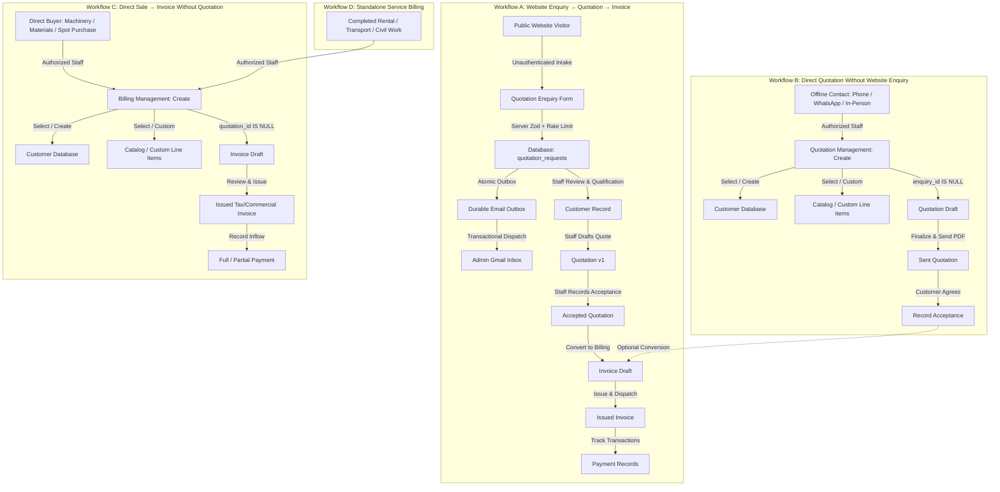
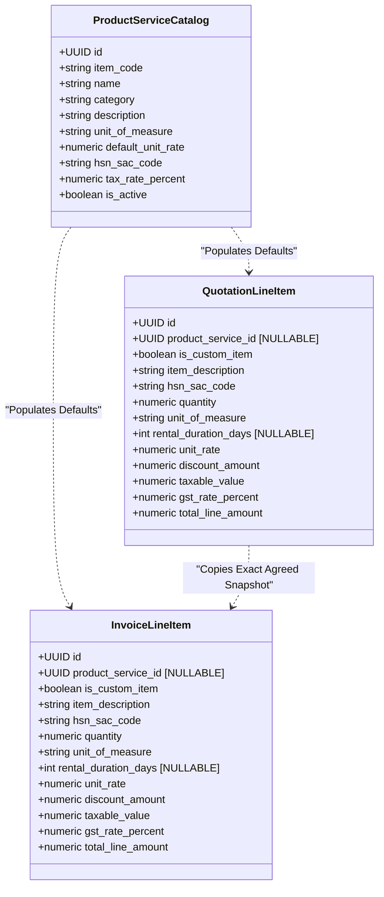
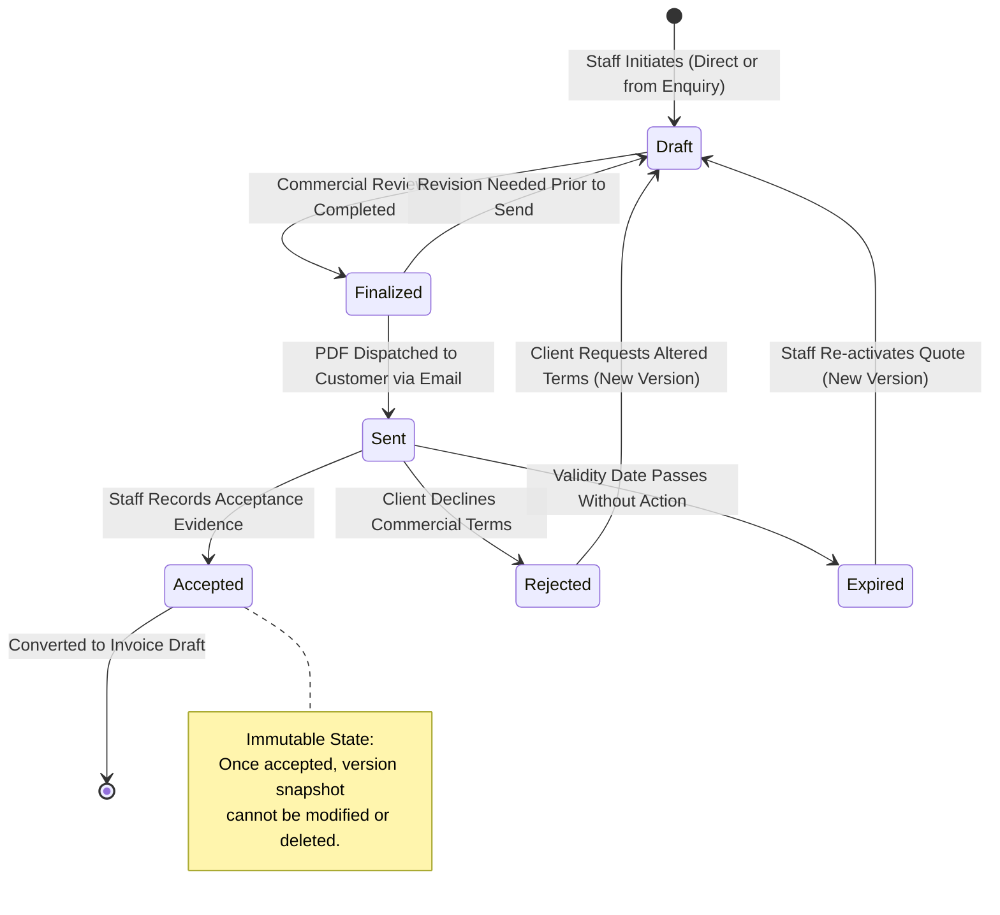
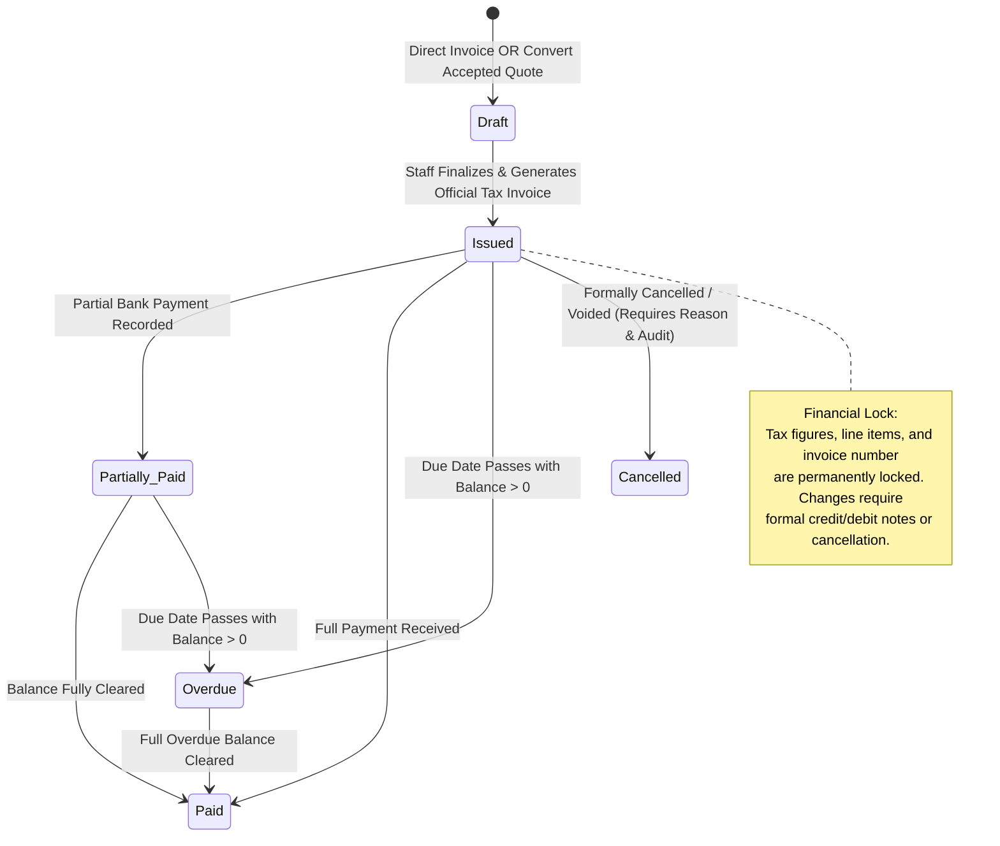
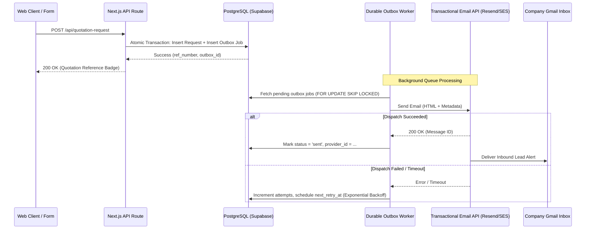

# Phase 2C: Final Consolidated Architecture Planning
## Enquiry Management, Quotations, Billing, Product Catalog, Gmail Notifications & Staff Dashboard

**Project:** Santhaya Associates Pvt. Ltd. — Web Platform & Internal Operating System  
**Document:** `docs/PHASE-2C-ARCHITECTURE.md`  
**Version:** 1.0 (Consolidated Architecture Planning)  
**Date:** 2026-10-28  
**Status:** Architecture Proposal — Planning Only (Awaiting Human Review)  
**Security & Architecture Reviewers:** Senior Full-Stack Engineer, Database Architect, Security Reviewer  

---

## 1. Project Context & Scope Boundary

Santhaya Associates is an industrial and civil enterprise specializing in:
1. **Government and private construction tender services**
2. **Construction machinery supply** (cranes, excavators, piling rigs, road construction equipment)
3. **Equipment rental & leasing** (heavy earthmoving, compaction, batching plants)
4. **Materials supply** (aggregates, steel, cement, structural components)
5. **Manufacturing machinery supply** (industrial tooling, processing equipment)
6. **Commercial quotation, GST/non-GST billing, and payment tracking**

### Phase 2B Baseline & Starting Point
- Target development environment: **`bkqneudnnhvvwmtggorz`** (`https://bkqneudnnhvvwmtggorz.supabase.co`).
- Verified database tables (active in `public` schema):
  - `public.staff_profiles`
  - `public.customers`
  - `public.quotation_requests`
  - `public.rate_limits`
  - `public.audit_logs`
- Initial migration `supabase/migrations/20261026120000_phase2_schema_and_security.sql` was applied manually in the Supabase SQL Editor and verified via `scripts/verify-phase2-migration.mjs` (`npm.cmd run test:migration-status`).
- Supabase CLI migration history for version `20261026120000` is pending CLI metadata reconciliation (`supabase migration repair --status applied 20261026120000`), which will be executed during future CLI pipeline initialization.

---

## 2. Four Independent Business Workflows

The platform is designed around four decoupled, first-class commercial workflows. Quotations and Invoices must **never** be artificially forced to depend on preceding steps.



### Workflow Specifications

#### Workflow A — Website Enquiry → Quotation → Invoice
1. **Public Intake**: A prospect visits `/request-quotation` and submits specifications without login or account creation.
2. **Server Gateway**: Next.js API Route `/api/quotation-request` validates payload with Zod, checks honeypot decoy (`_company_fax`), hashes client IP with salt, and calls atomic rate-limiter.
3. **Persistence & Outbox**: Stores the enquiry snapshot into `quotation_requests` and creates a durable delivery record in `email_outbox`.
4. **Gmail Alert**: Transactional email worker delivers a formatted alert to the company's Gmail inbox (`inquiries@santhaya.local` / corporate Gmail).
5. **Staff Review**: Estimators view the inquiry in the private dashboard, link or create a customer profile, and draft Quotation v1.
6. **Acceptance & Conversion**: Upon client agreement, staff records acceptance metadata and optionally converts the quote into an invoice draft.

#### Workflow B — Direct Quotation Without Website Enquiry
- **Context**: Used when clients contact Santhaya Associates directly via phone, WhatsApp, tender notices, or walk-ins.
- **Decoupled Architecture**: `quotations.enquiry_id` is **strictly nullable**.
- **Execution**: Staff selects an existing customer or creates a new one, adds catalog items or ad-hoc custom items, configures delivery/rental terms, and generates a quotation draft.

#### Workflow C — Direct Sale → Invoice Without Quotation
- **Context**: Used for direct equipment sales, spot material supplies, or repeat orders where no formal quotation is required.
- **Decoupled Architecture**: `invoices.quotation_id` is **strictly nullable**.
- **Integrity Guarantee**: The system **never** creates synthetic "dummy quotations" or "fake enquiries" to satisfy invoice dependencies.

#### Workflow D — Standalone Service Billing
- **Context**: Periodic billing for active machinery rental contracts, logistics/transport runs, or milestone-based civil subcontracting.
- **Execution**: Utilizes the exact same decoupled invoice workflow as Workflow C, selecting service/rental catalog entries and billing according to verified measurement sheets.

---

## 3. Staff Dashboard Architecture

The staff dashboard is an authenticated, internal web portal isolated from the public marketing site.

### Mandatory Route & Visibility Boundaries
- **Zero Public Links**: Public headers, footers, mobile menus, and quotation forms **never** display Login, Sign In, Account, or Dashboard links.
- **Private Route Hierarchy**:
  - Staff Login: `/staff/login`
  - Dashboard Base: `/staff/dashboard`
- **SEO & Security Controls**: All `/staff/*` routes apply `noindex, nofollow` HTTP headers and are excluded from `sitemap.xml` and `robots.txt`. Security relies on server-side identity verification, not obscure URLs.

### 10 Private Dashboard Navigation Sections

```
┌────────────────────────────────────────────────────────────────────────┐
│                        SANTHAYA ASSOCIATES STAFF PORTAL                 │
├─────────────────┬──────────────────────────────────────────────────────┤
│ Navigation      │ Main Workspace                                       │
├─────────────────┼──────────────────────────────────────────────────────┤
│ 1. Overview     │ KPI Cards, Inquiries Awaiting Review, Pending Quotes,│
│                 │ Overdue Invoices, Recent Cash Inflows                │
│ 2. Enquiries    │ Inbound Web Leads, Review Drawer, Risk Signals,      │
│                 │ Qualification, Quick "Convert to Quotation" CTA     │
│ 3. Customers    │ Master Registry, Statutory Identifiers (GSTIN/PAN),  │
│                 │ Shipping Sites, Financial Aging History              │
│ 4. Quotations   │ Quotation Lifecycle: Drafts, Finalized, Sent,        │
│                 │ Accepted, Expired, Revision History, PDF Generator   │
│ 5. Billing      │ Invoicing Center: Direct Invoice, Quote Conversion,  │
│                 │ Tax Invoices, Payment Tracking, Overdue Tracking     │
│ 6. Catalog      │ Products, Machinery, Rentals, Transport Rates,        │
│                 │ Default Rates, HSN/SAC Mapping, Custom Item Support │
│ 7. Payments     │ Payment Intake, Bank UTR Matching, Invoice Aging,    │
│                 │ Partial Collections, Receipt PDFs                    │
│ 8. Documents    │ Secure Storage Vault: Generated PDFs, Signed Proofs, │
│                 │ Technical Specs, Short-Lived Expiring Signed Links   │
│ 9. Staff Admin  │ Team Directory, Role Grants (Admin/Estimator/Billing),│
│                 │ Invitation Management, Account Deactivation          │
│ 10. Settings    │ Tax Schedules, Terms Templates, Email Outbox Health, │
│                 │ Audit Trail Logs, System Configuration               │
└─────────────────┴──────────────────────────────────────────────────────┘
```

---

## 4. Product & Service Catalog — Approved Option A Architecture

The system implements **Catalog Option A**: supporting both reusable saved catalog entries and on-the-fly custom items, with immutable historical snapshots on line items.



### Core Catalog Principles
1. **Saved Catalog Items**:
   - Reusable entries for heavy equipment (e.g. *Tata Hitachi ZX210 Excavator*), equipment rentals (e.g. *Monthly 50-Ton Crane Lease*), materials (*M-Sand / Concrete Aggregate per MT*), and services (*Tender Bid Documentation Package*).
   - Contain default rates, standard HSN/SAC codes, and default tax percentages.
2. **Custom / Ad-Hoc Items**:
   - When quoting custom tender packages or specialized machinery modifications, staff can enter a custom line item without pre-registering it in the catalog (`product_service_id = NULL`, `is_custom_item = true`).
   - Staff can optionally click **"Save to Catalog"** to promote a custom item to a permanent reusable entry.
3. **Immutable Rate Snapshots**:
   - Catalog prices represent default suggestions.
   - Once added to a Quotation or Invoice, rates, descriptions, and tax classifications are **frozen in the line-item table**.
   - Subsequent price modifications in the catalog **never alter historical quotes or issued invoices**.
4. **No Inventory Tracking in Phase 2C**:
   - Inventory, stock deductions, and warehouse locations are explicitly deferred. Catalog items track descriptions, pricing rules, and tax codes only.

---

## 5. Customer Management Architecture

A unified customer directory serves enquiries, quotations, invoices, and payment tracking.

### Data Model & Capabilities
- **Customer Types**: `private_corporate` (Contractors, Infrastructure EPCs), `government` (State/Central PWD, Municipalities), `individual` (Private developers).
- **Tax & Location Attributes**: Primary contact person, company legal name, phone, email, registered GSTIN, billing address, shipping / site address, and place of supply state code.
- **Safe Matching & Anti-Duplicate Protocol**:
  - Enquiries are **never automatically merged** into customer records based solely on phone number or email address.
  - Staff reviews the inquiry against existing verified records using corporate identity: GSTIN, PAN, Corporate CIN, and legal business name.
  - Staff manually approves linking an inquiry to an existing customer or provisions a new master customer row.

---

## 6. Quotation Lifecycle & Versioning State Machine



### Quotation Versioning & Immutability Rules
1. **Independent Numbering**: Sequential alphanumeric format: `QUO-YYYY-XXXXX` (e.g. `QUO-2026-00001`) governed by database sequence `quotation_number_seq`.
2. **Multi-Version Architecture**:
   - The master `quotations` table maintains high-level state, customer relationship, and pointer to `current_version_id`.
   - The `quotation_versions` table maintains specific iterations (`version_number = 1, 2, 3...`) with frozen subtotal, discount, tax, and PDF storage references.
   - Modifying a sent or negotiated quotation creates a **new version row**, preserving earlier iterations for audit review.
3. **Manual Acceptance Recording**:
   - Customers accept via signed quotation PDF, corporate Purchase Order (PO), email confirmation, or authorized WhatsApp acceptance.
   - Staff records: Acceptance date, acceptance method, accepted version number, staff user ID, customer signatory name, and optional uploaded proof document.
   - Once marked `Accepted`, the accepted version is locked against editing.

---

## 7. Invoice Management & Quotation Conversion Architecture



### Invoice Creation Methods
1. **Conversion from Accepted Quotation**:
   - The conversion engine reads the **accepted quotation version** snapshot.
   - Copies customer billing information, line items, agreed rates, discount structures, and tax parameters into a new `invoices` draft.
   - Links `invoices.quotation_id` and `invoices.quotation_version_id`.
   - Prevents duplicate conversions: An accepted quote cannot be converted more than once unless explicitly voided or scoped to partial milestone billing.
2. **Direct Invoice Creation**:
   - Staff navigates to Billing -> Create Invoice.
   - Directly selects customer, adds catalog/custom line items, and defines payment terms.
   - `invoices.quotation_id` remains `NULL`.

### Financial Snapshot & Document Integrity
- **Numbering**: Sequential series governed by `invoice_number_seq` (e.g. `INV-2026-00001` or statutory format `SA/2026-27/0001`).
- **Two-Tier Status Model**:
  - `lifecycle_status`: `'draft'`, `'issued'`, `'cancelled'`, `'rectified'`
  - `payment_status`: `'unpaid'`, `'partially_paid'`, `'paid'`, `'overdue'`
- **Issuance Lock**: Once an invoice transitions to `'issued'`, line items, tax calculations, and customer details cannot be updated via standard UI. Corrections follow approved credit note or cancellation procedures.

---

## 8. GST & Non-GST Commercial Billing Engine

### Statutory Review Gate
Per **RULES §10** and **PRD §6**, all Indian GST calculation routines, tax allocations, and place-of-supply rules must be reviewed and approved by a certified Indian Chartered Accountant prior to production deployment.

### Calculation Principles & Rounding Rules
1. **Decimal Precision**:
   - All line item rates, subtotals, tax components, and final balances use `NUMERIC(15,2)` in PostgreSQL and integer-cents or decimal-safe math in TypeScript.
   - Binary floating-point (`FLOAT`, `DOUBLE PRECISION`) is strictly forbidden.
2. **Tax Classification Logic**:
   - **Intra-State Supply**: When Supplier State (`27 - Maharashtra`) == Place of Supply State:
     $$\text{CGST} = \text{Taxable Value} \times \frac{\text{Rate}}{2}$$
     $$\text{SGST} = \text{Taxable Value} \times \frac{\text{Rate}}{2}$$
   - **Inter-State Supply**: When Supplier State != Place of Supply State:
     $$\text{IGST} = \text{Taxable Value} \times \text{Rate}$$
   - **Exempt / Non-GST Supply**: Specified items (e.g. pure labor contracts or exempt civil works) have tax rate set to `0.00%` and classification flagged as `'exempt'`.
3. **Deterministic Rounding Policy**:
   - Line-item tax values are calculated to 4 decimal places internally and rounded to 2 decimal places using half-up rounding.
   - Invoice total is rounded to the nearest integer rupee with explicit `round_off_amount` displayed on the invoice document.

---

## 9. PDF Generation & Document Storage Architecture

### Visual & Document Standards
- Built using server-side React PDF rendering (`@react-pdf/renderer` or server-side headless Chromium).
- Incorporates official Santhaya Associates brand assets:
  - Deep Navy `#10243B` primary headers and borders.
  - Industrial Gold `#F4B323` accent lines and highlights.
  - Authentic `santhaya-logo-header.png` at exact aspect ratio (1.314:1) with zero distortion.
  - Company statutory footer (CIN, GSTIN, PAN, Registered Office Address, Bank NEFT/RTGS Coordinates).

### Secure Private Storage Architecture
- Documents are stored in private Supabase Storage buckets:
  - `quotations_private`
  - `invoices_private`
  - `documents_private` (acceptance proof, signed receipts)
- **Zero Permanent Public URLs**: Buckets are strictly non-public.
- **Signed Expiring URLs**: Document downloads and email links utilize cryptographically signed, short-lived URLs (15-minute expiration) generated on-demand by authenticated server endpoints.

---

## 10. Provider-Independent Transactional Email Architecture

### Email Strategy & Reliability
The transactional email subsystem is decoupled from specific vendors via an adapter pattern (`IEmailProvider`), allowing seamless deployment with Resend, AWS SES, Postmark, or Brevo.



### Key Email Workflows
1. **New Enquiry Lead Alert**: Dispatched immediately to Santhaya Associates' administration Gmail inbox (`inquiries@santhaya.local` / corporate Gmail).
2. **Customer Quotation PDF Email**: Dispatched when staff clicks "Email Quotation" in the dashboard.
3. **Customer Invoice PDF Email**: Dispatched when staff issues an invoice.
4. **Delivery Failure Alert**: Dispatched to staff if an automated customer email exhausts maximum retries.

---

## 11. Payment Tracking & Ledger Architecture

### Capabilities
- **Multiple Payments per Invoice**: Accommodates progressive payments (e.g. 30% advance, 50% on machinery dispatch, 20% on site commissioning).
- **Payment Attributes**: Unique payment receipt number (`PAY-2026-00001`), payment date, amount received, payment mode (NEFT/RTGS, Cheque, Bank Transfer, UPI, Cash), bank UTR / reference number, staff user ID, and internal notes.
- **Balance Invariance Guard**: Database constraint and trigger ensure:
  $$\text{Balance Due} = \text{Invoice Total} - \sum \text{Payments Received}$$
- **Anti-Overpayment Guard**: Server and database prevent recording payments where `amount_received > balance_due` unless handled by an approved customer credit note workflow.
- **No Direct Payment Gateway**: Phase 2C plans manual and offline bank-transfer tracking only. Online checkout/gateway integration is deferred.

---

## 12. Security, RLS & Authentication Architecture

### Strict Separation of Public vs Staff Access
- Public visitors never authenticate. Form submissions are anonymous and ingest via the server-side API Route.
- Staff access is restricted to authenticated Supabase accounts possessing an active record in `staff_profiles` with a designated role:
  - `admin`: Full system control, staff management, audit log access, quotation/invoice issuance and cancellation.
  - `estimator`: Create/edit enquiries, manage customers, generate quotations, view catalog.
  - `billing_manager`: Issue invoices, record payments, manage billing records, view quotations.
  - `viewer`: Read-only access to inquiries, quotations, and catalog.
- Self-privilege escalation is strictly blocked at the database level: non-admins cannot alter roles or activate deactivated profiles.

---

## 13. Summary of Architectural Guarantees

1. **Independent Workflows**: Quotations and Invoices can be created independently without preceding website enquiries.
2. **Option A Catalog Support**: Both saved catalog items and custom line items are first-class citizens.
3. **Immutability of Financial Records**: Finalized quotes, accepted revisions, and issued invoices preserve frozen line-item rates.
4. **Reliable Communication**: Transactional email uses an atomic outbox queue with exponential backoff and Gmail inbox delivery.
5. **Zero Public Login**: Public site remains 100% accessible without visitor accounts. Staff dashboard is strictly segregated.

---

## 14. Phase 2D-B Addendum — Updated Business Requirements & Security Architecture

### 14.1 Resend Free-Tier Transactional Email Architecture
- **Provider Selection**: Resend free-tier is the approved transactional email provider for company Gmail notifications.
- **Gmail Destination**: Admin enquiry alerts are delivered to the corporate Gmail inbox configured via `INTERNAL_NOTIFICATION_EMAIL`.
- **Verified Sender**: Emails are dispatched from `EMAIL_FROM_ADDRESS` (e.g. `onboarding@resend.dev` in development, verified domain in production).
- **Free-Tier Protection**: Configurable safeguards (`EMAIL_DAILY_LIMIT` default 80, `EMAIL_MONTHLY_LIMIT` default 2500) prevent exceeding free-tier allowances. When limits are reached, the outbox worker pauses processing without dropping or failing enquiries. The underlying enquiry is stored first, guaranteed by the atomic database procedure.
- **Zero Paid Integrations**: No paid plans, paid addons, paid SMS, or paid WhatsApp Business APIs are implemented.

### 14.2 Public Website Enquiry Contact Rules
- **Single-Contact Intake**: Public prospects at `/request-quotation` must provide at least one valid contact method:
  - Phone-only (10-digit Indian mobile) + no email = **ACCEPT**
  - Email-only (valid RFC-compliant email) + no phone = **ACCEPT**
  - Both phone and email valid = **ACCEPT**
  - Neither provided = **REJECT** (cross-field Zod & DB validation)
  - Invalid phone format or invalid email format = **REJECT**

### 14.3 Staff-Created Customer Contact Flexibility
- **Optional Email and Phone**: Staff can create customer master records with `email = NULL` and `phone = NULL`, provided mandatory corporate identity fields (`company_name`, `billing_state`, `client_type`) are present.
- **Statutory Identity**: Phone and email are not the primary customer keys; stable UUIDs and PAN/GSTIN provide identity verification.

### 14.4 Manual Phone & WhatsApp Quotation Delivery
- **Offline / Non-Email Workflow**:
  1. Staff create quotation draft in private dashboard.
  2. Staff finalize quotation and generate official PDF. Every finalized quotation receives a unique reference (`QTN-YYYY-XXXXX`).
  3. Staff download PDF and contact client via Phone, WhatsApp, In-Person, or Printed copy.
  4. Staff record delivery details: delivery channel, delivery timestamp, staff member ID, and optional delivery notes/evidence.
  5. Staff manually record client acceptance.
- **No Direct WhatsApp / SMS API**: System does not claim automated WhatsApp or SMS dispatch. A phone call conveys the reference number or arranges delivery; PDF is delivered manually.

### 14.5 Concurrency & IP Extraction Security Hardening
- **Outbox Worker Checkout Fix**: Optimistic lock now verifies that exactly one row was claimed (`claimedRows && claimedRows.length === 1`), preventing duplicate email sends when concurrent workers execute.
- **Database Queue Batch Checkout**: Procedure `claim_email_outbox_batch` prepared using `FOR UPDATE SKIP LOCKED` for database-level concurrency protection.
- **Trusted Reverse-Proxy IP Policy**: Client IP extraction now explicitly isolates untrusted `X-Forwarded-For` injection, requiring production edge proxies (Vercel/Cloudflare) to strip or sanitize incoming proxy headers.

