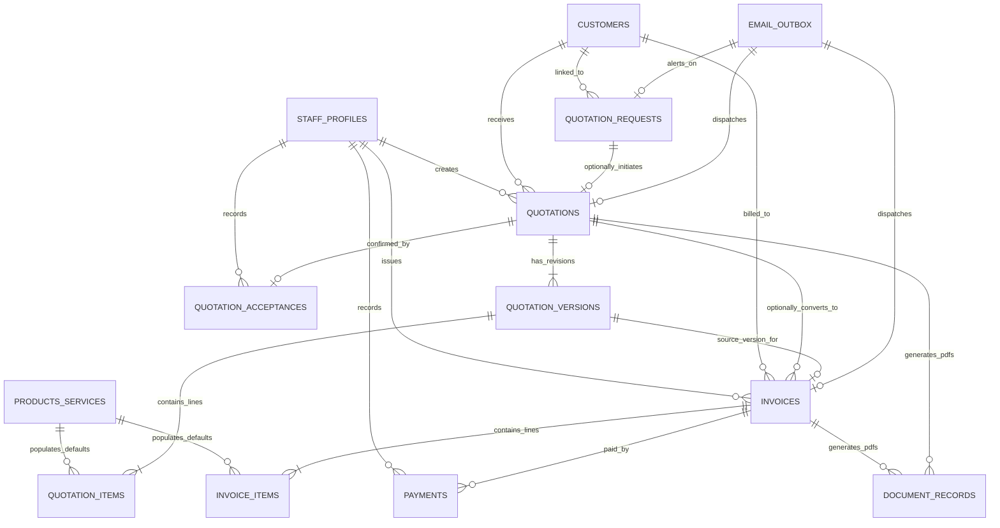

# Phase 2C: Comprehensive Database Schema & Migration Plan
## Tables, Relationships, Constraints, Sequences, RLS Policies & CLI Reconciliation

**Project:** Santhaya Associates Pvt. Ltd. — Web Platform & Internal Operating System  
**Document:** `docs/PHASE-2C-DATABASE-PLAN.md`  
**Version:** 1.0 (Database Architecture Plan)  
**Date:** 2026-10-28  
**Status:** Architecture Proposal — Planning Only (Awaiting Human Review)  

---

## 1. Existing Phase 2B Baseline & Verified Database Reality

### Verified Applied Migration: `20261026120000_phase2_schema_and_security.sql`
- **Application Method**: Manually executed via the Supabase Dashboard SQL Editor on development sandbox `bkqneudnnhvvwmtggorz`.
- **Verification Status**: Verified via `scripts/verify-phase2-migration.mjs` (`npm.cmd run test:migration-status`) on 2026-10-28.
- **Active Tables in `public` schema**:
  1. `public.staff_profiles` (Staff accounts referencing `auth.users(id)` with roles: `'admin'`, `'estimator'`, `'billing_manager'`, `'viewer'`).
  2. `public.customers` (Master corporate customer entities with legal name, GSTIN, place of supply state, and billing address).
  3. `public.quotation_requests` (Inbound public website quotation inquiries with client-generated UUID `idempotency_key` and SHA-256 payload hash).
  4. `public.rate_limits` (Distributed atomic token bucket rate limiter with row-level locks).
  5. `public.audit_logs` (Tamper-resistant audit trail with BEFORE UPDATE/DELETE/TRUNCATE trigger protection).
- **Active Enums**: `staff_role_enum`, `customer_type_enum`, `service_category_enum`, `quotation_request_status_enum`.
- **Active Sequences**: `public.quotation_request_seq`.
- **Active Stored Procedures**: `submit_quotation_request`, `check_rate_limit`, `cleanup_expired_rate_limits`, `is_active_staff`, `has_staff_role`, `prevent_audit_log_mutation`.

### CLI Migration History Reconciliation Plan
- **Current State**: The database contains all Phase 2B schema elements, but the Supabase CLI internal table `supabase_migrations.schema_migrations` does not have an entry for version `20261026120000` because execution was performed through the Dashboard query editor.
- **Planned Reconciliation Command** (To be run when CLI access token or database URL is configured):
  ```bash
  # Marks existing migration as applied in CLI history without re-running DDL
  npx supabase migration repair --status applied 20261026120000
  ```
- **Safety Directive**: No repair or CLI sync commands are executed during Phase 2C planning.

---

## 2. Entity Relationship Diagram (ERD) — Phase 2C Additions

The database architecture expands additively without mutating or dropping any Phase 2B tables.



---

## 3. Decoupled Foreign Key Architecture

A foundational architectural requirement is that **quotations and invoices do not have mandatory dependencies on upstream processes**:

| Foreign Key Relationship | Nullable? | Rationale | Supported Business Workflow |
| :--- | :--- | :--- | :--- |
| `quotations.customer_id` | **NO** (`NOT NULL`) | Every quotation must have an identified commercial customer entity. | Workflows A & B |
| `quotations.enquiry_id` | **YES** (`NULLABLE`) | Direct quotations initiated via phone, WhatsApp, or tender documents do not originate from a website enquiry. | **Workflow B** (Direct Quotation) |
| `invoices.customer_id` | **NO** (`NOT NULL`) | Every invoice must be legally issued to an identified customer. | Workflows A, B, C & D |
| `invoices.quotation_id` | **YES** (`NULLABLE`) | Direct sales of machinery, equipment rentals, spot material supply, or service contracts do not require prior quotations. | **Workflows C & D** (Direct Sale & Standalone Service) |
| `invoices.quotation_version_id` | **YES** (`NULLABLE`) | Set only when an invoice is converted from an accepted quotation. | Workflow A & B (Converted Invoices) |
| `quotation_items.product_service_id` | **YES** (`NULLABLE`) | Staff can add custom/ad-hoc line items without creating catalog items. | Catalog Option A (Custom Items) |
| `invoice_items.product_service_id` | **YES** (`NULLABLE`) | Staff can bill custom services or spot items without prior catalog entry. | Catalog Option A (Custom Items) |

---

## 4. Proposed Database Additions (Schema Specification)

### 1. `public.products_services` (Product & Service Catalog — Option A)
Maintains reusable master catalog entries for heavy machinery, rental rates, materials, transport, and tender services.

```sql
CREATE TABLE IF NOT EXISTS public.products_services (
  id UUID PRIMARY KEY DEFAULT gen_random_uuid(),
  item_code VARCHAR(30) UNIQUE NOT NULL, -- e.g. 'MACH-EXC-20T', 'RENT-CRN-50T'
  name TEXT NOT NULL,
  category VARCHAR(50) NOT NULL, -- 'machinery', 'equipment_rental', 'materials', 'transport', 'tender_service'
  description TEXT,
  unit_of_measure VARCHAR(20) NOT NULL, -- 'unit', 'day', 'month', 'metric_ton', 'kilometer', 'sq_meter'
  default_unit_rate NUMERIC(15,2) NOT NULL DEFAULT 0.00,
  hsn_sac_code VARCHAR(10), -- e.g. '8429' (Machinery), '9973' (Leasing/Rental), '9954' (Civil Works)
  tax_rate_percent NUMERIC(5,2) NOT NULL DEFAULT 18.00, -- Dynamic default tax percent
  is_active BOOLEAN NOT NULL DEFAULT true,
  created_at TIMESTAMPTZ NOT NULL DEFAULT timezone('utc'::text, now()),
  updated_at TIMESTAMPTZ NOT NULL DEFAULT timezone('utc'::text, now())
);

CREATE INDEX IF NOT EXISTS idx_products_services_category ON public.products_services(category);
CREATE INDEX IF NOT EXISTS idx_products_services_active ON public.products_services(is_active);
CREATE INDEX IF NOT EXISTS idx_products_services_code ON public.products_services(item_code);
```

### 2. `public.quotations` (Master Commercial Quotation Record)
Tracks quotation metadata, customer relationship, lifecycle status, and optional enquiry link.

```sql
CREATE TYPE public.quotation_status_enum AS ENUM (
  'draft',
  'finalized',
  'sent',
  'accepted',
  'rejected',
  'expired',
  'superseded'
);

CREATE TABLE IF NOT EXISTS public.quotations (
  id UUID PRIMARY KEY DEFAULT gen_random_uuid(),
  quotation_number VARCHAR(30) UNIQUE NOT NULL, -- e.g. 'QUO-2026-00001'
  customer_id UUID NOT NULL REFERENCES public.customers(id) ON DELETE RESTRICT,
  enquiry_id UUID REFERENCES public.quotation_requests(id) ON DELETE SET NULL, -- Strictly Nullable
  current_version_id UUID, -- References quotation_versions(id)
  status public.quotation_status_enum NOT NULL DEFAULT 'draft'::public.quotation_status_enum,
  valid_until DATE NOT NULL,
  payment_terms TEXT NOT NULL DEFAULT '100% advance or approved commercial credit.',
  delivery_terms TEXT NOT NULL DEFAULT 'Ex-Works / Delivery to specified project site.',
  commercial_conditions TEXT,
  internal_notes TEXT,
  customer_notes TEXT,
  created_by_staff_id UUID NOT NULL REFERENCES public.staff_profiles(id),
  created_at TIMESTAMPTZ NOT NULL DEFAULT timezone('utc'::text, now()),
  updated_at TIMESTAMPTZ NOT NULL DEFAULT timezone('utc'::text, now())
);

CREATE INDEX IF NOT EXISTS idx_quotations_customer ON public.quotations(customer_id);
CREATE INDEX IF NOT EXISTS idx_quotations_enquiry ON public.quotations(enquiry_id);
CREATE INDEX IF NOT EXISTS idx_quotations_status ON public.quotations(status);
CREATE INDEX IF NOT EXISTS idx_quotations_created_at ON public.quotations(created_at DESC);
```

### 3. `public.quotation_versions` (Immutable Quotation Revisions)
Maintains distinct iterations of a quotation (`v1, v2, v3...`). Once marked accepted, the accepted version is permanently locked.

```sql
CREATE TABLE IF NOT EXISTS public.quotation_versions (
  id UUID PRIMARY KEY DEFAULT gen_random_uuid(),
  quotation_id UUID NOT NULL REFERENCES public.quotations(id) ON DELETE CASCADE,
  version_number INT NOT NULL,
  is_accepted BOOLEAN NOT NULL DEFAULT false,
  subtotal_amount NUMERIC(15,2) NOT NULL DEFAULT 0.00,
  discount_amount NUMERIC(15,2) NOT NULL DEFAULT 0.00,
  taxable_value NUMERIC(15,2) NOT NULL DEFAULT 0.00,
  tax_amount NUMERIC(15,2) NOT NULL DEFAULT 0.00,
  total_amount NUMERIC(15,2) NOT NULL DEFAULT 0.00,
  pdf_storage_path TEXT, -- Supabase Storage private bucket path
  created_by_staff_id UUID NOT NULL REFERENCES public.staff_profiles(id),
  created_at TIMESTAMPTZ NOT NULL DEFAULT timezone('utc'::text, now()),
  CONSTRAINT uq_quotation_version UNIQUE (quotation_id, version_number)
);

CREATE INDEX IF NOT EXISTS idx_quotation_versions_quote ON public.quotation_versions(quotation_id);
```

### 4. `public.quotation_items` (Frozen Quotation Line-Item Snapshots)
Preserves exact agreed rates and descriptions. Supports both catalog items and custom items.

```sql
CREATE TABLE IF NOT EXISTS public.quotation_items (
  id UUID PRIMARY KEY DEFAULT gen_random_uuid(),
  quotation_version_id UUID NOT NULL REFERENCES public.quotation_versions(id) ON DELETE CASCADE,
  product_service_id UUID REFERENCES public.products_services(id) ON DELETE SET NULL, -- Nullable for custom items
  is_custom_item BOOLEAN NOT NULL DEFAULT false,
  line_number INT NOT NULL,
  item_description TEXT NOT NULL,
  hsn_sac_code VARCHAR(10) NOT NULL,
  quantity NUMERIC(10,2) NOT NULL CHECK (quantity > 0),
  unit_of_measure VARCHAR(20) NOT NULL,
  rental_duration_days INT CHECK (rental_duration_days IS NULL OR rental_duration_days > 0),
  unit_rate NUMERIC(15,2) NOT NULL CHECK (unit_rate >= 0),
  discount_amount NUMERIC(15,2) NOT NULL DEFAULT 0.00 CHECK (discount_amount >= 0),
  taxable_value NUMERIC(15,2) NOT NULL CHECK (taxable_value >= 0),
  gst_rate_percent NUMERIC(5,2) NOT NULL CHECK (gst_rate_percent >= 0),
  cgst_amount NUMERIC(15,2) NOT NULL DEFAULT 0.00,
  sgst_amount NUMERIC(15,2) NOT NULL DEFAULT 0.00,
  igst_amount NUMERIC(15,2) NOT NULL DEFAULT 0.00,
  total_line_amount NUMERIC(15,2) NOT NULL CHECK (total_line_amount >= 0),
  created_at TIMESTAMPTZ NOT NULL DEFAULT timezone('utc'::text, now()),
  CONSTRAINT uq_quotation_item_line UNIQUE (quotation_version_id, line_number)
);

CREATE INDEX IF NOT EXISTS idx_quotation_items_version ON public.quotation_items(quotation_version_id);
```

### 5. `public.quotation_acceptances` (Manual Customer Acceptance Log)
Records client acceptance details, method, and uploaded proof.

```sql
CREATE TABLE IF NOT EXISTS public.quotation_acceptances (
  id UUID PRIMARY KEY DEFAULT gen_random_uuid(),
  quotation_id UUID NOT NULL REFERENCES public.quotations(id) ON DELETE RESTRICT,
  quotation_version_id UUID NOT NULL REFERENCES public.quotation_versions(id) ON DELETE RESTRICT,
  acceptance_date DATE NOT NULL,
  acceptance_method VARCHAR(50) NOT NULL, -- 'email', 'signed_pdf', 'client_po', 'whatsapp', 'verbal_po'
  signatory_name TEXT NOT NULL,
  signatory_designation TEXT,
  recorded_by_staff_id UUID NOT NULL REFERENCES public.staff_profiles(id),
  evidence_document_id UUID, -- References document_records(id)
  acceptance_notes TEXT,
  created_at TIMESTAMPTZ NOT NULL DEFAULT timezone('utc'::text, now()),
  CONSTRAINT uq_quotation_acceptance UNIQUE (quotation_id, quotation_version_id)
);
```

### 6. `public.invoices` (Independent Commercial & GST Billing Invoices)
Supports both quotation conversion and direct invoice generation without quotations.

```sql
CREATE TYPE public.invoice_lifecycle_status_enum AS ENUM (
  'draft',
  'issued',
  'cancelled',
  'rectified'
);

CREATE TYPE public.invoice_payment_status_enum AS ENUM (
  'unpaid',
  'partially_paid',
  'paid',
  'overdue'
);

CREATE TABLE IF NOT EXISTS public.invoices (
  id UUID PRIMARY KEY DEFAULT gen_random_uuid(),
  invoice_number VARCHAR(30) UNIQUE NOT NULL, -- e.g. 'INV-2026-00001' or 'SA/2026-27/0001'
  customer_id UUID NOT NULL REFERENCES public.customers(id) ON DELETE RESTRICT,
  quotation_id UUID REFERENCES public.quotations(id) ON DELETE SET NULL, -- Strictly Nullable
  quotation_version_id UUID REFERENCES public.quotation_versions(id) ON DELETE SET NULL, -- Strictly Nullable
  invoice_date DATE NOT NULL,
  due_date DATE NOT NULL,
  place_of_supply_state_code VARCHAR(2) NOT NULL, -- '27' for Maharashtra
  supply_type VARCHAR(20) NOT NULL DEFAULT 'intra_state', -- 'intra_state', 'inter_state', 'exempt'
  customer_gstin VARCHAR(15),
  billing_address TEXT NOT NULL,
  shipping_address TEXT,
  subtotal_amount NUMERIC(15,2) NOT NULL DEFAULT 0.00,
  discount_amount NUMERIC(15,2) NOT NULL DEFAULT 0.00,
  taxable_value NUMERIC(15,2) NOT NULL DEFAULT 0.00,
  cgst_amount NUMERIC(15,2) NOT NULL DEFAULT 0.00,
  sgst_amount NUMERIC(15,2) NOT NULL DEFAULT 0.00,
  igst_amount NUMERIC(15,2) NOT NULL DEFAULT 0.00,
  additional_charges NUMERIC(15,2) NOT NULL DEFAULT 0.00, -- Freight, insurance, handling
  round_off_amount NUMERIC(5,2) NOT NULL DEFAULT 0.00,
  total_amount NUMERIC(15,2) NOT NULL DEFAULT 0.00,
  paid_amount NUMERIC(15,2) NOT NULL DEFAULT 0.00 CHECK (paid_amount >= 0),
  balance_due NUMERIC(15,2) NOT NULL DEFAULT 0.00,
  lifecycle_status public.invoice_lifecycle_status_enum NOT NULL DEFAULT 'draft'::public.invoice_lifecycle_status_enum,
  payment_status public.invoice_payment_status_enum NOT NULL DEFAULT 'unpaid'::public.invoice_payment_status_enum,
  cancellation_reason TEXT,
  pdf_storage_path TEXT,
  created_by_staff_id UUID NOT NULL REFERENCES public.staff_profiles(id),
  created_at TIMESTAMPTZ NOT NULL DEFAULT timezone('utc'::text, now()),
  updated_at TIMESTAMPTZ NOT NULL DEFAULT timezone('utc'::text, now()),
  CONSTRAINT chk_balance_valid CHECK (balance_due >= 0 AND balance_due <= total_amount)
);

CREATE INDEX IF NOT EXISTS idx_invoices_customer ON public.invoices(customer_id);
CREATE INDEX IF NOT EXISTS idx_invoices_quotation ON public.invoices(quotation_id);
CREATE INDEX IF NOT EXISTS idx_invoices_payment_status ON public.invoices(payment_status);
CREATE INDEX IF NOT EXISTS idx_invoices_lifecycle ON public.invoices(lifecycle_status);
CREATE INDEX IF NOT EXISTS idx_invoices_due_date ON public.invoices(due_date);
```

### 7. `public.invoice_items` (Frozen Invoice Line-Item Snapshots)
Preserves line items and financial values permanently upon issuance.

```sql
CREATE TABLE IF NOT EXISTS public.invoice_items (
  id UUID PRIMARY KEY DEFAULT gen_random_uuid(),
  invoice_id UUID NOT NULL REFERENCES public.invoices(id) ON DELETE CASCADE,
  product_service_id UUID REFERENCES public.products_services(id) ON DELETE SET NULL, -- Nullable for custom items
  is_custom_item BOOLEAN NOT NULL DEFAULT false,
  line_number INT NOT NULL,
  item_description TEXT NOT NULL,
  hsn_sac_code VARCHAR(10) NOT NULL,
  quantity NUMERIC(10,2) NOT NULL CHECK (quantity > 0),
  unit_of_measure VARCHAR(20) NOT NULL,
  rental_duration_days INT CHECK (rental_duration_days IS NULL OR rental_duration_days > 0),
  unit_rate NUMERIC(15,2) NOT NULL CHECK (unit_rate >= 0),
  discount_amount NUMERIC(15,2) NOT NULL DEFAULT 0.00 CHECK (discount_amount >= 0),
  taxable_value NUMERIC(15,2) NOT NULL CHECK (taxable_value >= 0),
  gst_rate_percent NUMERIC(5,2) NOT NULL CHECK (gst_rate_percent >= 0),
  cgst_amount NUMERIC(15,2) NOT NULL DEFAULT 0.00,
  sgst_amount NUMERIC(15,2) NOT NULL DEFAULT 0.00,
  igst_amount NUMERIC(15,2) NOT NULL DEFAULT 0.00,
  total_line_amount NUMERIC(15,2) NOT NULL CHECK (total_line_amount >= 0),
  created_at TIMESTAMPTZ NOT NULL DEFAULT timezone('utc'::text, now()),
  CONSTRAINT uq_invoice_item_line UNIQUE (invoice_id, line_number)
);

CREATE INDEX IF NOT EXISTS idx_invoice_items_invoice ON public.invoice_items(invoice_id);
```

### 8. `public.payments` (Payment Ledger & Bank Reconciliations)
Supports full and partial progressive payments linked to invoices.

```sql
CREATE TABLE IF NOT EXISTS public.payments (
  id UUID PRIMARY KEY DEFAULT gen_random_uuid(),
  payment_reference VARCHAR(30) UNIQUE NOT NULL, -- e.g. 'PAY-2026-00001'
  invoice_id UUID NOT NULL REFERENCES public.invoices(id) ON DELETE RESTRICT,
  amount NUMERIC(15,2) NOT NULL CHECK (amount > 0),
  payment_date DATE NOT NULL,
  payment_mode VARCHAR(30) NOT NULL, -- 'neft_rtgs', 'cheque', 'bank_transfer', 'upi', 'cash', 'other'
  transaction_reference TEXT, -- Bank UTR / Cheque Number
  notes TEXT,
  recorded_by_staff_id UUID NOT NULL REFERENCES public.staff_profiles(id),
  created_at TIMESTAMPTZ NOT NULL DEFAULT timezone('utc'::text, now())
);

CREATE INDEX IF NOT EXISTS idx_payments_invoice ON public.payments(invoice_id);
CREATE INDEX IF NOT EXISTS idx_payments_date ON public.payments(payment_date DESC);
```

### 9. `public.document_records` (Private Document Vault Metadata)
Tracks private PDF documents and uploaded customer proofs with SHA-256 integrity checksums.

```sql
CREATE TABLE IF NOT EXISTS public.document_records (
  id UUID PRIMARY KEY DEFAULT gen_random_uuid(),
  entity_type VARCHAR(30) NOT NULL, -- 'quotation', 'invoice', 'acceptance_evidence'
  entity_id UUID NOT NULL,
  document_type VARCHAR(30) NOT NULL, -- 'quotation_pdf', 'invoice_pdf', 'signed_po', 'bank_slip'
  file_name TEXT NOT NULL,
  storage_bucket VARCHAR(50) NOT NULL, -- 'quotations_private', 'invoices_private', 'documents_private'
  storage_path TEXT NOT NULL,
  file_size_bytes BIGINT NOT NULL,
  mime_type VARCHAR(100) NOT NULL DEFAULT 'application/pdf',
  checksum_sha256 VARCHAR(64) NOT NULL,
  created_by_staff_id UUID NOT NULL REFERENCES public.staff_profiles(id),
  created_at TIMESTAMPTZ NOT NULL DEFAULT timezone('utc'::text, now())
);

CREATE INDEX IF NOT EXISTS idx_document_records_entity ON public.document_records(entity_type, entity_id);
```

### 10. `public.email_outbox` (Durable Transactional Email Queue)
Guarantees reliable background email dispatch with exponential retry backoff.

```sql
CREATE TYPE public.email_status_enum AS ENUM (
  'pending',
  'processing',
  'sent',
  'failed',
  'dead_letter'
);

CREATE TABLE IF NOT EXISTS public.email_outbox (
  id UUID PRIMARY KEY DEFAULT gen_random_uuid(),
  recipient_email TEXT NOT NULL,
  subject TEXT NOT NULL,
  email_type VARCHAR(50) NOT NULL, -- 'enquiry_alert_admin', 'quotation_customer', 'invoice_customer'
  payload JSONB NOT NULL,
  status public.email_status_enum NOT NULL DEFAULT 'pending'::public.email_status_enum,
  attempts INT NOT NULL DEFAULT 0,
  max_attempts INT NOT NULL DEFAULT 5,
  next_retry_at TIMESTAMPTZ NOT NULL DEFAULT timezone('utc'::text, now()),
  provider_message_id TEXT,
  error_message TEXT,
  related_entity_type VARCHAR(50),
  related_entity_id UUID,
  created_at TIMESTAMPTZ NOT NULL DEFAULT timezone('utc'::text, now()),
  processed_at TIMESTAMPTZ
);

CREATE INDEX IF NOT EXISTS idx_email_outbox_queue ON public.email_outbox(status, next_retry_at) 
  WHERE status IN ('pending', 'failed');
```

---

## 5. Sequences for Sequential Document Numbering

```sql
-- Quotation sequence: QUO-YYYY-XXXXX
CREATE SEQUENCE IF NOT EXISTS public.quotation_number_seq START WITH 1 INCREMENT BY 1 NO CYCLE;

-- Invoice sequence: INV-YYYY-XXXXX (or SA/YYYY-YY/XXXX)
CREATE SEQUENCE IF NOT EXISTS public.invoice_number_seq START WITH 1 INCREMENT BY 1 NO CYCLE;

-- Payment receipt sequence: PAY-YYYY-XXXXX
CREATE SEQUENCE IF NOT EXISTS public.payment_number_seq START WITH 1 INCREMENT BY 1 NO CYCLE;

-- Revoke usage from anonymous callers; grant exclusively to service_role
REVOKE ALL ON SEQUENCE public.quotation_number_seq FROM PUBLIC, anon, authenticated;
GRANT USAGE, SELECT ON SEQUENCE public.quotation_number_seq TO service_role;

REVOKE ALL ON SEQUENCE public.invoice_number_seq FROM PUBLIC, anon, authenticated;
GRANT USAGE, SELECT ON SEQUENCE public.invoice_number_seq TO service_role;

REVOKE ALL ON SEQUENCE public.payment_number_seq FROM PUBLIC, anon, authenticated;
GRANT USAGE, SELECT ON SEQUENCE public.payment_number_seq TO service_role;
```

---

## 6. Financial Invariance Triggers (Payment & Balance Reconciliation)

When a payment is inserted into `public.payments`, an atomic trigger automatically updates `invoices.paid_amount`, recalculates `invoices.balance_due`, and updates `invoices.payment_status` without application race conditions:

```sql
CREATE OR REPLACE FUNCTION public.recalculate_invoice_payment_status()
RETURNS TRIGGER
LANGUAGE plpgsql
SECURITY DEFINER
SET search_path = public, pg_temp
AS $$
DECLARE
  v_total_paid NUMERIC(15,2);
  v_invoice_total NUMERIC(15,2);
  v_new_balance NUMERIC(15,2);
  v_new_status public.invoice_payment_status_enum;
  v_target_invoice_id UUID;
BEGIN
  IF TG_OP = 'DELETE' THEN
    v_target_invoice_id := OLD.invoice_id;
  ELSE
    v_target_invoice_id := NEW.invoice_id;
  END IF;

  -- Lock invoice row for update
  SELECT total_amount INTO v_invoice_total
  FROM public.invoices
  WHERE id = v_target_invoice_id
  FOR UPDATE;

  -- Calculate total payments received
  SELECT COALESCE(SUM(amount), 0.00) INTO v_total_paid
  FROM public.payments
  WHERE invoice_id = v_target_invoice_id;

  -- Anti-overpayment guard
  IF v_total_paid > v_invoice_total THEN
    RAISE EXCEPTION 'OVERPAYMENT_NOT_ALLOWED: Total payments (%) exceed invoice total (%).', v_total_paid, v_invoice_total;
  END IF;

  v_new_balance := v_invoice_total - v_total_paid;

  IF v_new_balance = 0.00 AND v_total_paid > 0 THEN
    v_new_status := 'paid'::public.invoice_payment_status_enum;
  ELSIF v_total_paid > 0.00 THEN
    v_new_status := 'partially_paid'::public.invoice_payment_status_enum;
  ELSE
    v_new_status := 'unpaid'::public.invoice_payment_status_enum;
  END IF;

  UPDATE public.invoices
  SET paid_amount = v_total_paid,
      balance_due = v_new_balance,
      payment_status = v_new_status,
      updated_at = timezone('utc'::text, now())
  WHERE id = v_target_invoice_id;

  RETURN NEW;
END;
$$;

ALTER FUNCTION public.recalculate_invoice_payment_status() OWNER TO postgres;

CREATE TRIGGER trg_payments_balance_sync
  AFTER INSERT OR UPDATE OR DELETE ON public.payments
  FOR EACH ROW EXECUTE FUNCTION public.recalculate_invoice_payment_status();
```

---

## 7. Row Level Security & Access Matrix

### Security Policy Rules
1. **Zero Anonymous Access**: `REVOKE ALL` is executed against all 10 new tables for `PUBLIC` and `anon`. Anonymous clients cannot query catalog, quotes, invoices, or payment records.
2. **Role-Based Access for Authenticated Staff**:
   - `admin`: Full SELECT, INSERT, UPDATE on all operational tables.
   - `estimator`: SELECT/INSERT/UPDATE on `customers`, `quotations`, `quotation_versions`, `quotation_items`, `products_services`. Read-only on `invoices`.
   - `billing_manager`: Full access on `invoices`, `invoice_items`, `payments`. Read-only on `quotations`.
   - `viewer`: Read-only (`SELECT`) on all operational tables.

```sql
-- Enable RLS across all 10 new tables
ALTER TABLE public.products_services ENABLE ROW LEVEL SECURITY;
ALTER TABLE public.quotations ENABLE ROW LEVEL SECURITY;
ALTER TABLE public.quotation_versions ENABLE ROW LEVEL SECURITY;
ALTER TABLE public.quotation_items ENABLE ROW LEVEL SECURITY;
ALTER TABLE public.quotation_acceptances ENABLE ROW LEVEL SECURITY;
ALTER TABLE public.invoices ENABLE ROW LEVEL SECURITY;
ALTER TABLE public.invoice_items ENABLE ROW LEVEL SECURITY;
ALTER TABLE public.payments ENABLE ROW LEVEL SECURITY;
ALTER TABLE public.document_records ENABLE ROW LEVEL SECURITY;
ALTER TABLE public.email_outbox ENABLE ROW LEVEL SECURITY;

-- Revoke all table-level access from anon and public
REVOKE ALL ON public.products_services FROM PUBLIC, anon;
REVOKE ALL ON public.quotations FROM PUBLIC, anon;
REVOKE ALL ON public.quotation_versions FROM PUBLIC, anon;
REVOKE ALL ON public.quotation_items FROM PUBLIC, anon;
REVOKE ALL ON public.quotation_acceptances FROM PUBLIC, anon;
REVOKE ALL ON public.invoices FROM PUBLIC, anon;
REVOKE ALL ON public.invoice_items FROM PUBLIC, anon;
REVOKE ALL ON public.payments FROM PUBLIC, anon;
REVOKE ALL ON public.document_records FROM PUBLIC, anon;
REVOKE ALL ON public.email_outbox FROM PUBLIC, anon;

-- Staff Read Access Policy (Reusable SQL template)
CREATE POLICY "Active staff can select products_services"
  ON public.products_services FOR SELECT TO authenticated
  USING (public.is_active_staff(auth.uid()));

CREATE POLICY "Active staff can select quotations"
  ON public.quotations FOR SELECT TO authenticated
  USING (public.is_active_staff(auth.uid()));

CREATE POLICY "Active staff can select invoices"
  ON public.invoices FOR SELECT TO authenticated
  USING (public.is_active_staff(auth.uid()));

CREATE POLICY "Active staff can select payments"
  ON public.payments FOR SELECT TO authenticated
  USING (public.is_active_staff(auth.uid()));
```

---

## 8. Summary of Database Architectural Guarantees

1. **Strictly Decoupled**: Quotations do not require an enquiry; Invoices do not require a quotation.
2. **Option A Catalog Support**: Both catalog-linked items and ad-hoc custom line items are supported with frozen snapshots.
3. **Double-Entry Balance Integrity**: Database trigger strictly enforces $\text{Balance Due} = \text{Invoice Total} - \sum \text{Payments}$, blocking overpayment.
4. **Tamper-Resistant Auditing**: Critical financial actions (quote acceptance, invoice issuance, payment receipts) generate immutable audit logs.
5. **No Breaking Changes**: Extends the verified Phase 2B baseline seamlessly without altering existing tables.
