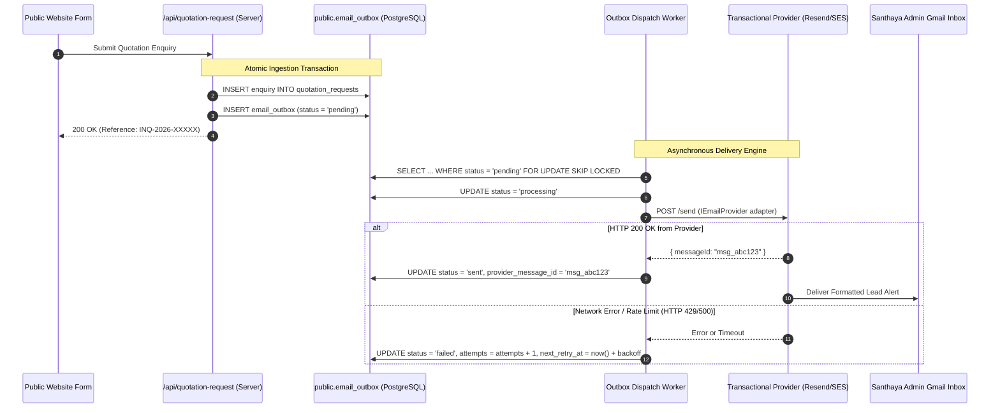
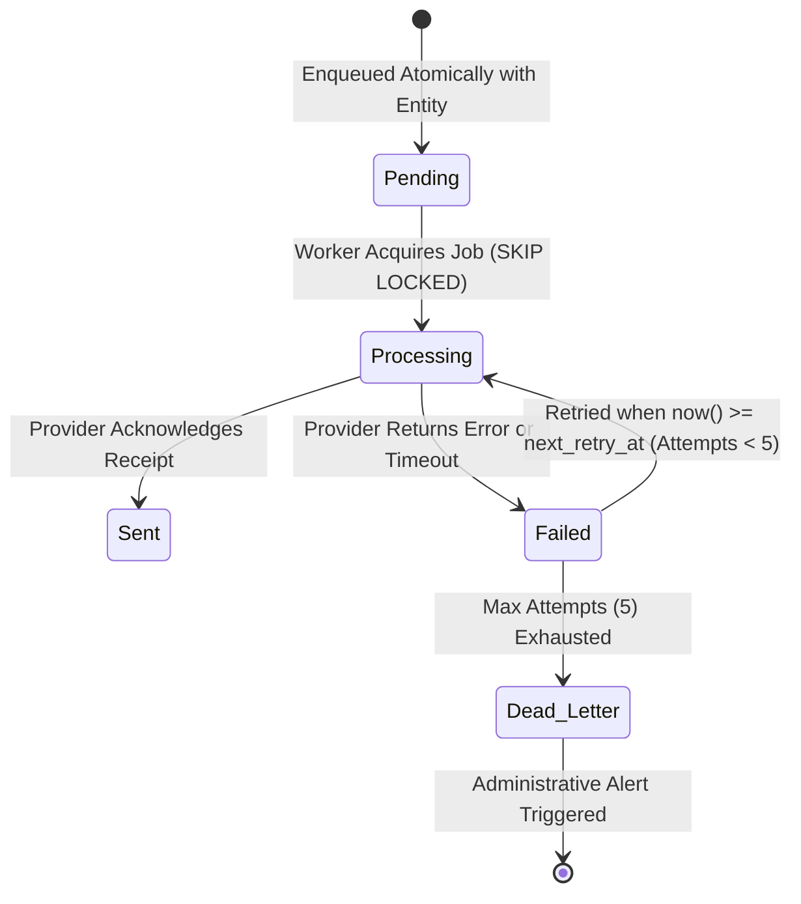

# Phase 2C: Transactional Email Subsystem & Outbox Architecture Plan
## Provider-Independent Delivery, Gmail Reception, Durable Outbox & Deliverability

**Project:** Santhaya Associates Pvt. Ltd. — Web Platform & Internal Operating System  
**Document:** `docs/PHASE-2C-EMAIL-PLAN.md`  
**Version:** 1.0 (Email Architecture Plan)  
**Date:** 2026-10-28  
**Status:** Architecture Proposal — Planning Only (Awaiting Human Review)  

---

## 1. Provider-Independent Architecture & Gmail Reception

### Strategic Objectives
1. **Decoupled Architecture**: The transactional email system is strictly provider-agnostic. The application business logic communicates exclusively with an abstract interface (`IEmailProvider`), allowing the underlying service (Resend, AWS SES, Postmark, or Brevo) to be swapped with zero changes to quotation, enquiry, or billing workflows.
2. **Gmail Corporate Reception**: Santhaya Associates uses a company Gmail / Google Workspace inbox (`inquiries@santhaya.local` / corporate Gmail) as the primary recipient for real-time enquiry alerts.
3. **No Direct SMTP in Client**: Browser code never connects directly to SMTP servers or possesses API credentials. All dispatches originate from server-side handlers via the durable database outbox.

---

## 2. Durable Email Outbox Pattern

To prevent dropped notifications during network timeouts or provider outages, all email dispatches follow the **Durable Transactional Outbox Pattern**.



### Outbox State Machine & Exponential Backoff



### Exponential Backoff Schedule

| Attempt | Delay After Failure | Target Elapsed Time | Action on Failure |
| :--- | :--- | :--- | :--- |
| **Attempt 1** | Immediate | 0 seconds | Transition to `failed`, set retry in 1 minute. |
| **Attempt 2** | +1 minute | 1 minute | Transition to `failed`, set retry in 5 minutes. |
| **Attempt 3** | +5 minutes | 6 minutes | Transition to `failed`, set retry in 15 minutes. |
| **Attempt 4** | +15 minutes | 21 minutes | Transition to `failed`, set retry in 1 hour. |
| **Attempt 5** | +1 hour | 1 hour 21 minutes | Final attempt. |
| **Exhausted** | N/A | Dead Letter | Mark `status = 'dead_letter'`; log error; dispatch administrative alert. |

---

## 3. Four Transactional Email Workflows

### 1. Inbound Enquiry Alert to Company Gmail
- **Trigger**: Customer submits enquiry at `/request-quotation`.
- **Recipient**: Company Gmail inbox (`inquiries@santhaya.local` / corporate Gmail).
- **Subject**: `[New Inquiry] INQ-2026-XXXXX — {Business Name} ({Service Category})`
- **Body Content**:
  - Reference number, submission timestamp.
  - Business name, contact person, verified phone number, official email.
  - GSTIN (if provided).
  - Scope: Service category, detailed project requirements, estimated quantities, technical specs, site delivery state.
  - Anti-Bot signal summary (`risk_flag: none | rapid_submission`).
  - Direct deep-link: `Open Enquiry in Staff Dashboard`.

### 2. Quotation PDF Delivery to Customer
- **Trigger**: Estimator clicks **"Email Quotation"** in Dashboard Quotation Management.
- **Recipient**: Customer's official procurement contact email.
- **Subject**: `Quotation QUO-2026-XXXXX — Santhaya Associates Pvt. Ltd.`
- **Body Content**:
  - Formal commercial salutation.
  - Executive summary of quoted items/services.
  - Quotation validity period (e.g. *Valid until 15-Nov-2026*).
  - Payment and delivery terms summary.
  - Secure signed download link (or direct PDF attachment).
  - Instructions for submitting formal acceptance / purchase order.

### 3. Invoice PDF Delivery to Customer
- **Trigger**: Billing Manager issues commercial/tax invoice and clicks **"Email Invoice"**.
- **Recipient**: Customer accounts payable / billing contact email.
- **Subject**: `Tax Invoice INV-2026-XXXXX — Santhaya Associates Pvt. Ltd.`
- **Body Content**:
  - Invoice reference number, issue date, payment due date.
  - Net taxable amount, applicable GST (CGST/SGST/IGST), total invoice value.
  - Bank NEFT/RTGS settlement coordinates (Account Name, Bank, Account Number, IFSC Code).
  - Secure signed PDF download link.

### 4. Delivery Failure Alert to Admin
- **Trigger**: Outbox worker exhausts maximum retries on an essential notification.
- **Recipient**: Company administrative email.
- **Subject**: `[URGENT] Email Delivery Failure — Outbox Job {ID}`
- **Body Content**: Recipient address, original email type, error message received from provider, and manual intervention steps.

---

## 4. Provider Abstraction Interface (`IEmailProvider`)

The email layer implements an adapter pattern. Switching from Resend to AWS SES or Postmark requires changing only the adapter class, not application services.

```typescript
// src/lib/email/types.ts

export interface EmailAttachment {
  filename: string;
  content: Buffer | string; // Base64 or Buffer
  contentType: string;
}

export interface EmailMessage {
  to: string | string[];
  from?: string; // Defaults to process.env.EMAIL_FROM_ADDRESS
  replyTo?: string;
  subject: string;
  html: string;
  text: string;
  attachments?: EmailAttachment[];
  tags?: Record<string, string>;
  idempotencyKey?: string;
}

export interface EmailDispatchResult {
  success: boolean;
  providerMessageId?: string;
  error?: {
    code: string;
    message: string;
    retryable: boolean;
  };
}

export interface IEmailProvider {
  name: string;
  sendEmail(message: EmailMessage): Promise<EmailDispatchResult>;
}
```

---

## 5. Email Templates & Styling Specifications

### Visual Standards
- Built using **React Email** or clean inline-CSS HTML templates.
- **Brand Palette Adherence**:
  - Header Banner: Deep Navy `#10243B` with embedded authentic `santhaya-logo-header.png`.
  - Accent Divider & Highlights: Industrial Gold `#F4B323`.
  - Background: Neutral slate `#F8FAFC`.
  - Typography: Clean sans-serif fallback (`system-ui, -apple-system, 'Segoe UI', Roboto, sans-serif`).
- **Plain Text Fallback**: Every template includes a dedicated plain-text version to guarantee accessibility across terminal mail clients and prevent spam classification.

---

## 6. DNS & Deliverability Requirements for Domain Setup

When the domain and transactional email provider are selected for production launch, the following DNS records must be configured in the domain registrar / DNS provider:

```
┌─────────┬───────────────────────────────┬────────────────────────────────────────────────────────┐
│ Record  │ Name / Host                   │ Target Value / Syntax                                  │
├─────────┼───────────────────────────────┼────────────────────────────────────────────────────────┤
│ TXT     │ @ (or mail domain)            │ v=spf1 include:{provider_spf_domain} ~all              │
│ CNAME   │ {provider_selector}._domainkey│ {provider_selector}.domainkey.{provider}.com           │
│ TXT     │ _dmarc                        │ v=DMARC1; p=quarantine; pct=100; rua=mailto:dmarc@... │
│ MX      │ mail.santhaya.in              │ feedback-smtp.{region}.amazonses.com (if AWS SES)      │
│ CNAME   │ email.santhaya.in             │ {provider_return_path_target}                          │
└─────────┴───────────────────────────────┴────────────────────────────────────────────────────────┘
```

### Best-Practice Deliverability Checklist
1. **DKIM (DomainKeys Identified Mail)**: 2048-bit RSA key signature generated by provider.
2. **SPF (Sender Policy Framework)**: Explicit authorization of sending IPs; avoids `+all` risks.
3. **DMARC**: Strict alignment between `From` header domain and envelope SPF/DKIM domains.
4. **Custom Return-Path**: Ensures bounce handling aligns with company subdomain (e.g. `bounces.santhaya.in`).
5. **No Gmail Impersonation**: Outgoing customer emails must use `@santhaya.in` (or approved domain). The system never sends *from* `@gmail.com` via third-party APIs (which causes immediate DMARC reject). Gmail is used solely as the *recipient* for administrative notifications.

---

## 7. Security & Secret Management

- **API Keys**: Stored exclusively in server-only environment variables:
  - `TRANSACTIONAL_EMAIL_API_KEY`: Private API credential.
  - `EMAIL_FROM_ADDRESS`: e.g. `Santhaya Associates <notifications@santhaya.in>`.
  - `INTERNAL_NOTIFICATION_EMAIL`: `inquiries@santhaya.local` / corporate Gmail.
- **Zero Client Exposure**: Email keys are never prefixed with `NEXT_PUBLIC_` and never referenced in React client components.
- **PII Scrubbing in Logs**: Application logs record outbox job IDs, recipient domain hashes, and provider message IDs, but **never log raw quotation amounts, customer names, or body content**.
