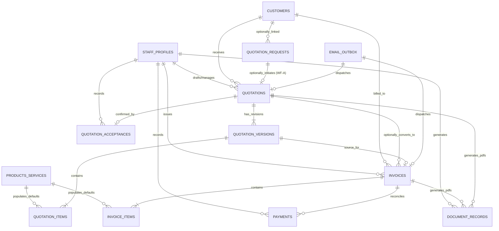
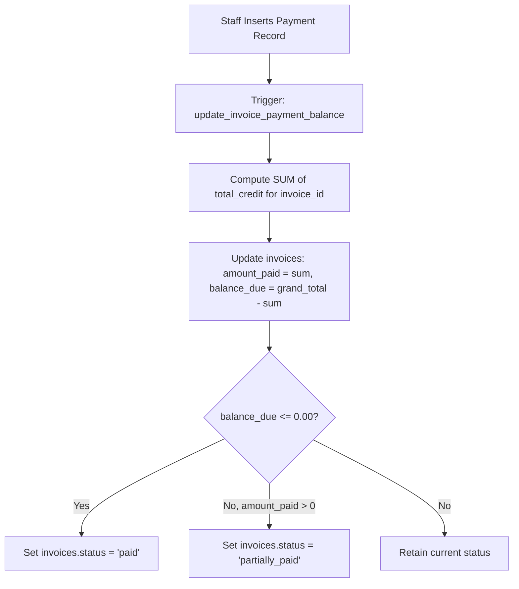

# Santhaya Associates — Phase 3 Database Architecture Specification
## Relational Schema, Financial Precision, Numbering Strategies, RLS & Migration Design

**Project:** Santhaya Associates Pvt. Ltd. — Web Platform & Internal Operating System  
**Document:** `docs/phase3/PHASE-3-DATABASE-DESIGN.md`  
**Version:** 1.0 (Database Design Specification)  
**Date:** 2026-10-28  
**Status:** Architecture Proposal — Planning Only (Awaiting Human Review)  

---

## 1. Existing Phase 2 Database Baseline

The current active database in development sandbox `bkqneudnnhvvwmtggorz` contains 6 verified tables:
1. `public.staff_profiles`: Linked 1:1 with `auth.users(id)`.
2. `public.customers`: Master client profiles with optional `email` and `phone`.
3. `public.quotation_requests`: Inbound public inquiry snapshots with idempotency keys.
4. `public.rate_limits`: Distributed token bucket rate limiter.
5. `public.audit_logs`: Append-only tamper-resistant log table.
6. `public.email_outbox`: Durable outbox queue for transactional alerts.

Phase 3 introduces **9 purely additive tables** (bringing the complete platform schema to 15 tables). Existing tables will remain intact, with zero destructive modifications or column drops.

---

## 2. Complete Phase 3 Entity-Relationship Diagram (ERD)



---

## 3. Decoupled Foreign Key Matrix

To support the four distinct commercial workflows (Workflows A, B, C, and D), foreign key constraints must adhere strictly to these nullability rules:

| Entity Relationship | Foreign Key Column | Nullable? | Rationale | Supported Workflows |
| :--- | :--- | :--- | :--- | :--- |
| `quotations` → `customers` | `customer_id` | **NO** (`NOT NULL`) | Every commercial quotation must have an identified legal client entity. | Workflows A & B |
| `quotations` → `quotation_requests` | `enquiry_id` | **YES** (`NULLABLE`) | Direct quotations initiated via phone, WhatsApp, tender notices, or walk-ins do not originate from a website inquiry. | **Workflow B** (Direct Quotation) |
| `invoices` → `customers` | `customer_id` | **NO** (`NOT NULL`) | An invoice is a statutory tax document and must be issued to a legal client entity. | Workflows A, B, C & D |
| `invoices` → `quotations` | `quotation_id` | **YES** (`NULLABLE`) | Direct machinery sales, spot material deliveries, and standard service billings do not require preceding quotations. | **Workflows C & D** (Direct Sale & Service) |
| `invoices` → `quotation_versions` | `quotation_version_id` | **YES** (`NULLABLE`) | Populated only when an invoice is directly converted from an accepted quote revision. | Workflows A & B (Converted Quotes) |
| `quotation_items` → `products_services` | `product_service_id` | **YES** (`NULLABLE`) | Staff can add ad-hoc or custom line items without polluting the master catalog. | Catalog Option A (Custom Items) |
| `invoice_items` → `products_services` | `product_service_id` | **YES** (`NULLABLE`) | Spot billing or emergency repairs can be invoiced as custom items directly. | Catalog Option A (Custom Items) |

---

## 4. Financial Precision, Data Types & Currency Standards

All financial amounts, quantities, and rates must adhere to strict decimal precision rules to prevent IEEE 754 floating-point inaccuracies:

| Domain | PostgreSQL Data Type | Precision / Scale | Formatting Rule |
| :--- | :--- | :--- | :--- |
| **Line Item Unit Price / Rate** | `NUMERIC(15, 2)` | Up to ₹999,999,999,999.99 | Exactly 2 decimal places |
| **Billed Quantity** | `NUMERIC(12, 4)` | Supports partial units (e.g. `24.5000` MT, `8.2500` Hours) | Up to 4 decimal places |
| **Tax Rates (CGST, SGST, IGST)** | `NUMERIC(5, 2)` | Percentage format (e.g. `9.00` = 9%, `18.00` = 18%) | Exactly 2 decimal places |
| **Tax Amounts** | `NUMERIC(15, 2)` | Computed tax in INR | Banker's Rounding (Round half to even) to 2 decimals |
| **Subtotals, Discounts, Totals** | `NUMERIC(15, 2)` | Monetary totals | Exactly 2 decimal places |
| **Paid Amounts & Balances** | `NUMERIC(15, 2)` | Cumulative ledger balances | Exactly 2 decimal places |

---

## 5. Numbering Strategies & Statutory GST Sequence Rules

### 5.1 Quotation Numbering (`QTN-YYYY-XXXXX`)
- **Format**: `QTN-2026-00001`, `QTN-2026-00002`
- **Revisions**: Formatted as `QTN-2026-00001-R0` (Original draft), `QTN-2026-00001-R1` (Revision 1), `QTN-2026-00001-R2` (Revision 2).
- **Mechanism**: PostgreSQL sequence `public.quotation_number_seq`. Because quotations are non-statutory commercial proposals, minor sequence gaps due to aborted drafts are legally acceptable.

### 5.2 Statutory GST Tax Invoice Numbering (`INV/YYYY-YY/XXXX`)
- **Statutory Constraint (Rule 46(b) of CGST Rules 2017)**:
  - Must be a consecutive serial number not exceeding 16 characters in one or multiple series.
  - Must be unique for the financial year.
  - **Must be gapless**: Missing numbers in tax invoices raise regulatory queries during GSTR-1 audits (Table 13).
- **Architectural Solution for Gapless Invoicing**:
  - PostgreSQL sequences (`nextval`) consume numbers immediately upon call. If an invoice draft is discarded or its transaction rolls back, sequence gaps occur.
  - **Rule**: Invoice numbers are **never assigned to drafts**.
  - Draft invoices receive a temporary internal identifier (e.g. `DRAFT-INV-<uuid>`).
  - The formal statutory number (`SA/26-27/0001`) is assigned **strictly at the exact moment of issuance** (`status` transitions from `'draft'` to `'issued'`) inside an exclusive row-level lock on the financial year sequence counter table (`invoice_sequence_counters`).

---

## 6. Phase 3 Proposed Schema DDL (Additive)

### 6.1 Product & Master Catalog (`public.products_services`)
```sql
CREATE TYPE public.item_classification_enum AS ENUM (
  'construction_machinery',
  'manufacturing_machinery',
  'rental_equipment',
  'construction_material',
  'tender_service',
  'transport_logistics',
  'maintenance_labor'
);

CREATE TYPE public.unit_of_measurement_enum AS ENUM (
  'unit',
  'hour',
  'day',
  'month',
  'metric_ton',
  'kilogram',
  'cubic_meter',
  'sq_meter',
  'running_meter',
  'km',
  'lumpsum',
  'lot'
);

CREATE TABLE IF NOT EXISTS public.products_services (
  id UUID PRIMARY KEY DEFAULT gen_random_uuid(),
  sku_code VARCHAR(50) UNIQUE,
  item_name VARCHAR(255) NOT NULL,
  classification public.item_classification_enum NOT NULL,
  description TEXT,
  hsn_sac_code VARCHAR(10),
  default_unit public.unit_of_measurement_enum NOT NULL DEFAULT 'unit',
  default_unit_rate NUMERIC(15, 2) NOT NULL DEFAULT 0.00,
  default_gst_rate NUMERIC(5, 2) NOT NULL DEFAULT 18.00,
  is_active BOOLEAN NOT NULL DEFAULT true,
  metadata JSONB DEFAULT '{}'::jsonb,
  created_at TIMESTAMPTZ NOT NULL DEFAULT timezone('utc'::text, now()),
  updated_at TIMESTAMPTZ NOT NULL DEFAULT timezone('utc'::text, now()),
  CONSTRAINT chk_unit_rate_non_negative CHECK (default_unit_rate >= 0),
  CONSTRAINT chk_gst_rate_valid CHECK (default_gst_rate IN (0.00, 5.00, 12.00, 18.00, 28.00))
);

CREATE INDEX IF NOT EXISTS idx_products_classification ON public.products_services(classification, is_active);
CREATE INDEX IF NOT EXISTS idx_products_name ON public.products_services(lower(item_name));
```

### 6.2 Quotations & Revisions (`public.quotations`, `public.quotation_versions`, `public.quotation_items`)
```sql
CREATE TYPE public.quotation_status_enum AS ENUM (
  'draft',
  'issued',
  'accepted',
  'rejected',
  'superseded',
  'expired',
  'converted_to_invoice'
);

CREATE SEQUENCE IF NOT EXISTS public.quotation_number_seq START WITH 1 INCREMENT BY 1;

CREATE TABLE IF NOT EXISTS public.quotations (
  id UUID PRIMARY KEY DEFAULT gen_random_uuid(),
  quotation_number VARCHAR(50) NOT NULL UNIQUE,
  customer_id UUID NOT NULL REFERENCES public.customers(id) ON DELETE RESTRICT,
  enquiry_id UUID REFERENCES public.quotation_requests(id) ON DELETE SET NULL, -- Strictly NULLABLE (Workflow B)
  status public.quotation_status_enum NOT NULL DEFAULT 'draft',
  created_by_staff_id UUID NOT NULL REFERENCES public.staff_profiles(id) ON DELETE RESTRICT,
  current_version_number INT NOT NULL DEFAULT 0,
  created_at TIMESTAMPTZ NOT NULL DEFAULT timezone('utc'::text, now()),
  updated_at TIMESTAMPTZ NOT NULL DEFAULT timezone('utc'::text, now())
);

CREATE TABLE IF NOT EXISTS public.quotation_versions (
  id UUID PRIMARY KEY DEFAULT gen_random_uuid(),
  quotation_id UUID NOT NULL REFERENCES public.quotations(id) ON DELETE CASCADE,
  version_number INT NOT NULL,
  version_code VARCHAR(60) NOT NULL, -- e.g. QTN-2026-00042-R0
  validity_days INT NOT NULL DEFAULT 30,
  expires_at DATE NOT NULL,
  delivery_location TEXT NOT NULL,
  payment_terms TEXT NOT NULL DEFAULT '100% advance against Proforma Invoice or 30 days credit on approved LC',
  terms_conditions TEXT,
  subtotal_amount NUMERIC(15, 2) NOT NULL DEFAULT 0.00,
  discount_amount NUMERIC(15, 2) NOT NULL DEFAULT 0.00,
  total_tax_amount NUMERIC(15, 2) NOT NULL DEFAULT 0.00,
  grand_total_amount NUMERIC(15, 2) NOT NULL DEFAULT 0.00,
  is_locked BOOLEAN NOT NULL DEFAULT false, -- Locked once issued or accepted
  issued_at TIMESTAMPTZ,
  created_by_staff_id UUID NOT NULL REFERENCES public.staff_profiles(id) ON DELETE RESTRICT,
  created_at TIMESTAMPTZ NOT NULL DEFAULT timezone('utc'::text, now()),
  CONSTRAINT uq_quotation_version UNIQUE (quotation_id, version_number)
);

CREATE TABLE IF NOT EXISTS public.quotation_items (
  id UUID PRIMARY KEY DEFAULT gen_random_uuid(),
  quotation_version_id UUID NOT NULL REFERENCES public.quotation_versions(id) ON DELETE CASCADE,
  product_service_id UUID REFERENCES public.products_services(id) ON DELETE SET NULL, -- Strictly NULLABLE (Custom item support)
  sort_order INT NOT NULL DEFAULT 0,
  item_name VARCHAR(255) NOT NULL,
  description TEXT,
  hsn_sac_code VARCHAR(10),
  unit public.unit_of_measurement_enum NOT NULL DEFAULT 'unit',
  quantity NUMERIC(12, 4) NOT NULL DEFAULT 1.0000,
  unit_rate NUMERIC(15, 2) NOT NULL DEFAULT 0.00,
  discount_amount NUMERIC(15, 2) NOT NULL DEFAULT 0.00,
  taxable_amount NUMERIC(15, 2) NOT NULL DEFAULT 0.00,
  gst_rate NUMERIC(5, 2) NOT NULL DEFAULT 18.00,
  tax_amount NUMERIC(15, 2) NOT NULL DEFAULT 0.00,
  line_total NUMERIC(15, 2) NOT NULL DEFAULT 0.00,
  created_at TIMESTAMPTZ NOT NULL DEFAULT timezone('utc'::text, now()),
  CONSTRAINT chk_quote_item_quantity CHECK (quantity > 0),
  CONSTRAINT chk_quote_item_rate CHECK (unit_rate >= 0)
);

CREATE TABLE IF NOT EXISTS public.quotation_acceptances (
  id UUID PRIMARY KEY DEFAULT gen_random_uuid(),
  quotation_id UUID NOT NULL REFERENCES public.quotations(id) ON DELETE RESTRICT,
  quotation_version_id UUID NOT NULL REFERENCES public.quotation_versions(id) ON DELETE RESTRICT,
  accepted_at TIMESTAMPTZ NOT NULL DEFAULT timezone('utc'::text, now()),
  accepted_by_contact_name VARCHAR(100) NOT NULL,
  acceptance_channel VARCHAR(50) NOT NULL, -- 'whatsapp', 'email', 'phone', 'signed_po', 'in_person'
  client_po_reference VARCHAR(100),
  client_po_document_id UUID,
  recorded_by_staff_id UUID NOT NULL REFERENCES public.staff_profiles(id) ON DELETE RESTRICT,
  staff_notes TEXT,
  created_at TIMESTAMPTZ NOT NULL DEFAULT timezone('utc'::text, now())
);
```

### 6.3 Invoicing & Payments (`public.invoices`, `public.invoice_items`, `public.payments`)
```sql
CREATE TYPE public.invoice_type_enum AS ENUM (
  'gst_tax_invoice',
  'commercial_bill',
  'proforma_invoice',
  'credit_note'
);

CREATE TYPE public.invoice_status_enum AS ENUM (
  'draft',
  'issued',
  'partially_paid',
  'paid',
  'cancelled',
  'overdue'
);

CREATE TYPE public.payment_mode_enum AS ENUM (
  'neft_rtgs',
  'bank_transfer',
  'cheque',
  'upi',
  'cash'
);

CREATE TABLE IF NOT EXISTS public.invoices (
  id UUID PRIMARY KEY DEFAULT gen_random_uuid(),
  invoice_number VARCHAR(50) UNIQUE, -- NULL while draft; assigned at issuance
  invoice_type public.invoice_type_enum NOT NULL DEFAULT 'gst_tax_invoice',
  status public.invoice_status_enum NOT NULL DEFAULT 'draft',
  customer_id UUID NOT NULL REFERENCES public.customers(id) ON DELETE RESTRICT,
  quotation_id UUID REFERENCES public.quotations(id) ON DELETE SET NULL, -- Strictly NULLABLE (Workflow C & D)
  quotation_version_id UUID REFERENCES public.quotation_versions(id) ON DELETE SET NULL,
  issue_date DATE,
  due_date DATE,
  financial_year VARCHAR(10) NOT NULL, -- e.g. '2026-27'
  place_of_supply_state VARCHAR(100) NOT NULL,
  is_interstate BOOLEAN NOT NULL DEFAULT false,
  billing_address TEXT NOT NULL,
  customer_gstin VARCHAR(15),
  subtotal_taxable NUMERIC(15, 2) NOT NULL DEFAULT 0.00,
  cgst_amount NUMERIC(15, 2) NOT NULL DEFAULT 0.00,
  sgst_amount NUMERIC(15, 2) NOT NULL DEFAULT 0.00,
  igst_amount NUMERIC(15, 2) NOT NULL DEFAULT 0.00,
  total_tax_amount NUMERIC(15, 2) NOT NULL DEFAULT 0.00,
  total_discount_amount NUMERIC(15, 2) NOT NULL DEFAULT 0.00,
  grand_total NUMERIC(15, 2) NOT NULL DEFAULT 0.00,
  amount_paid NUMERIC(15, 2) NOT NULL DEFAULT 0.00,
  balance_due NUMERIC(15, 2) NOT NULL DEFAULT 0.00,
  terms_conditions TEXT,
  created_by_staff_id UUID NOT NULL REFERENCES public.staff_profiles(id) ON DELETE RESTRICT,
  created_at TIMESTAMPTZ NOT NULL DEFAULT timezone('utc'::text, now()),
  updated_at TIMESTAMPTZ NOT NULL DEFAULT timezone('utc'::text, now())
);

CREATE TABLE IF NOT EXISTS public.invoice_items (
  id UUID PRIMARY KEY DEFAULT gen_random_uuid(),
  invoice_id UUID NOT NULL REFERENCES public.invoices(id) ON DELETE CASCADE,
  product_service_id UUID REFERENCES public.products_services(id) ON DELETE SET NULL, -- Strictly NULLABLE
  sort_order INT NOT NULL DEFAULT 0,
  item_name VARCHAR(255) NOT NULL,
  description TEXT,
  hsn_sac_code VARCHAR(10),
  unit public.unit_of_measurement_enum NOT NULL DEFAULT 'unit',
  quantity NUMERIC(12, 4) NOT NULL DEFAULT 1.0000,
  unit_rate NUMERIC(15, 2) NOT NULL DEFAULT 0.00,
  discount_amount NUMERIC(15, 2) NOT NULL DEFAULT 0.00,
  taxable_value NUMERIC(15, 2) NOT NULL DEFAULT 0.00,
  gst_rate NUMERIC(5, 2) NOT NULL DEFAULT 18.00,
  cgst_amount NUMERIC(15, 2) NOT NULL DEFAULT 0.00,
  sgst_amount NUMERIC(15, 2) NOT NULL DEFAULT 0.00,
  igst_amount NUMERIC(15, 2) NOT NULL DEFAULT 0.00,
  line_total NUMERIC(15, 2) NOT NULL DEFAULT 0.00,
  created_at TIMESTAMPTZ NOT NULL DEFAULT timezone('utc'::text, now())
);

CREATE TABLE IF NOT EXISTS public.payments (
  id UUID PRIMARY KEY DEFAULT gen_random_uuid(),
  invoice_id UUID NOT NULL REFERENCES public.invoices(id) ON DELETE RESTRICT,
  payment_reference VARCHAR(100), -- UTR or Cheque number
  payment_date DATE NOT NULL DEFAULT CURRENT_DATE,
  payment_mode public.payment_mode_enum NOT NULL DEFAULT 'neft_rtgs',
  amount_received NUMERIC(15, 2) NOT NULL,
  tds_deducted NUMERIC(15, 2) NOT NULL DEFAULT 0.00,
  total_credit NUMERIC(15, 2) NOT NULL, -- amount_received + tds_deducted
  bank_name VARCHAR(100),
  notes TEXT,
  recorded_by_staff_id UUID NOT NULL REFERENCES public.staff_profiles(id) ON DELETE RESTRICT,
  created_at TIMESTAMPTZ NOT NULL DEFAULT timezone('utc'::text, now()),
  CONSTRAINT chk_payment_amount_pos CHECK (amount_received > 0),
  CONSTRAINT chk_payment_tds_non_neg CHECK (tds_deducted >= 0)
);

CREATE TABLE IF NOT EXISTS public.document_records (
  id UUID PRIMARY KEY DEFAULT gen_random_uuid(),
  document_type VARCHAR(50) NOT NULL, -- 'quotation_pdf', 'invoice_pdf', 'receipt_pdf'
  related_entity_type VARCHAR(50) NOT NULL, -- 'quotation', 'invoice', 'payment'
  related_entity_id UUID NOT NULL,
  storage_bucket VARCHAR(100) NOT NULL DEFAULT 'private-documents',
  storage_path TEXT NOT NULL,
  file_name VARCHAR(255) NOT NULL,
  file_size_bytes BIGINT NOT NULL,
  sha256_checksum VARCHAR(64) NOT NULL,
  generated_by_staff_id UUID NOT NULL REFERENCES public.staff_profiles(id) ON DELETE RESTRICT,
  created_at TIMESTAMPTZ NOT NULL DEFAULT timezone('utc'::text, now())
);
```

---

## 7. PostgreSQL Immutability Triggers & Balance Reconciliation



### 7.1 Invoice Payment Balance Reconciler
```sql
CREATE OR REPLACE FUNCTION public.sync_invoice_payment_totals()
RETURNS TRIGGER
LANGUAGE plpgsql
SECURITY DEFINER
SET search_path = public, pg_temp
AS $$
DECLARE
  v_invoice_id UUID;
  v_grand_total NUMERIC(15, 2);
  v_total_paid NUMERIC(15, 2);
  v_new_balance NUMERIC(15, 2);
  v_new_status public.invoice_status_enum;
BEGIN
  IF TG_OP = 'DELETE' THEN
    v_invoice_id := OLD.invoice_id;
  ELSE
    v_invoice_id := NEW.invoice_id;
  END IF;

  SELECT grand_total INTO v_grand_total FROM public.invoices WHERE id = v_invoice_id;
  SELECT COALESCE(SUM(total_credit), 0.00) INTO v_total_paid FROM public.payments WHERE invoice_id = v_invoice_id;

  v_new_balance := v_grand_total - v_total_paid;

  IF v_new_balance <= 0.00 THEN
    v_new_status := 'paid'::public.invoice_status_enum;
  ELSIF v_total_paid > 0.00 THEN
    v_new_status := 'partially_paid'::public.invoice_status_enum;
  ELSE
    v_new_status := 'issued'::public.invoice_status_enum;
  END IF;

  UPDATE public.invoices
  SET amount_paid = v_total_paid,
      balance_due = v_new_balance,
      status = CASE WHEN status = 'draft' THEN 'draft'::public.invoice_status_enum ELSE v_new_status END,
      updated_at = timezone('utc'::text, now())
  WHERE id = v_invoice_id;

  RETURN NULL;
END;
$$;

DROP TRIGGER IF EXISTS trg_sync_invoice_payments ON public.payments;
CREATE TRIGGER trg_sync_invoice_payments
  AFTER INSERT OR UPDATE OR DELETE ON public.payments
  FOR EACH ROW
  EXECUTE FUNCTION public.sync_invoice_payment_totals();
```

### 7.2 Issued Invoice Immutability Guard
```sql
CREATE OR REPLACE FUNCTION public.prevent_issued_invoice_mutation()
RETURNS TRIGGER
LANGUAGE plpgsql
SECURITY DEFINER
SET search_path = public, pg_temp
AS $$
BEGIN
  IF OLD.status IN ('issued', 'partially_paid', 'paid', 'cancelled') THEN
    -- Allow updating financial balance columns modified by the payment reconciler trigger
    IF (NEW.amount_paid <> OLD.amount_paid OR NEW.balance_due <> OLD.balance_due OR NEW.status <> OLD.status)
       AND (NEW.subtotal_taxable = OLD.subtotal_taxable AND NEW.grand_total = OLD.grand_total AND NEW.invoice_number = OLD.invoice_number) THEN
      RETURN NEW;
    END IF;

    RAISE EXCEPTION 'ILLEGAL_MUTATION: Issued tax invoices are legally immutable. Amendments must be executed via formal Credit Notes or cancellations.';
  END IF;
  RETURN NEW;
END;
$$;

DROP TRIGGER IF EXISTS trg_protect_issued_invoices ON public.invoices;
CREATE TRIGGER trg_protect_issued_invoices
  BEFORE UPDATE ON public.invoices
  FOR EACH ROW
  EXECUTE FUNCTION public.prevent_issued_invoice_mutation();
```

---

## 8. Migration Safety & Sequencing Plan

1. **Purely Additive DDL**: No existing columns or tables are deleted or altered destructively.
2. **Transaction Scoping**: DDL statements will be packaged in sequential migration files.
3. **Execution Gate**: Migrations will **not** be executed during Phase 3 planning; execution will occur only when individual implementation stages are authorized by the user.

