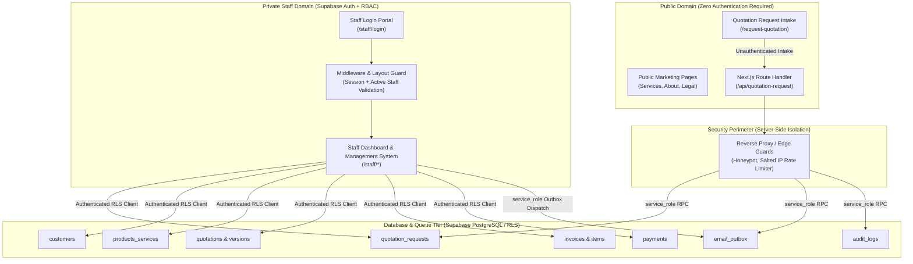
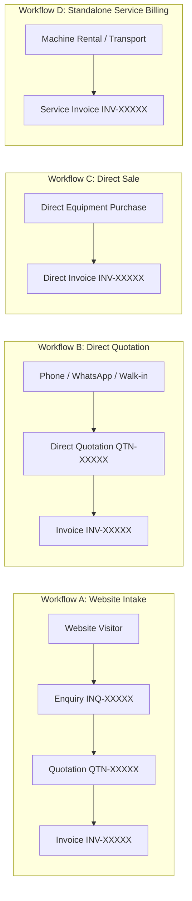
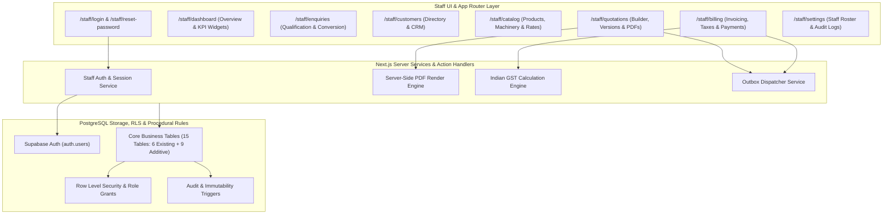

# Santhaya Associates — Phase 3 Master Architecture Specification
## Private Staff Management, Quotation Lifecycle, Commercial Billing & ERP System

**Project:** Santhaya Associates Pvt. Ltd. — Web Platform & Internal Operating System  
**Document:** `docs/phase3/PHASE-3-MASTER-ARCHITECTURE.md`  
**Version:** 1.0 (Phase 3 Master Architecture)  
**Date:** 2026-10-28  
**Status:** Architecture Proposal — Planning Only (Awaiting Human Review)  
**Security & Architecture Reviewers:** Senior Full-Stack Architect, PostgreSQL Security Engineer, Next.js Systems Designer  

---

## 1. Executive Summary & System Context

Santhaya Associates is an industrial enterprise operating across three core commercial pillars:
1. **Government and Private Construction Tender Services**: Bidding, compliance documentation, joint-venture estimation, and project subcontracting.
2. **Construction Machinery Supply & Rentals**: Hydraulic excavators, crawler cranes, piling rigs, road rollers, transit mixers, batching plants, and heavy earthmoving fleet leasing.
3. **Manufacturing Machinery Supply**: Industrial plant tooling, fabrication machinery, CNC systems, and structural steel processing equipment.

### 1.1 Scope of Phase 3
Phase 1 established the public corporate identity and scope-locked service presentation. Phase 2 established unauthenticated public quotation intake, atomic database persistence, and transactional email alerting via Resend.

**Phase 3 designs the private internal management system**: a staff-only web application enabling authenticated employees to qualify website enquiries, manage customer master records, draft and issue multi-version quotations, generate statutory Indian GST invoices, record offline payments, generate branded PDFs, and orchestrate transactional document delivery.

---

## 2. Architectural Baseline & Existing Verified Reality

### 2.1 Verified Implemented Architecture (Phases 1 & 2)
The platform is built on Next.js 14 (App Router, Node.js 24 runtime, TypeScript strict mode, Tailwind CSS). The development database is hosted on Supabase (project reference: `bkqneudnnhvvwmtggorz`).

The following database components are verified and active in development:
- **`public.staff_profiles`**: Linked to `auth.users(id)` with `role` and `is_active` flags.
- **`public.customers`**: Master corporate customer table with flexible, nullable contact fields (`email` and `phone` nullable, allowing walk-in/offline clients).
- **`public.quotation_requests`**: Inbound public enquiries with UUIDv4 idempotency and SHA-256 payload integrity hashing.
- **`public.rate_limits`**: Atomic token-bucket rate limiter via `check_rate_limit()` RPC.
- **`public.audit_logs`**: Append-only log with BEFORE UPDATE/DELETE/TRUNCATE trigger safeguards.
- **`public.email_outbox`**: Durable outbox table supporting exponential retry schedules (+1m, +5m, +15m, +1h), `FOR UPDATE SKIP LOCKED` batch claiming, and Resend delivery.

### 2.2 CLI Migration Tracking Note
Initial migrations (`20261026120000` and `20261028120000`) were applied directly via the Supabase Dashboard SQL Editor. CLI migration metadata reconciliation (`supabase migration repair --status applied`) is planned for a dedicated pipeline step; Phase 3 plans purely additive migrations without modifying or repairing existing migration records.

---

## 3. Non-Negotiable Core Architectural Principles

### 3.1 Non-Negotiable Public Website Rule
1. **Unauthenticated Public Browsing**: Public visitors and prospective clients must **never** be presented with login, registration, or account creation prompts to access the site, view services, or submit inquiries.
2. **Zero Public Auth UI**: No `Login`, `Sign In`, `Sign Up`, `Register`, `Staff Portal`, or `Account` links may appear in the public header, mobile menu, footer, or quotation intake forms.
3. **Zero Security Through Obscurity**: Staff routes (`/staff/*`) are excluded from `sitemap.xml` and carry `X-Robots-Tag: noindex, nofollow`, but security is enforced strictly through cryptographic session cookies, Next.js server middleware, server layout guards, and PostgreSQL Row Level Security (RLS).
4. **No Public Staff Registration**: Supabase Auth self-registration (`auth.signUp`) is permanently disabled. Staff accounts are provisioned exclusively by authorized administrators via secure invitation.

### 3.2 Four Decoupled Business Workflows
The system models real-world civil contracting and machinery trading through four independent workflows:

- **Workflow A (Enquiry → Quotation → Invoice)**: Prospect submits `/request-quotation` → staff qualifies lead → drafts quotation → customer accepts → converts to invoice.
- **Workflow B (Direct Quotation without Enquiry)**: Customer contacts via phone or tender notice → staff creates quotation directly (`enquiry_id IS NULL`) → customer accepts → converts to invoice.
- **Workflow C (Direct Sale without Quotation)**: Buyer purchases equipment or materials directly → staff issues invoice directly (`quotation_id IS NULL`). The database **never** generates fake quotations to satisfy foreign keys.
- **Workflow D (Standalone Service Billing)**: Periodic billing for machinery rental hours, transport runs, or subcontracting milestones (`quotation_id IS NULL`).

---

## 4. Subsystem Decomposition & High-Level Responsibilities

### 4.1 High-Level Subsystem Breakdown
1. **Authentication & Identity Subsystem**: Next.js Server Components, Server Actions, Supabase Auth SSR cookies (`@supabase/ssr`), and `public.staff_profiles` validation.
2. **Staff Dashboard & Analytics**: Read-only materialized KPI rollups and real-time operational counts (unassigned leads, expiring quotations, overdue invoices).
3. **Customer Relationship Subsystem**: Master client records supporting government tender authorities, private corporations, and individual subcontractors.
4. **Website Enquiry Qualification**: Pipeline for assigning estimators, recording internal qualification notes, and converting leads to formal quotes.
5. **Product & Master Catalog Subsystem (Option A)**: Master catalog for machinery models, rental rates, and materials, with support for custom/ad-hoc line items on quotes and invoices.
6. **Quotation Lifecycle Subsystem**: Multi-version quotation builder, revision history, customer terms, PDF generation, and manual staff acceptance recording.
7. **Billing, GST Invoicing & Payment Subsystem**: GST and commercial invoice generation, tax computation (CGST, SGST, IGST), payment recording, and balance reconciliation triggers.
8. **Document Generation & Storage Subsystem**: Server-rendered branded PDFs stored in private Supabase Storage buckets with short-lived signed URLs.
9. **Transactional Communication Subsystem**: Extension of the durable `email_outbox` queue to deliver quotation and invoice PDFs via Resend.

---

## 5. Technology Stack & Integration Standards

| Layer | Technology | Version / Specification | Architectural Purpose |
| :--- | :--- | :--- | :--- |
| **Framework** | Next.js (App Router) | `14.2.x` (React 18) | Hybrid Server Components, Server Actions, Route Handlers |
| **Language** | TypeScript | `5.6.x` (Strict Mode) | End-to-end type safety, auto-generated database schema types |
| **Styling & UI** | Tailwind CSS + Lucide | `3.4.x` / `0.454.x` | Responsive corporate theme (Navy `#10243B`, Gold `#F4B323`) |
| **Database & Auth** | Supabase PostgreSQL | PostgreSQL 15 | Row Level Security, Auth, Functions, Triggers |
| **DB Client** | `@supabase/ssr` / `supabase-js` | `0.12.x` / `2.118.x` | Cookie-based SSR sessions + isolated service-role admin client |
| **Validation** | Zod | `3.23.x` | Dual-boundary input validation (Server Actions & Route Handlers) |
| **PDF Engine** | `@react-pdf/renderer` or Puppeteer Core | Headless server engine | Pixel-perfect branded PDF generation |
| **Email Service** | Resend REST API | Provider Adapter v1 | Transactional dispatch of inquiry alerts and client documents |
| **Object Storage**| Supabase Storage | Private Buckets | Storage of generated PDFs with signed, expiring download URLs |

---

## 6. Document Roadmap for Phase 3 Architecture

This master document is supported by six specialized architecture specifications located in `docs/phase3/`:

1. **`PHASE-3-DATABASE-DESIGN.md`**: Complete relational schema, foreign keys, numeric precision standards, sequences, triggers, and SQL migration scripts.
2. **`PHASE-3-SECURITY-AND-RBAC.md`**: Threat modeling, Supabase Auth session mechanics, role permission matrix, RLS policy specifications, and credential isolation.
3. **`PHASE-3-STAFF-WORKFLOWS.md`**: Step-by-step business workflows for lead qualification, quotation versioning, manual acceptance, invoicing, and payment recording.
4. **`PHASE-3-UI-ROUTES.md`**: Detailed routing architecture, page layouts, sidebar navigation, component hierarchies, form states, and responsive viewports.
5. **`PHASE-3-IMPLEMENTATION-ROADMAP.md`**: Sequential staged implementation plan (Stages 3A through 3E) with test gates, acceptance criteria, and rollback strategies.
6. **`PHASE-3-RISKS-AND-OPEN-DECISIONS.md`**: Statutory Indian GST compliance questions, dependency vulnerability remediation plans, and operational decisions requiring management sign-off.

