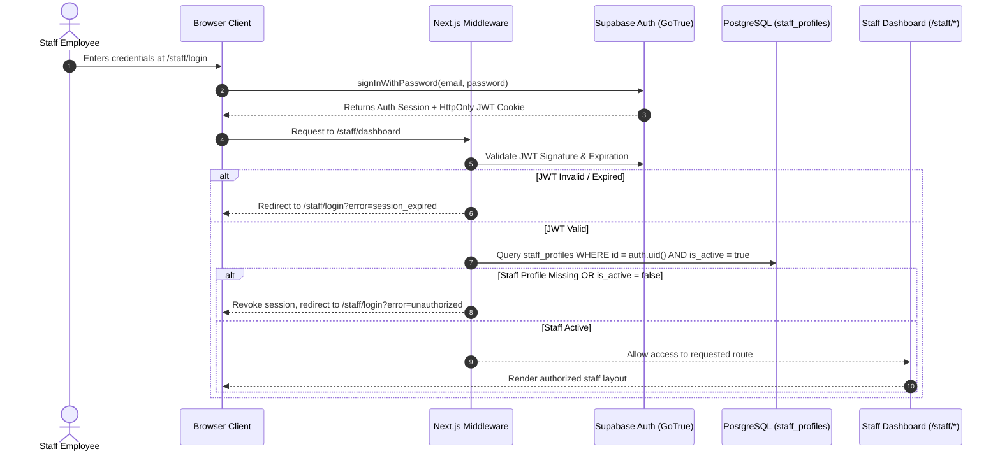
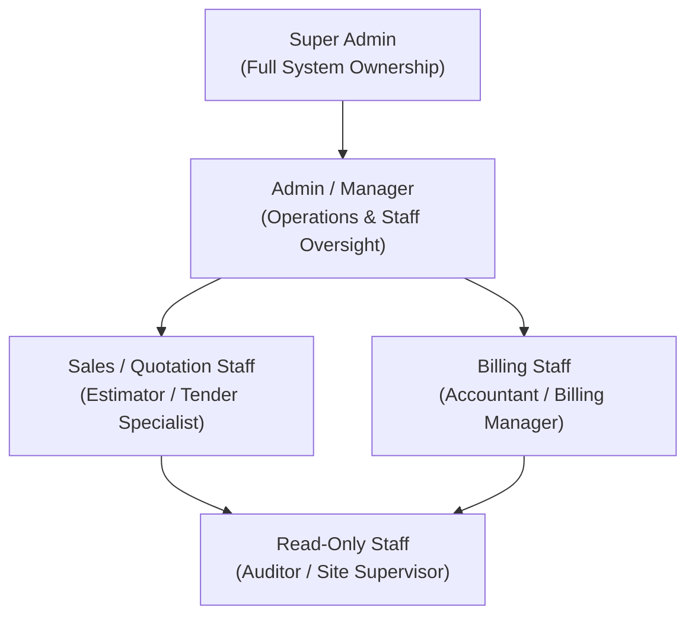
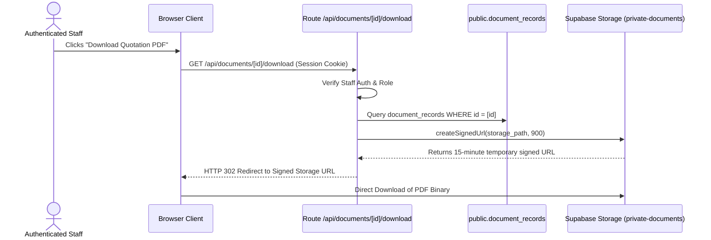

# Santhaya Associates — Phase 3 Security & Access Control Specification
## Authentication, Role-Based Access Control (RBAC), Row Level Security (RLS) & Perimeter Defense

**Project:** Santhaya Associates Pvt. Ltd. — Web Platform & Internal Operating System  
**Document:** `docs/phase3/PHASE-3-SECURITY-AND-RBAC.md`  
**Version:** 1.0 (Security & RBAC Architecture)  
**Date:** 2026-10-28  
**Status:** Architecture Proposal — Planning Only (Awaiting Human Review)  
**Security Reviewers:** PostgreSQL Security Engineer, Application Security Architect  

---

## 1. Security Architecture Foundations

The staff management system adheres to a **defense-in-depth security model**: security controls are layered across network, framework middleware, server actions, database RLS, and append-only audit logging.

```
┌────────────────────────────────────────────────────────────────────────┐
│                        DEFENSE-IN-DEPTH LAYERS                         │
├───────────────────┬────────────────────────────────────────────────────┤
│ 1. Network / Edge │ Next.js Middleware cookie validation + CSP + CSRF. │
├───────────────────┼────────────────────────────────────────────────────┤
│ 2. Framework Gate │ Server Component Layout guards verify is_active.   │
├───────────────────┼────────────────────────────────────────────────────┤
│ 3. Service Layer  │ Dual-validation: Zod schemas + Server Action auth. │
├───────────────────┼────────────────────────────────────────────────────┤
│ 4. Database RLS   │ Row Level Security restricts queries to role scope.│
├───────────────────┼────────────────────────────────────────────────────┤
│ 5. Table Grants   │ DML statements explicitly revoked from anon/public.│
├───────────────────┼────────────────────────────────────────────────────┤
│ 6. Storage Tier   │ Private document bucket with 15-min signed URLs.   │
├───────────────────┼────────────────────────────────────────────────────┤
│ 7. Audit Trail    │ Append-only audit_logs protected by tamper triggers│
└───────────────────┴────────────────────────────────────────────────────┘
```

---

## 2. Staff Authentication & Session Lifecycle



### 2.1 Staff Identity Principles
1. **No Public Registration**: Public sign-up is permanently disabled via Supabase Auth settings (`ENABLE_SIGNUP = false`). Calling `supabase.auth.signUp()` throws an error.
2. **Admin-Controlled Staff Provisioning**: New staff members are created strictly by Super Admins through server-side Supabase Admin API (`supabase.auth.admin.inviteUserByEmail` or `createUser`), followed by an atomic insert into `public.staff_profiles`.
3. **Decoupled Auth User vs. Staff Authorization**:
   - Creating a user in `auth.users` **does not grant staff dashboard access**.
   - Access to `/staff/*` requires that `public.staff_profiles` contains a matching record where `id = auth.uid()` AND `is_active = true`.
   - If an employee leaves the company, setting `is_active = false` immediately terminates all route and database access on the very next HTTP request without needing to delete their historical audit entries.
4. **Session Mechanics**:
   - Managed via `@supabase/ssr` using `HttpOnly`, `SameSite=Lax`, `Secure` cookies.
   - Access tokens have a 1-hour expiry; refresh tokens are stored securely in browser cookies and rotated on usage.
5. **Password Recovery**: Admin-triggered invitation / reset email sent securely via Resend transactional email, redirecting to a protected `/staff/reset-password` route.

---

## 3. Role-Based Access Control (RBAC) & Permission Matrix

The application defines 5 distinct staff roles stored in `public.staff_role_enum`:



| Functional Domain | Super Admin (`super_admin`) | Admin / Manager (`admin`) | Sales / Estimator (`estimator`) | Billing Staff (`billing_manager`) | Read-Only (`viewer`) |
| :--- | :---: | :---: | :---: | :---: | :---: |
| **View Dashboard & Metrics** | Full | Full | Sales/Quote KPIs | Billing/Tax KPIs | Read-Only Summary |
| **Manage Public Enquiries** | Full | Assign & Qualify | Assign & Qualify | View Only | View Only |
| **Manage Customer Records** | Full | Create / Edit | Create / Edit | Create / Edit | View Only |
| **Manage Product Catalog** | Full | Create / Edit / Deactivate | View Rates | View Rates | View Only |
| **Draft & Revise Quotations** | Full | Create / Edit / Issue | Create / Edit / Issue | View Only | View Only |
| **Record Quote Acceptance** | Full | Record | Record | View Only | View Only |
| **Draft & Issue Invoices** | Full | Create / Issue / Cancel | View Linked Invoices | Create / Issue / Cancel | View Only |
| **Record Payments** | Full | Record / Reconcile | View Status | Record / Reconcile | View Only |
| **Download PDF Documents** | Full | Full | Full | Full | View Only |
| **Dispatch Client Emails** | Full | Full | Quotes Only | Invoices Only | Denied |
| **Manage Staff Accounts** | Full | Invite / Toggle Active | Denied | Denied | Denied |
| **Inspect System Audit Logs**| Full | Operations Logs | Own Actions Only | Own Actions Only | Denied |

---

## 4. PostgreSQL Row Level Security (RLS) Implementation Plan

Every Phase 3 table enforces `ENABLE ROW LEVEL SECURITY`. Table permissions (`SELECT`, `INSERT`, `UPDATE`, `DELETE`) are explicitly revoked from `anon` and granted to `authenticated` staff subject to restrictive RLS policies:

### 4.1 Master Staff Authorization Function
```sql
-- Helper function to evaluate active staff status in RLS policies
CREATE OR REPLACE FUNCTION public.current_staff_profile()
RETURNS public.staff_profiles
LANGUAGE sql
STABLE
SECURITY DEFINER
SET search_path = public, pg_temp
AS $$
  SELECT * FROM public.staff_profiles
  WHERE id = auth.uid() AND is_active = true;
$$;

-- Helper function to check role membership
CREATE OR REPLACE FUNCTION public.has_staff_role(VARIADIC allowed_roles public.staff_role_enum[])
RETURNS BOOLEAN
LANGUAGE sql
STABLE
SECURITY DEFINER
SET search_path = public, pg_temp
AS $$
  SELECT EXISTS (
    SELECT 1 FROM public.staff_profiles
    WHERE id = auth.uid()
      AND is_active = true
      AND role = ANY(allowed_roles)
  );
$$;
```

### 4.2 Representative RLS Policies

#### 1. Customers Table (`public.customers`)
```sql
ALTER TABLE public.customers ENABLE ROW LEVEL SECURITY;

-- 1. All active staff can view customers
CREATE POLICY "Active staff can view customers"
  ON public.customers FOR SELECT TO authenticated
  USING (public.has_staff_role('super_admin', 'admin', 'estimator', 'billing_manager', 'viewer'));

-- 2. Estimators, Billing Managers, and Admins can create customers
CREATE POLICY "Authorized staff can insert customers"
  ON public.customers FOR INSERT TO authenticated
  WITH CHECK (public.has_staff_role('super_admin', 'admin', 'estimator', 'billing_manager'));

-- 3. Authorized staff can update customers
CREATE POLICY "Authorized staff can update customers"
  ON public.customers FOR UPDATE TO authenticated
  USING (public.has_staff_role('super_admin', 'admin', 'estimator', 'billing_manager'))
  WITH CHECK (public.has_staff_role('super_admin', 'admin', 'estimator', 'billing_manager'));

-- 4. Customer deletion is restricted to Super Admins (soft-delete preferred)
CREATE POLICY "Super Admins can delete customers"
  ON public.customers FOR DELETE TO authenticated
  USING (public.has_staff_role('super_admin'));
```

#### 2. Quotations & Versions Tables (`public.quotations`, `public.quotation_versions`)
```sql
ALTER TABLE public.quotations ENABLE ROW LEVEL SECURITY;
ALTER TABLE public.quotation_versions ENABLE ROW LEVEL SECURITY;

CREATE POLICY "Active staff can view quotations"
  ON public.quotations FOR SELECT TO authenticated
  USING (public.has_staff_role('super_admin', 'admin', 'estimator', 'billing_manager', 'viewer'));

CREATE POLICY "Estimators and Admins can manage quotations"
  ON public.quotations FOR ALL TO authenticated
  USING (public.has_staff_role('super_admin', 'admin', 'estimator'))
  WITH CHECK (public.has_staff_role('super_admin', 'admin', 'estimator'));

-- Revision locking: once version is locked, UPDATE is denied by RLS
CREATE POLICY "Cannot mutate locked quotation versions"
  ON public.quotation_versions FOR UPDATE TO authenticated
  USING (is_locked = false AND public.has_staff_role('super_admin', 'admin', 'estimator'))
  WITH CHECK (public.has_staff_role('super_admin', 'admin', 'estimator'));
```

#### 3. Invoices Table (`public.invoices`)
```sql
ALTER TABLE public.invoices ENABLE ROW LEVEL SECURITY;

CREATE POLICY "Active staff can view invoices"
  ON public.invoices FOR SELECT TO authenticated
  USING (public.has_staff_role('super_admin', 'admin', 'estimator', 'billing_manager', 'viewer'));

CREATE POLICY "Billing staff and Admins can create and edit invoices"
  ON public.invoices FOR ALL TO authenticated
  USING (public.has_staff_role('super_admin', 'admin', 'billing_manager'))
  WITH CHECK (public.has_staff_role('super_admin', 'admin', 'billing_manager'));
```

---

## 5. Storage Security & Private Document Bucket

PDF documents (quotations, GST invoices, payment receipts) contain commercial terms, client identities, and bank details.



1. **Private Bucket**: Stored in a private Supabase Storage bucket named `private-documents` (`public = false`). Direct anonymous HTTP access is completely blocked.
2. **Short-Lived Signed URLs**: Downloads are routed through an authenticated Next.js API endpoint (`/api/documents/[id]/download`) which checks staff authorization, logs the download event into `audit_logs`, and issues a cryptographic signed URL valid for **15 minutes**.
3. **SHA-256 File Checksums**: `document_records` records the exact SHA-256 hash of the generated PDF to guarantee document authenticity against tampering.

---

## 6. Audit Logging & Privileged Activity Tracking

Every privileged operation executes an append-only entry into `public.audit_logs`:
- **Staff account created / role updated / deactivated**
- **Quotation version issued / customer acceptance recorded**
- **GST Invoice issued / cancelled**
- **Payment recorded / adjusted**
- **PDF document downloaded / client email dispatched**

Audit entries capture `actor_id` (staff UUID), `actor_ip_hash`, `entity_type`, `entity_id`, `action`, and JSON snapshots of `previous_state` and `new_state`. All entries are protected by database trigger `prevent_audit_log_mutation()`.

