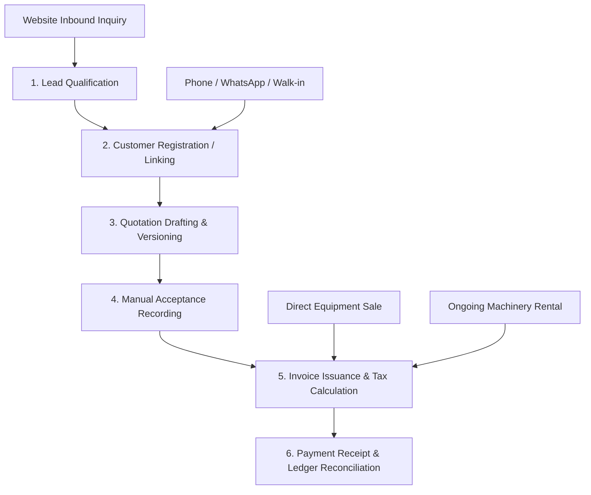
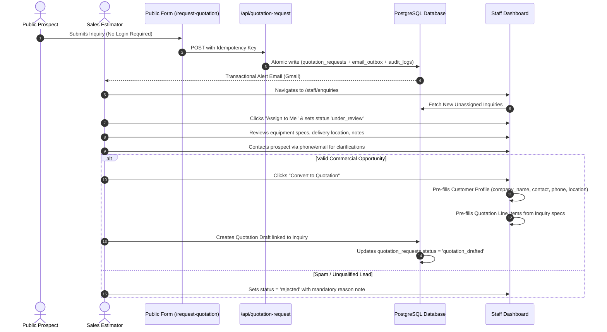
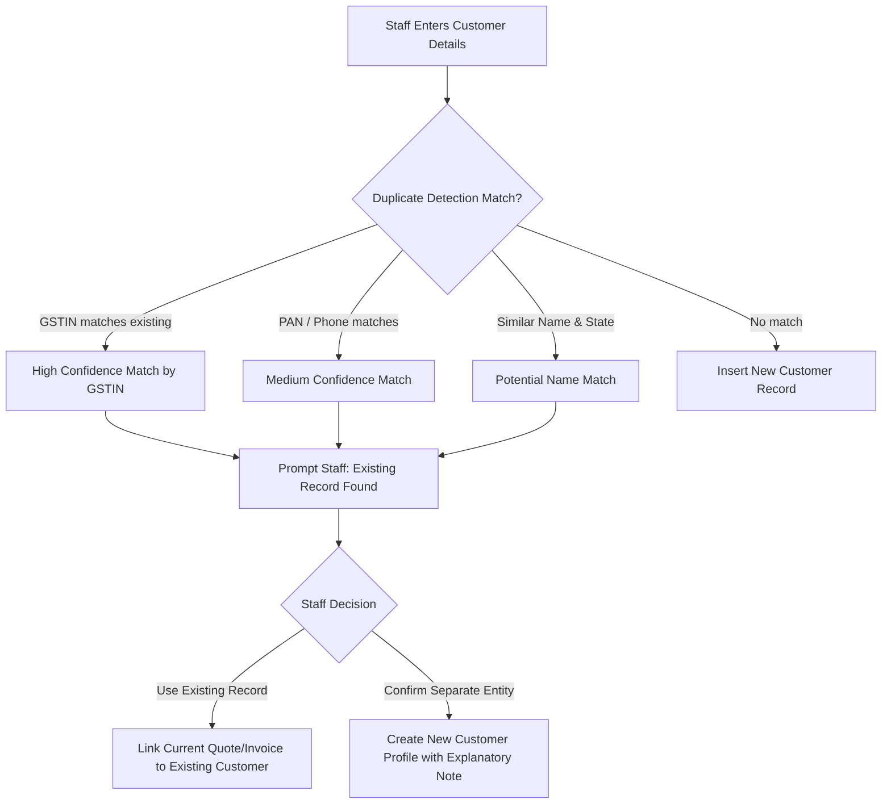
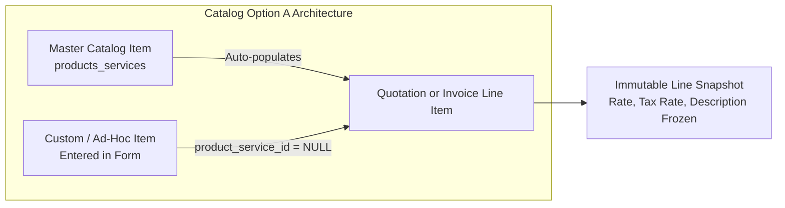
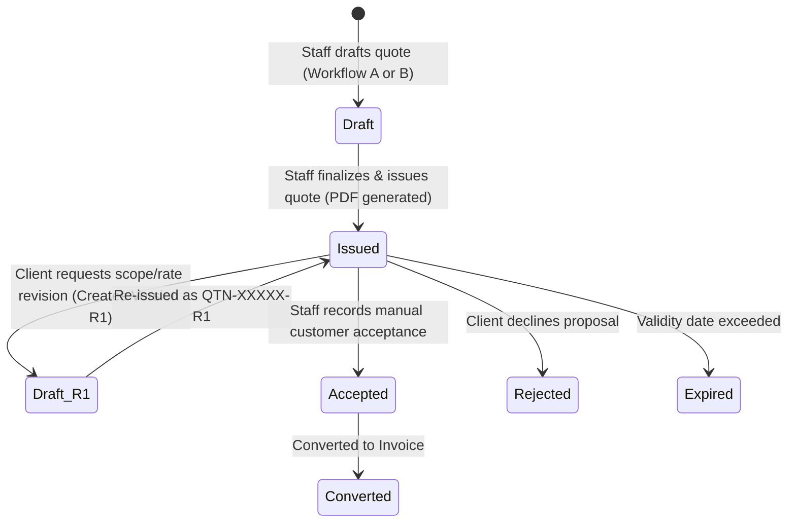
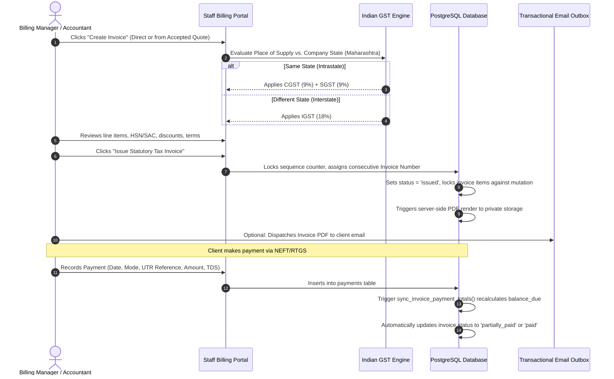

# Santhaya Associates — Phase 3 Staff Workflows Specification
## Operational Lifecycle: Enquiries, Customers, Quotations, Invoicing, Payments & Delivery

**Project:** Santhaya Associates Pvt. Ltd. — Web Platform & Internal Operating System  
**Document:** `docs/phase3/PHASE-3-STAFF-WORKFLOWS.md`  
**Version:** 1.0 (Staff Operational Workflows)  
**Date:** 2026-10-28  
**Status:** Architecture Proposal — Planning Only (Awaiting Human Review)  

---

## 1. Overview of Operating Workflows

Phase 3 implements standard operating procedures for Santhaya Associates staff, spanning the commercial lifecycle from lead intake to cash receipt:

---

## 2. Workflow 1: Public Enquiry Qualification & Conversion (Workflow A)

### Operational Rules:
1. **Snapshots are Immutable**: Public inquiry data in `quotation_requests` is never overwritten. Staff annotations and qualification statuses are recorded in dedicated fields (`assigned_staff_id`, `status`, `notes`).
2. **Flexible Contact Qualification**: If the prospect only provided a phone number, staff conducts follow-up via phone call or WhatsApp before drafting the quotation.

---

## 3. Workflow 2: Customer Management & Non-Destructive Duplicate Handling

### 3.1 Customer Profile Creation
- **Staff-Created Flexibility**: Staff can register customers with **neither email nor phone** if only an office address or GSTIN is available (e.g. government tender authorities or walk-in machinery buyers).
- **Required Fields for Staff Intake**:
  - `company_name`: Legal or trade name (e.g. *Apex Civil Infra Pvt Ltd*).
  - `primary_contact_person`: Contact representative.
  - `billing_state`: Place of supply state (mandatory for GST place-of-supply tax logic).
  - `client_type`: Category (`government_dept`, `private_corporate`, `proprietorship_individual`, `subcontractor`).
  - `email` and `phone`: Strictly optional.

### 3.2 Duplicate Detection & Safe Merging Strategy
Automatic customer merging based on email or phone alone is strictly prohibited:

- **Non-Destructive Association**: If a duplicate is identified later, historical quotation and invoice snapshots remain anchored to their original customer ID. Records are merged via reference reassignment, not by deleting customer entities.

---

## 4. Workflow 3: Product Catalog Management (Option A)

The system supports **Catalog Option A**: master saved items alongside free-form ad-hoc line items:

### Catalog Operational Guidelines:
1. **Master Items**: Used for standard heavy machinery fleet models (e.g. *Tata Hitachi EX200 LC Hydraulic Excavator*), standard rental rate structures (*Monthly Rig Rental - 200 Hours*), and construction materials (*Structural Steel Beams ISMB 400*).
2. **Custom / Ad-Hoc Items**: Estimators can enter custom technical work (e.g. *Specialized riverbed piling under bridge pier #4*) directly into quotation line items without adding the entry to the master catalog.
3. **Price Freezing**: When a line item is saved on a quotation or invoice, its `item_name`, `description`, `hsn_sac_code`, `unit_rate`, and `gst_rate` are copied into the line item row. Future changes to catalog pricing **never** retroactively alter historical quotes or invoices.

---

## 5. Workflow 4: Quotation Lifecycle & Multi-Version Revision Management

### Step-by-Step Quotation Lifecycle:
1. **Drafting (R0)**: Staff selects customer, enters delivery terms, payment terms, and line items. System computes subtotals, GST, and grand total. Status is `draft`.
2. **Issuance**: Estimator clicks "Issue Quotation". System generates official quotation version code (`QTN-2026-00042-R0`), locks the line items (`is_locked = true`), and triggers server-side PDF generation.
3. **Client Delivery**: Staff downloads PDF for manual delivery (WhatsApp / printed) or clicks "Send via Email" to dispatch via the outbox queue.
4. **Revision Handling (R1, R2)**:
   - If the client requests changes (e.g. quantity reduction or rate renegotiation), staff clicks "Create Revision".
   - System clones Version R0 into Version R1 (`QTN-2026-00042-R1`).
   - R0 remains preserved in the audit history.
   - Staff modifies R1 and issues it when ready.
5. **Manual Acceptance Recording**:
   - Customer acceptance is **recorded manually by authorized staff**.
   - Public self-serve acceptance is not supported at this stage.
   - Staff records: Acceptance Date, Channel (`whatsapp`, `email`, `signed_po`, `phone`, `in_person`), Client PO Number, and attaches the client’s signed document.
   - Quotation status transitions to `accepted`.

---

## 6. Workflow 5: GST Invoicing, Tax Calculations & Payment Tracking

### Invoicing Operational Rules:
1. **Statutory Gapless Sequence**: Invoice numbers are assigned strictly upon issuance. Drafts never consume sequence numbers.
2. **Indian GST Place-of-Supply Engine**:
   - Company Origin: Maharashtra (State Code 27).
   - Intrastate Supply (Client Place of Supply in Maharashtra): Output Tax splits equally into **CGST** and **SGST**.
   - Interstate Supply (Client Place of Supply outside Maharashtra): Output Tax applies as **IGST**.
   - B2B Compliance: Client GSTIN format validated (`^[0-9]{2}[A-Z]{5}[0-9]{4}[A-Z]{1}[1-9A-Z]{1}Z[0-9A-Z]{1}$`).
3. **Automated Payment Balance Reconciliation**:
   - Staff inputs `amount_received` and optional `tds_deducted` (TDS under Section 194C/194I of Income Tax Act).
   - The database trigger automatically credits `total_credit = amount_received + tds_deducted`.
   - Recomputes `balance_due = grand_total - SUM(total_credit)`.
   - Transitions status to `paid` when balance reaches `0.00`.

