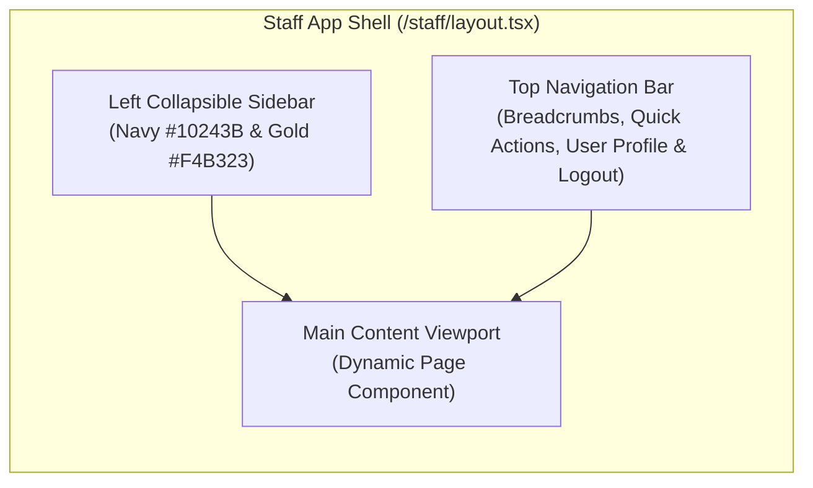

# Santhaya Associates — Phase 3 UI & Routing Architecture Specification
## Staff Dashboard Layout, Navigation Hierarchy, Route Protection & Component Design

**Project:** Santhaya Associates Pvt. Ltd. — Web Platform & Internal Operating System  
**Document:** `docs/phase3/PHASE-3-UI-ROUTES.md`  
**Version:** 1.0 (Staff UI & Routes Specification)  
**Date:** 2026-10-28  
**Status:** Architecture Proposal — Planning Only (Awaiting Human Review)  

---

## 1. Routing Hierarchy & Layout Architecture

The Next.js App Router structure segregates the public corporate marketing application from the private staff management operating system:

```
src/app/
├── (public)/                      # Unauthenticated Public Website
│   ├── page.tsx                  # Homepage showcase & authentic branding
│   ├── services/                 # Scope-locked service pillars
│   │   ├── tenders/page.tsx      # Construction tenders
│   │   ├── machinery/page.tsx    # Construction machinery supply
│   │   └── manufacturing/page.tsx# Manufacturing machinery supply
│   ├── about/page.tsx            # Company background & profile
│   ├── request-quotation/        # Unauthenticated enquiry form
│   ├── privacy/page.tsx          # Privacy policy
│   ├── terms/page.tsx            # Terms of service
│   └── layout.tsx                # Public header, drawer, and corporate footer
│
├── (staff-auth)/                  # Standalone Staff Authentication Portal
│   ├── staff/login/page.tsx      # Staff email + password login
│   ├── staff/reset-password/     # Password recovery & reset
│   └── layout.tsx                # Minimal, distraction-free auth container
│
└── staff/                         # Protected Staff Management ERP (/staff/*)
    ├── layout.tsx                # Protected layout: Sidebar, Header, Breadcrumbs, Session guard
    ├── dashboard/page.tsx        # Overview & commercial KPIs
    ├── enquiries/                # Public enquiry intake pipeline
    │   ├── page.tsx              # Enquiry list, status filters, search
    │   └── [id]/page.tsx         # Detailed lead specs, notes & quote converter
    ├── customers/                # Master customer directory (CRM)
    │   ├── page.tsx              # Customer list, search, duplicate warnings
    │   ├── new/page.tsx          # Manual customer registration
    │   └── [id]/page.tsx         # Customer profile, ledger & document history
    ├── catalog/                  # Products & Services Master Catalog
    │   ├── page.tsx              # Catalog list, classification filter, rates
    │   └── new/page.tsx          # Create new catalog item
    ├── quotations/               # Quotation Management (Separate Main Section)
    │   ├── page.tsx              # Quotations list, status filters, validity alerts
    │   ├── new/page.tsx          # Quotation draft builder
    │   ├── [id]/page.tsx         # Version view, PDF viewer, acceptance modal
    │   └── [id]/revision/page.tsx# Create new quote version (R1, R2)
    ├── billing/                  # Billing & Invoice Management (Separate Main Section)
    │   ├── page.tsx              # GST Invoices list, payment status, aging
    │   ├── new/page.tsx          # Invoice draft builder (Direct or from quote)
    │   └── [id]/page.tsx         # Invoice view, GST tax breakdown, payment modal
    ├── documents/page.tsx        # Central document archive & signed PDF downloads
    └── settings/                 # Administrative Control Panel
        ├── staff/page.tsx        # Staff roster, role management, invitation modal
        └── audit-logs/page.tsx   # Tamper-resistant audit inspection
```

---

## 2. Protected Layout Architecture & Sidebar Navigation



### 2.1 Segregated Sidebar Navigation Sections
The sidebar provides clean, dedicated access to all 10 core operational sections. Quotations and Billing are maintained as **completely separate main navigation sections**:

| Section Name | Route | Icon | Permitted Roles | Description |
| :--- | :--- | :--- | :--- | :--- |
| **1. Overview** | `/staff/dashboard` | `LayoutDashboard` | All Active Staff | Commercial KPIs, quick summaries, activity feed |
| **2. Enquiries** | `/staff/enquiries` | `Inbox` | All Active Staff | Public leads, qualification notes, convert to quote |
| **3. Customers** | `/staff/customers` | `Building2` | All Active Staff | Client profiles, GSTIN directory, transaction history |
| **4. Quotations** | `/staff/quotations` | `FileText` | Estimator, Admin, Super Admin | Multi-version quote builder, PDFs, manual acceptance |
| **5. Billing** | `/staff/billing` | `Receipt` | Billing Manager, Admin, Super Admin | Tax invoices, GST breakdowns, payment reconciliation |
| **6. Catalog** | `/staff/catalog` | `Package` | All Active Staff (Edit: Estimator/Admin) | Master machinery, rental rates, construction materials |
| **7. Documents** | `/staff/documents` | `FolderLock` | All Active Staff | Central repository of signed PDF documents |
| **8. Staff Admin** | `/staff/settings/staff` | `Users` | Admin, Super Admin | User invitations, active/inactive toggles, roles |
| **9. Audit Trail** | `/staff/settings/audit-logs`| `ShieldCheck` | Admin, Super Admin | Read-only inspection of system mutation logs |
| **10. My Account** | `/staff/settings/profile` | `UserCheck` | All Active Staff | Password change, active session review, logout |

---

## 3. Detailed Page Wireframes & Core Features

### 3.1 Overview Dashboard (`/staff/dashboard`)
- **Key Metrics Row**:
  - `New Inquiries`: Count of unassigned public inquiries.
  - `Active Quotations`: Count of issued proposals awaiting customer decision.
  - `Overdue Invoices`: Count and monetary sum of issued invoices past due date.
  - `Total Collected (Current Month)`: Reconciled incoming payments.
- **Urgent Action Banners**:
  - Unqualified inquiries pending review > 24 hours.
  - Quotations expiring within 7 days.
  - Invoices with partial payment balances.
- **Recent Activity Feed**: Real-time stream from `public.audit_logs` (e.g. *"Karan M. issued Quotation QTN-2026-00042-R0"*).

### 3.2 Customer Management Views (`/staff/customers`)
- **Directory Table**: Shows Company Name, Contact Person, GSTIN, State, Client Type, Linked Quotes, Linked Invoices.
- **Duplicate Prevention Modal**: Triggers when staff inputs an existing GSTIN or matching phone number, displaying the existing profile and asking whether to link or proceed.
- **Detail View (`/staff/customers/[id]`)**:
  - Master details (Billing address, GSTIN, contact channel).
  - History Tabs: Linked Inquiries, Active Quotations, Issued Invoices, Recorded Payments.

### 3.3 Quotation Builder & Lifecycle View (`/staff/quotations`)
- **Builder Form (`/staff/quotations/new`)**:
  - Step 1: Client selection (search existing or quick-add customer).
  - Step 2: Line items table. Each row has: Item selector (dropdown from master catalog or "Custom Item" free-text), Description, HSN/SAC, Unit (hours, days, units, MT), Quantity, Unit Rate (₹), GST Rate (%), Line Total.
  - Step 3: Terms, Validity (default 30 days), Delivery location, Payment terms.
  - Real-time Subtotal, GST, and Grand Total computation.
- **Detail & Revision View (`/staff/quotations/[id]`)**:
  - Version switcher pills: `v1 (R0) [Accepted]`, `v2 (R1) [Superseded]`.
  - Action buttons: "Download PDF", "Send via Email", "Create Revision (R+1)".
  - "Record Acceptance" Button: Opens modal capturing Customer Contact, Channel (`whatsapp`, `signed_po`, `phone`), and PO Number.

### 3.4 Billing & Invoice Management (`/staff/billing`)
- **Invoice Builder (`/staff/billing/new`)**:
  - Mode A: Convert from Accepted Quotation (copies line items, applies customer details, locks prices).
  - Mode B: Direct Invoice (Workflow C/D — free-form line entry, direct machinery sale or service billing).
  - Indian GST engine computes Place of Supply:
    - If customer state = Maharashtra → split output tax into **CGST** and **SGST**.
    - If customer state ≠ Maharashtra → apply single **IGST**.
- **Invoice Detail View (`/staff/billing/[id]`)**:
  - Statutory header: Santhaya Associates GSTIN, Customer GSTIN, Place of Supply.
  - Status Badge: `Draft`, `Issued`, `Partially Paid`, `Paid`, `Cancelled`.
  - Financial Summary Card: Grand Total, Total Paid, Balance Due.
  - Payment Recording Modal: Input Payment Date, Amount (₹), Mode (NEFT/RTGS/Cheque), UTR Reference, TDS Deducted (₹).

---

## 4. UI/UX States & Accessibility Standards

1. **Responsive Viewport Support**:
   - **Desktop (1440px+)**: Multi-column grids, fixed sidebar, side-by-side PDF preview.
   - **Tablet (768px–1024px)**: Collapsible icon sidebar, responsive tables with horizontal scroll.
   - **Mobile (375px–767px)**: Full-width drawer menu, card-based customer/invoice list views, stacked form inputs.
2. **State Design**:
   - **Loading States**: Shimmer skeleton loaders on table rows and metric cards.
   - **Empty States**: Helpful action prompts (e.g. *"No pending quotations found. Create your first quotation or qualify an incoming enquiry."*).
   - **Error Handling**: Inline field validation errors under Zod schema rules; clear non-technical toast notifications on server action failures.
   - **Confirmation Modals**: Destructive or legally significant actions (Issuing a statutory tax invoice, cancelling an invoice, deactivating a staff profile) require explicit double-confirmation modals.

