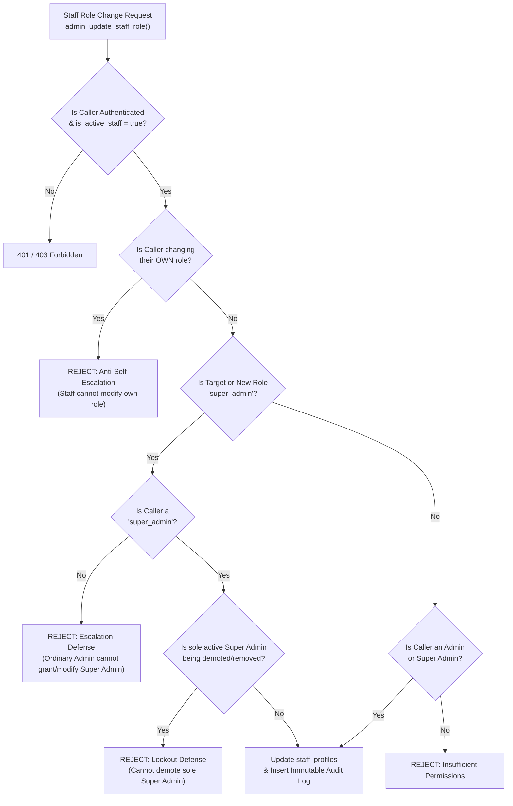

# Santhaya Associates — Stage 3A-3 Secure RBAC, Migration & Staff Administration Design
Document Version: 1.0.0
Status: Prepared for Review & Approval
Target Environment: Development (`bkqneudnnhvvwmtggorz`)

---

## 1. Executive Summary

Stage 3A-3 establishes the administrative backbone and Role-Based Access Control (RBAC) foundation for the private staff management operating system.

It enhances database-level authorization to:
1. Formally add `'super_admin'` to `public.staff_role_enum`.
2. Abolish broad direct `UPDATE` permissions on `public.staff_profiles` in favor of strict column-level self-updates (`full_name` only).
3. Introduce atomic, tamper-resistant `SECURITY DEFINER` RPC functions with explicit anti-self-escalation, role hierarchy validation, sole super-admin deactivation defense, and direct insertion into `public.audit_logs`.
4. Provide a resilient, idempotent, one-time bootstrap procedure for the primary company executive with zero public self-registration.

---

## 2. Proposed Migration Path & Exact Schema Changes

### Migration File
`supabase/migrations/20261029120000_stage3a_staff_auth_enhancements.sql`

### Manual Execution Steps in Supabase SQL Editor
Due to PostgreSQL transactional enum restrictions (where `ALTER TYPE ... ADD VALUE` cannot be executed inside a transaction block that references the newly added value), execute in two sequential steps:

#### Step 1: Enum Extension
```sql
ALTER TYPE public.staff_role_enum ADD VALUE IF NOT EXISTS 'super_admin';
```

#### Step 2: Privilege Hardening & Administrative RPCs
Run the remaining migration statements:
1. **Drop broad UPDATE policy**:
   ```sql
   DROP POLICY IF EXISTS "Only active admins can update staff profiles" ON public.staff_profiles;
   ```
2. **Column-Level Privilege Revocation**:
   ```sql
   REVOKE UPDATE ON public.staff_profiles FROM authenticated;
   GRANT UPDATE (full_name, updated_at) ON public.staff_profiles TO authenticated;
   ```
3. **Self-Name Update Policy**:
   ```sql
   CREATE POLICY "Active staff can update own full_name"
     ON public.staff_profiles FOR UPDATE TO authenticated
     USING (id = auth.uid() AND public.is_active_staff(auth.uid()))
     WITH CHECK (id = auth.uid() AND public.is_active_staff(auth.uid()));
   ```
4. **Deploy Helper Function `is_super_admin(UUID)`**:
   Returns boolean checking `role = 'super_admin' AND is_active = true`.
5. **Deploy Administrative RPC `admin_update_staff_role(p_target_user_id UUID, p_new_role public.staff_role_enum)`**.
6. **Deploy Administrative RPC `admin_update_staff_status(p_target_user_id UUID, p_is_active BOOLEAN)`**.
7. **Deploy Administrative RPC `admin_create_staff_profile(p_user_id UUID, p_email TEXT, p_full_name TEXT, p_role public.staff_role_enum)`**.
8. **Minimal Privilege Grants**:
   Revokes execution from `PUBLIC` and `anon`; grants exclusively to `authenticated` and `service_role`.

---

## 3. Privilege Escalation Protections & Defenses



### Specific Guardrails Enforced:
1. **Anti-Self-Escalation**:
   A staff member (`auth.uid()`) is mathematically barred from modifying their own role. Even if an admin gains access to the RPC, `IF p_target_user_id = v_caller_id THEN RAISE EXCEPTION ...` blocks self-promotion to `super_admin`.
2. **Admin Ceiling**:
   Ordinary `admin` accounts can only provision or reassign operational roles: `estimator`, `billing_manager`, `viewer`. Any attempt by an `admin` to assign `admin` or `super_admin` raises a database exception.
3. **Sole Super Admin Lockout Prevention**:
   The system counts `SELECT count(*) FROM staff_profiles WHERE role = 'super_admin' AND is_active = true`. If this count is $\le 1$, demoting or deactivating the sole Super Admin is blocked at the database level.
4. **No Direct Client Table Updates**:
   Direct table updates to `role`, `is_active`, `id`, or `email` on `public.staff_profiles` are revoked at the PostgreSQL column privilege level (`REVOKE UPDATE ON public.staff_profiles FROM authenticated`). Only `admin_*` RPCs can modify these columns.

---

## 4. One-Time Super Admin Bootstrap Procedure

### Script: [`scripts/bootstrap-super-admin.mjs`](file:///c:/Users/Admin/.gemini/antigravity/scratch/Santhaya-Associates/scripts/bootstrap-super-admin.mjs)

### Execution Protocol:
1. **Human Authorization Required**:
   The script must never be executed automatically or during CI test runs.
2. **Target Project Verification**:
   Validates `DEV_SUPABASE_PROJECT_REF === 'bkqneudnnhvvwmtggorz'`.
3. **Zero Existing Super Admin Invariant**:
   Inspects `public.staff_profiles`. If any existing Super Admin is found, execution aborts with error code 1.
4. **Credential Ingestion**:
   Credentials must be supplied via non-persisted environment variables:
   ```powershell
   $env:BOOTSTRAP_ADMIN_EMAIL = "director@santhaya.com"
   $env:BOOTSTRAP_ADMIN_NAME = "Executive Director"
   $env:BOOTSTRAP_ADMIN_PASSWORD = "<secure-generated-password>"
   node scripts/bootstrap-super-admin.mjs
   ```
5. **Idempotent Recovery**:
   If an Auth user exists from an interrupted attempt, the script reconciles the missing `staff_profiles` record without throwing unique key errors.
6. **Immutable Logging**:
   Inserts action `super_admin_bootstrap` into `public.audit_logs`.

---

## 5. Staff Administration Permission Model

| Action | Super Admin (`super_admin`) | Manager / Admin (`admin`) | Estimator / Billing / Viewer |
| :--- | :---: | :---: | :---: |
| **Invite / Create Staff** | All roles (`super_admin`, `admin`, `estimator`, `billing_manager`, `viewer`) | Operational roles (`estimator`, `billing_manager`, `viewer`) only | Denied |
| **Assign / Change Roles** | All roles (except self) | Operational roles (except self and admins) | Denied |
| **Toggle Active Status** | All staff (cannot deactivate sole Super Admin) | Operational staff only | Denied |
| **View Staff Directory** | Allowed | Allowed | Allowed (Active only) |
| **Trigger Password Reset** | Allowed | Operational staff only | Denied |
| **Inspect Audit Logs** | Full system audit trail | Operational and quotation audit trail | Own actions only |

---

## 6. Migration Safety, Secure Rollback & Post-Migration Verification

To guarantee zero database corruption and zero downtime:
1. **No destructive tools**: Never run `supabase db reset`, `supabase db push`, or CLI migration repair on the development database.
2. **Review before execute**: Migration SQL is stored in version control for inspection prior to manual application in Supabase SQL Editor.

### 6.1 Secure Rollback & Safe Recovery Protocol
If Stage 3A-3 enhancements must ever be reversed, the rollback procedure **must never restore the previous broad UPDATE vulnerability**:

```sql
-- Step R1: Drop the Stage 3A-3 administrative RPC functions
DROP FUNCTION IF EXISTS public.admin_create_staff_profile(UUID, TEXT, TEXT, public.staff_role_enum);
DROP FUNCTION IF EXISTS public.admin_update_staff_status(UUID, BOOLEAN);
DROP FUNCTION IF EXISTS public.admin_update_staff_role(UUID, public.staff_role_enum);
DROP FUNCTION IF EXISTS public.is_super_admin(UUID);

-- Step R2: Secure Authorization Defense (PRESERVE ANTI-ESCALATION)
-- NEVER restore the vulnerable broad UPDATE policy on staff_profiles.
-- Ensure table-level UPDATE remains revoked from authenticated:
REVOKE UPDATE ON public.staff_profiles FROM authenticated;

-- Ensure column-level UPDATE remains strictly confined to non-sensitive fields:
GRANT UPDATE (full_name, updated_at) ON public.staff_profiles TO authenticated;

-- Ensure policy strictly restricts updates to self display-name:
DROP POLICY IF EXISTS "Active staff can update own full_name" ON public.staff_profiles;
CREATE POLICY "Active staff can update own full_name"
  ON public.staff_profiles FOR UPDATE TO authenticated
  USING (id = auth.uid() AND public.is_active_staff(auth.uid()))
  WITH CHECK (id = auth.uid() AND public.is_active_staff(auth.uid()));
```

#### PostgreSQL Enum Limitation Note
In PostgreSQL, `ALTER TYPE ... ADD VALUE` is an irreversible catalog addition (PostgreSQL has no `DROP VALUE` syntax). Leaving `'super_admin'` in `staff_role_enum` unreferenced is 100% backwards-compatible, causes zero side effects, and does not grant any privileges unless assigned.

#### Partial Migration Failure Recovery
All statements in Step 2 of `20261029120000_stage3a_staff_auth_enhancements.sql` are strictly idempotent (`CREATE OR REPLACE FUNCTION`, `DROP POLICY IF EXISTS`, `REVOKE`, `GRANT`). If Step 2 fails mid-execution due to a network glitch or syntax discrepancy, it can be safely re-run in its entirety without dropping tables or creating duplicate records.

### Post-Migration Verification Queries (Read-Only)
Run these queries in Supabase SQL Editor immediately after executing Step 1 and Step 2 to verify proper application:

```sql
-- Query 1: Confirm 'super_admin' exists in staff_role_enum
SELECT enum_range(NULL::public.staff_role_enum) AS all_roles;

-- Query 2: Confirm table-level UPDATE is REVOKED from authenticated
SELECT grantee, privilege_type
FROM information_schema.table_privileges
WHERE table_schema = 'public' AND table_name = 'staff_profiles';

-- Query 3: Confirm column-level UPDATE is GRANTED ONLY on full_name and updated_at
SELECT grantee, privilege_type, column_name
FROM information_schema.column_privileges
WHERE table_schema = 'public' AND table_name = 'staff_profiles'
ORDER BY column_name, privilege_type;

-- Query 4: Confirm active RLS policies on staff_profiles
SELECT policyname, cmd, roles, qual, with_check
FROM pg_policies
WHERE schemaname = 'public' AND tablename = 'staff_profiles';

-- Query 5: Confirm Security Definer, search_path, and EXECUTE privileges on new RPCs
SELECT
  p.proname,
  pg_get_userbyid(p.proowner) AS owner,
  p.prosecdef AS is_security_definer,
  p.proconfig AS search_path,
  has_function_privilege('anon', p.oid, 'execute') AS anon_can_execute,
  has_function_privilege('authenticated', p.oid, 'execute') AS auth_can_execute
FROM pg_proc p
JOIN pg_namespace n ON n.oid = p.pronamespace
WHERE n.nspname = 'public'
  AND p.proname IN ('admin_update_staff_role', 'admin_update_staff_status', 'admin_create_staff_profile', 'is_super_admin');
```

